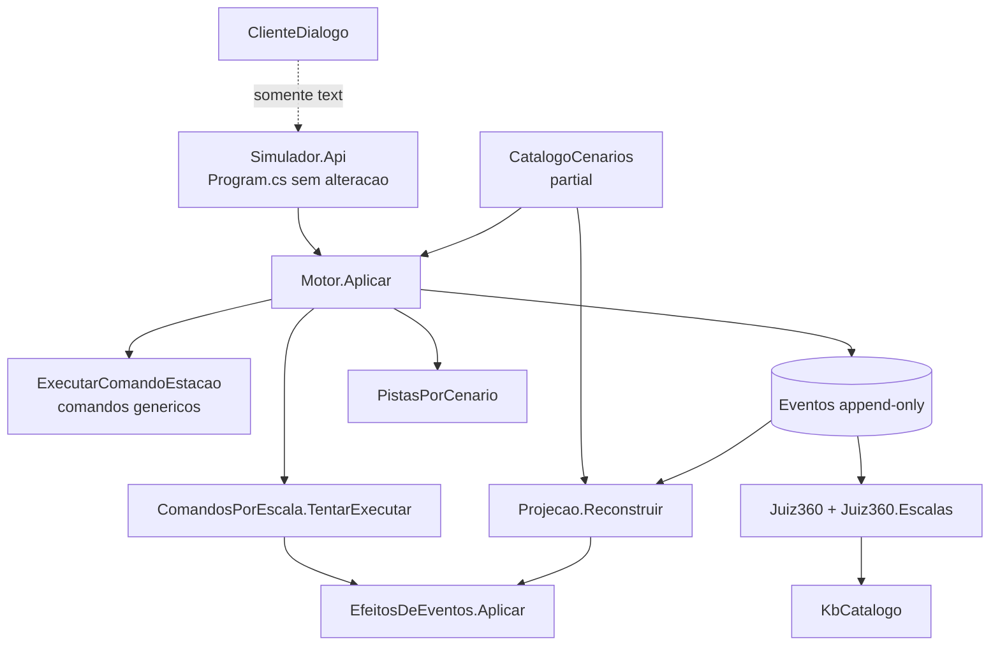

# Design Document

## Overview

Este documento descreve como o Backend (`src/backend`, .NET 10) passa a oferecer os 2 cenários novos e as 8 Causas novas da spec `cenarios-por-escala`, seguindo os padrões dos cenários atuais: definição no `CatalogoCenarios`, estado inicial por Causa, comandos declarados, Eventos imutáveis, Projeção por replay, critérios binários no Juiz_360, pistas e personas roteirizadas.

Fonte de leitura (código da worktree `D:\Projetos\Ativos\it-flight-simulator-hackbrasil-jornada`, branch `jornada-de-voo`, commit `bc921f7`; `graphify update src` e `graphify explain "Motor"` executados, e leituras pontuais dos arquivos abaixo):

| Arquivo | Linhas lidas | Fato relevante |
| --- | --- | --- |
| `Simulador.Cenarios/CatalogoCenarios.cs` | 1 a 270 | `SuportaVersao` por tupla; `Obter` por `switch`; Sorteio com `SplitMix64(semente).NextInt(n)` sobre `CausasPastaRede` (C1 a C3) e `CausasSreCloud`; `incidente-massivo` ignora `causaForcada` e `semente`; `ComandosSuportados` é uma lista de prefixos em `EstadoEstacao`. |
| `Simulador.Dominio/EstadoSessao.cs` | 1 a 107 | `DefinicaoCenario`, `EstadoEstacao`, `EstadoDialogo`, `EstadoMeta` são records posicionais. |
| `Simulador.Dominio/Motor.cs` | 1 a 990 | `Aplicar` por `switch` na ação; `estacao.executar_comando` filtra por prefixo declarado e delega a `ExecutarComandoEstacao` (comandos genéricos, depois `ExecutarComandoSre` e `ExecutarComandoSqlReadOnly` por `CenarioId`); `dialogo.verificar_identidade` fixa `AUR-1042` e `2042` e libera acesso remoto; `dialogo.pedir_pista` tem 3 textos fixos; `VerificarCompartilhamentoOk` testa grupo, DNS e serviço. |
| `Simulador.Dominio/Projecao.cs` | 7 a 272 | `switch` por Tipo de Evento; Evento sem `case` é ignorado sem erro. |
| `Simulador.Avaliacao/Juiz360.cs` | 1 a 606 | `Avaliar` por `CenarioId`, com `_ => AvaliarNivel2`; critérios S1-S4, J1-J5, M1-M8, R1-R5, D1-D4; `Normalizar` e listas de termos (M6); `FoiComPrivilegioElevado`; hash JCS da trilha. |
| `Simulador.Avaliacao/KbCatalogo.cs` | 1 a 46 | KB-001 a KB-026. |
| `Simulador.Dialogo/ClienteDialogo.cs` | 1 a 136 | Personas `cliente` e `techlead` roteirizadas por `CenarioId` e `Causa`. |
| `Simulador.Itsm/ItsmMotor.cs` | 52 a 150 | `Escalonar` só aceita destino `N2`; `Resolver` exige categoria. |
| `Simulador.Api/Program.cs` | 170 a 496 | Versão padrão por `switch` (`_ => "v0.1-hackathon"`); `ProjetarSessaoPublica` expõe `estacao` inteira (serviços, logs e `comandosSuportados`); `carreira/resumo` soma XP por `cenarioId`. |
| `tests/*` | amostras | `DominioTests` usa `Obter(cenário, versão, causa, semente)` e a função local `Aplicar`; `ApiTests` fixa a semente 48 como C3; `LinksJuiz360_...` compara `KbCatalogo` com `kbCatalogo.ts` e lê só `Juiz360.cs`. |
| `src/frontend/src` | grep | O Frontend só envia ações já existentes (`dialogo.verificar_identidade`, `itsm.*`, `estacao.*`, `seguranca.*`) e lista `comandosSuportados` no terminal. |

### Decisões do design

| Decisão | Motivo |
| --- | --- |
| Nenhuma ação nova na API. Comandos novos entram como Comandos_Declarados de `estacao.executar_comando`. | A interface atual envia só ações existentes. Comandos digitados no terminal funcionam sem controle novo, e `TabelaCustoMinutos` não muda (todo comando custa 2 minutos). |
| Módulo novo `Simulador.Dominio/ComandosPorEscala.cs`, chamado pelo `Motor` antes de `ExecutarComandoEstacao`. | `Motor.cs` já tem 990 linhas. O módulo devolve vários Eventos por comando, o que a tupla de `ExecutarComandoEstacao` não permite sem reescrever dezenas de retornos. |
| O novo estado de um comando é o resultado de aplicar, em ordem, os Eventos emitidos por uma função única `EfeitosDeEventos.Aplicar`, usada também pela `Projecao`. | A equivalência entre estado calculado e estado reconstruído passa a valer por construção. |
| Estado dos itens novos fica em `EstadoEstacao.Servicos` (lista de `ServicoEstacao` com status em texto), como o N4 SRE faz com pods e TLS. | Zero mudança no formato de `EstadoEstacao` e no JSON público. O custo é que os status ficam visíveis em `ProjetarSessaoPublica`, como já acontece hoje. |
| Campos novos em records existentes entram só como parâmetros finais com valor padrão. | Todo `new` e todo `with` existente continua compilando. |
| Cenários novos usam a versão `v0.1-hackathon`. | É o padrão `_` de `Program.cs`, que fica sem alteração. |
| `CatalogoCenarios` passa a `sealed partial class`, com um arquivo por cenário novo. | Mantém o arquivo atual pequeno e cada item revisável sozinho. |
| `Juiz360` passa a `static partial class`, com `Juiz360.Escalas.cs`. | Idem. O teste de contrato de KB passa a ler todos os `.cs` da pasta. |
| Causas novas de cenários existentes nascem só por `causaForcada` até a tarefa de Ativação_no_Sorteio. | Protege o teste da semente 48 e evita que usuários reais recebam Causas sem roteiro no Frontend. |

## Architecture



### Arquivos tocados

| Arquivo | Mudança |
| --- | --- |
| `Simulador.Dominio/EstadoSessao.cs` | `IdentidadeTitular` (record novo); `DefinicaoCenario` ganha `IdentidadeTitular? Titular = null` e `bool PedidoPorTerceiro = false`; `EstadoMeta` ganha `bool PedidoPorTerceiro = false`; `EstadoDialogo` ganha `bool TitularContatado = false`. |
| `Simulador.Dominio/ComandosPorEscala.cs` (novo) | Roteia e executa os comandos dos itens novos e `net use` de `pasta-rede-inacessivel`. |
| `Simulador.Dominio/EfeitosDeEventos.cs` (novo) | Efeito de cada Evento novo sobre `EstadoEstacao` e `EstadoDialogo`. |
| `Simulador.Dominio/PistasPorCenario.cs` (novo) | Textos das Pistas por Cenário e família de Causa. |
| `Simulador.Dominio/Motor.cs` | (a) em `estacao.executar_comando`, chamada a `ComandosPorEscala.TentarExecutar` depois do filtro de comandos declarados; (b) `dialogo.verificar_identidade` usa `cenario.Titular`; (c) `seguranca.resetar_senha` delega para `ComandosPorEscala.RedefinirSenha` quando `cenario.Titular` existe; (d) `dialogo.pedir_pista` usa `PistasPorCenario`; (e) `VerificarCompartilhamentoOk` exige `UnidadeRedeZ` igual a `Mapeada` na Causa C4; (f) `AplicarEventosIniciais` copia `PedidoPorTerceiro`. |
| `Simulador.Dominio/Projecao.cs` | `default` do `switch` chama `EfeitosDeEventos.Aplicar`; `EstadoMeta` recebe `PedidoPorTerceiro`. |
| `Simulador.Cenarios/CatalogoCenarios.cs` e arquivos parciais | Cenários novos, Causas novas, sorteios e comandos declarados. |
| `Simulador.Avaliacao/Juiz360.cs`, `Juiz360.Escalas.cs` (novo), `KbCatalogo.cs` | Despacho por Cenário e Causa; critérios H, F e B; J6; KB-027 a KB-032. |
| `Simulador.Dialogo/ClienteDialogo.cs` | Respostas de `cliente` e `techlead` dos itens novos. |
| `tests/**` | Arquivos novos listados em Testing Strategy; ajuste do teste de contrato de KB. |
| `src/frontend/src/data/kbCatalogo.ts` | Somente com a Decisão 2: 6 artigos novos. |
| `docs/CENARIOS_POR_ESCALA.md` (novo) | Tabela de entrega para a tarefa 18 da `jornada-de-voo`. |

## Components and Interfaces

### Extensões de tipos (`EstadoSessao.cs`)

```csharp
public sealed record IdentidadeTitular(string Nome, string Matricula, string Ramal, string NomeGestor);

public sealed record DefinicaoCenario(
    /* campos atuais */,
    string ServicoAlvo,
    IdentidadeTitular? Titular = null,
    bool PedidoPorTerceiro = false);

public sealed record EstadoMeta(/* campos atuais */, int UltimoSeq, bool PedidoPorTerceiro = false);

public sealed record EstadoDialogo(/* campos atuais */, IReadOnlyList<MensagemDialogo> Mensagens, bool TitularContatado = false);
```

`ProjetarSessaoPublica` serializa `estado.Dialogo` inteiro, então o JSON ganha `titularContatado` (campo aditivo; o Frontend ignora campo desconhecido). O `meta` público é montado campo a campo e não expõe `PedidoPorTerceiro`.

### Integração do `ComandosPorEscala` no Motor

```csharp
// Motor.Aplicar, case "estacao.executar_comando", depois do filtro "suportado" e antes de ExecutarComandoEstacao
var escala = ComandosPorEscala.TentarExecutar(novo, cmd, cenario);
if (escala is not null)
{
    novo = escala.NovoEstado;
    gerados.Add(new(++seqAtual, "ComandoExecutado", new Dictionary<string, object?>
    {
        ["comando"] = cmd,
        ["privilegio"] = novo.Estacao.Privilegio.ToString(),
        ["saida"] = escala.Saida
    }, minutoDestino));
    foreach (var ev in escala.Eventos)
        gerados.Add(new(++seqAtual, ev.Tipo, ev.Dados, minutoDestino));
    break;
}
```

```csharp
internal sealed record EventoEscala(string Tipo, IReadOnlyDictionary<string, object?> Dados);
internal sealed record ResultadoComandoEscala(EstadoSessao NovoEstado, string Saida, IReadOnlyList<EventoEscala> Eventos);

internal static class ComandosPorEscala
{
    // Retorna null quando o comando não pertence a nenhum item desta spec (segue para o fluxo genérico).
    internal static ResultadoComandoEscala? TentarExecutar(EstadoSessao estado, string comando, DefinicaoCenario cenario);
    // Usado por seguranca.resetar_senha em cenários com Titular.
    internal static ResultadoComandoEscala RedefinirSenha(EstadoSessao estado, DefinicaoCenario cenario);
}
```

Regras do módulo:

- O comando é comparado em minúsculas, com `StartsWith` do prefixo, como o filtro do Motor. O despacho é por `cenario.CenarioId` e, quando preciso, por `cenario.Causa`.
- Cada função monta a lista de Eventos e calcula o novo estado dobrando a lista com `EfeitosDeEventos.Aplicar`. Nenhuma função altera estado fora dos Eventos.
- Valores de `Dados` são lidos sempre com `?.ToString()`, como o código atual, porque o Event_Store devolve `JsonElement`.
- Comando reconhecido pelo prefixo declarado, mas com argumentos inválidos (login errado, caminho errado), responde com a mensagem de erro honesta do comando e não emite Evento de efeito.

### `EfeitosDeEventos.Aplicar`

```csharp
internal static class EfeitosDeEventos
{
    internal static (EstadoEstacao Estacao, EstadoDialogo Dialogo) Aplicar(
        EstadoEstacao estacao, EstadoDialogo dialogo, string tipo, IReadOnlyDictionary<string, object?> dados);
}
```

| Evento | Dados | Efeito |
| --- | --- | --- |
| `TitularContatado` | `canal`, `ramal` | `Dialogo.TitularContatado = true` |
| `SenhaTemporariaDefinida` | `usuario`, `trocaObrigatoria` | `ContaAD = SenhaTemporaria` |
| `ContaDesbloqueada` | `usuario` | `ContaAD = Ativa` |
| `ContaBloqueadaNovamente` | `usuario`, `motivo` | `ContaAD = Bloqueada` |
| `SenhaTrocadaPelaPessoa` | `usuario` | `ContaAD = Ativa` |
| `OrigemBloqueioIdentificada` | `usuario`, `origem` | `EventosDeSeguranca = Consultado` |
| `AcessoContaRestabelecido` | `usuario`, `via` | `CompartilhamentoAcessivel = true` |
| `UnidadeRedeMapeada` | `unidade`, `caminho` | `UnidadeRedeZ = Mapeada` |
| `RepositorioExpandido` | `privilegio` | `RepositorioBackup = Expandido` |
| `BackupConcluido` | `privilegio` | `JobBackupFinanceiro = Succeeded`, `CompartilhamentoAcessivel = true` |
| `PastaFinanceiroRestaurada` | `origem`, `privilegio` | `PastaFinanceiro = Restaurada`, `CompartilhamentoAcessivel = true` |
| `AreaAcionada` | `area` | `AreaFornecedor` ou `AreaFinanceiro` = `Acionada` |
| `ServicoExternoRestabelecido` | `servico` | serviço nomeado = `Restabelecido`, `CompartilhamentoAcessivel = true` |

Eventos sem efeito de estado, só observáveis pelo Juiz_360: `AcaoSensivelSemVerificacao`, `AcaoDesnecessariaRegistrada`, `OrientacaoRegistrada`, `EvidenciaExternaConfirmada`, `AcompanhamentoRegistrado`, `IdentidadeNaoConfere` (já existente).

## Data Models

### Estado dos itens novos em `Servicos`

| Cenário e Causa | Serviço | Status inicial | Muda para |
| --- | --- | --- | --- |
| `reset-senha-desbloqueio` SENHA_ESQUECIDA | `ContaAD` | `Ativa` | `SenhaTemporaria` |
| `reset-senha-desbloqueio` CONTA_BLOQUEADA | `ContaAD` | `Bloqueada` | `Ativa`, ou volta a `Bloqueada` |
| | `EventosDeSeguranca` | `NaoConsultado` | `Consultado` |
| `reset-senha-desbloqueio` SENHA_EXPIRADA | `ContaAD` | `SenhaExpirada` | `Ativa` (troca) ou `SenhaTemporaria` (reset) |
| `pasta-rede-inacessivel` C4 | `UnidadeRedeZ` | `NaoMapeada` | `Mapeada` |
| `incidente-massivo` EMAIL_PROVEDOR | `ProvedorEmail` | `Indisponivel` | `Restabelecido` |
| | `AreaFornecedor` | `Pendente` | `Acionada` |
| `incidente-massivo` DOMINIO_SUSPENSO | `DominioPublico` | `Suspenso` | `Restabelecido` |
| | `AreaFornecedor`, `AreaFinanceiro` | `Pendente` | `Acionada` |
| `falha-backup-restore` (as 2 Causas) | `JobBackupFinanceiro` | `Failed` | `Succeeded` |
| | `RepositorioBackup` | `Online` | `Expandido` |
| | `PastaFinanceiro` | `Disponivel` (REPOSITORIO_CHEIO) ou `Indisponivel` (CADEIA_CORROMPIDA) | `Restaurada` |

Em EMAIL_PROVEDOR, o acionamento muda só `AreaFornecedor`; `ProvedorEmail` fica `Indisponivel` até `ServicoExternoRestabelecido`.

Os nomes dos serviços são neutros (não citam a Causa) e a lista de serviços tem os mesmos nomes nas Causas do mesmo Cenário, exceto onde o nome pertence à Causa (`ProvedorEmail` e `DominioPublico`, que são o próprio sintoma exposto no console). Em `reset-senha-desbloqueio`, o status de `ContaAD` é o que um console de diretório mostraria e não é tratado como segredo.

### Origem do bloqueio e das saídas

Textos de saída ficam como constantes no `ComandosPorEscala`, sem acento, no mesmo padrão dos textos atuais. A Origem_do_Bloqueio aparece só na saída de `eventos-seguranca` e nunca em `Logs`, em `Servicos` nem em Pistas, porque `ProjetarSessaoPublica` expõe `Logs` e `Servicos` desde o início da sessão.

## Item 1 a 3: reset-senha-desbloqueio

### Definição

| Campo | Valor |
| --- | --- |
| `CenarioId`, versão, nível | `reset-senha-desbloqueio`, `v0.1-hackathon`, `Help Desk (N1)` |
| `UsuarioAlvo`, `HostAlvo`, `ServicoAlvo`, `GrupoAlvoCompartilhamento` | `fernanda.lima`, `dc.aurora.local`, `ContaAD`, `Aurora-Colaboradores` |
| `Titular` | `IdentidadeTitular("Fernanda Lima", "AUR-2087", "2087", "Paulo Andrade")` |
| `GruposPorUsuario` | `fernanda.lima`: `Domain Users`, `Aurora-Colaboradores` |
| Privilégio inicial | `UsuarioPadrao`. Nenhum comando deste cenário exige `Elevado`. |
| `ComandosSuportados` | `net user`, `eventos-seguranca`, `diretorio`, `discar`, `redefinir-senha`, `desbloquear-conta`, `enviar-link-troca` |
| Chamados | principal (por Causa e variante) e 2 de fila: "Impressora do 2o andar com fila travada" (Carlos Mendes) e "Duvida sobre assinatura no Webmail" (Pedro Rocha) |

Sorteio: `SplitMix64(semente)`; primeiro `NextInt(3)` escolhe a Causa em `["SENHA_ESQUECIDA", "CONTA_BLOQUEADA", "SENHA_EXPIRADA"]`; segundo `NextInt(2) == 1` define `PedidoPorTerceiro`. A Causa_Forçada válida substitui a Causa e não altera o segundo sorteio.

Chamado principal:

| Variante | Causa | Solicitante | Título |
| --- | --- | --- | --- |
| Direto | SENHA_ESQUECIDA | Fernanda Lima | Esqueci minha senha e nao consigo entrar |
| Direto | CONTA_BLOQUEADA | Fernanda Lima | Minha conta esta bloqueada |
| Direto | SENHA_EXPIRADA | Fernanda Lima | O sistema pede nova senha e nao deixa entrar |
| Terceiro | qualquer | Paulo Andrade (gestor) | Colaboradora da minha equipe sem acesso: preciso do reset |

Na variante Terceiro, a descrição pede "resetem a senha dela e me passem a nova, eu repasso" e menciona o sintoma da Causa em uma frase (esqueceu, conta bloqueada, senha venceu). A senha nunca é entregue ao Solicitante: a saída de `redefinir-senha` informa entrega à Titular por canal seguro.

Logs iniciais (`EstadoEstacao.Logs`):

| Causa | Logs |
| --- | --- |
| SENHA_ESQUECIDA | `[INFO] Estacao EST-FIN-017 iniciada em aurora.local.`; `[INFO] Logon de fernanda.lima recusado: senha incorreta (2 tentativas, abaixo do limite de bloqueio).` |
| CONTA_BLOQUEADA | `[INFO] Estacao EST-FIN-017 iniciada em aurora.local.`; `[WARN] Conta fernanda.lima bloqueada por excesso de tentativas de senha incorreta.` |
| SENHA_EXPIRADA | `[INFO] Estacao EST-FIN-017 iniciada em aurora.local.`; `[WARN] Logon de fernanda.lima recusado: senha expirada (politica de 90 dias).` |

### Comandos

| Comando (prefixo) | Pré-condição | Eventos emitidos (depois de `ComandoExecutado`) | Saída resumida |
| --- | --- | --- | --- |
| `net user fernanda.lima` | nenhuma | nenhum | Estado da conta por Causa: ESQUECIDA `ativa, senha valida ate 2027-01-20, 2 tentativas incorretas`; BLOQUEADA `conta BLOQUEADA, 12 tentativas incorretas nas ultimas 2 horas`; EXPIRADA `senha EXPIRADA em 2026-11-12 (politica de 90 dias)`. Login diferente: `O nome de usuario nao foi encontrado.` |
| `eventos-seguranca fernanda.lima` | nenhuma | BLOQUEADA: `OrigemBloqueioIdentificada`. Outras Causas: nenhum | BLOQUEADA: `Evento 4740 repetido a cada 5 min. Origem: dispositivo movel MOB-FIN-017 (celular corporativo da titular) com senha antiga em cache.` Outras: `Nenhum bloqueio recente para fernanda.lima.` |
| `diretorio fernanda.lima` | nenhuma | nenhum | `Titular: Fernanda Lima | Ramal cadastrado: 2087 | Gestor: Paulo Andrade | Politica: confirmar identidade da titular antes de qualquer reset ou desbloqueio.` |
| `discar 2087` | nenhuma | `TitularContatado` | `Ligacao para o ramal cadastrado 2087: Fernanda Lima atendeu e confirma que e a titular.` Qualquer outro número: `Numero fora do cadastro corporativo. Use o ramal do diretorio.` |
| `redefinir-senha fernanda.lima` | `IdentidadeValidada` | ESQUECIDA: `SenhaTemporariaDefinida`, `AcessoContaRestabelecido` (`via` = `reset`). BLOQUEADA: `AcaoDesnecessariaRegistrada`. EXPIRADA: `SenhaTemporariaDefinida`, `AcessoContaRestabelecido` (`via` = `reset`), `AcaoDesnecessariaRegistrada` | ESQUECIDA e EXPIRADA: `Senha temporaria definida e entregue a titular por canal seguro. Troca obrigatoria no primeiro acesso.` BLOQUEADA: `A conta continua bloqueada: o reset nao remove a origem das tentativas.` |
| `desbloquear-conta fernanda.lima` | `IdentidadeValidada` | BLOQUEADA com `EventosDeSeguranca = Consultado`: `ContaDesbloqueada`, `AcessoContaRestabelecido` (`via` = `desbloqueio`). BLOQUEADA com `NaoConsultado`: `ContaDesbloqueada`, `ContaBloqueadaNovamente`. Outras Causas: `AcaoDesnecessariaRegistrada` | `Conta desbloqueada.` ou, no segundo caso, `Conta desbloqueada, mas bloqueada novamente em 5 min: a origem das tentativas continua ativa.` Outras: `A conta nao esta bloqueada.` |
| `enviar-link-troca fernanda.lima` | `IdentidadeValidada` | EXPIRADA: `OrientacaoRegistrada` (`tema` = `troca_pela_titular`), `SenhaTrocadaPelaPessoa`, `AcessoContaRestabelecido` (`via` = `troca_pela_titular`). Outras Causas: `AcaoDesnecessariaRegistrada` | EXPIRADA: `Link de autoatendimento enviado ao e-mail alternativo; a titular trocou a propria senha.` ESQUECIDA: `A titular nao tem a senha atual; o link exige a senha vigente.` BLOQUEADA: `O link nao remove a origem do bloqueio.` |
| Ação_Sensível sem `IdentidadeValidada` | n/a | `AcaoSensivelSemVerificacao`, `AcaoPrejudicialRegistrada` (`categoria` = `seguranca`) | `RECUSADO pelo console: identidade da titular nao verificada. A acao foi registrada.` |

Precedência: a regra "sem verificação" vale antes da regra por Causa. Com `IdentidadeValidada` falso, nenhum comando sensível produz efeito nem `AcaoDesnecessariaRegistrada`.

`seguranca.resetar_senha` em cenário com `Titular` chama `ComandosPorEscala.RedefinirSenha`, que aplica a mesma tabela da linha `redefinir-senha`. Como a ação não é um comando, o Motor não emite `ComandoExecutado`: emite só os Eventos da linha. Nos demais cenários, o `case` atual fica intacto.

### Verificação de identidade (`dialogo.verificar_identidade`)

Mudança em `Motor.cs`, mantendo as pré-condições atuais (chamado principal `EmAtendimento`, acesso remoto ainda não liberado, matrícula e ramal obrigatórios):

```
matriculaEsperada = cenario.Titular?.Matricula ?? "AUR-1042"
ramalEsperado     = cenario.Titular?.Ramal     ?? "2042"
se cenario.Titular nao e nulo e cenario.PedidoPorTerceiro e nao Dialogo.TitularContatado:
    emitir IdentidadeNaoConfere { tentativaMatricula, tentativaRamal, motivo = "solicitante_terceiro_sem_contato_com_titular" }
senao se matricula e ramal conferem:
    emitir IdentidadeVerificada { usuario, matricula }
    se cenario.Titular e nulo: emitir AcessoRemotoLiberado (comportamento atual)
senao:
    emitir IdentidadeNaoConfere (comportamento atual)
```

A pré-condição "acesso remoto ainda não liberado" não bloqueia o cenário com Titular, porque ele nunca libera acesso remoto. Para cenários sem `Titular` nada muda.

### Juiz_360: `AvaliarResetSenha`

Cada critério é decidido só por Eventos ou pelo estado final.

| Id | Descrição | Atendido quando | `EventoSeq` | KB |
| --- | --- | --- | --- | --- |
| H1 | Verificou a identidade da Titular antes de qualquer Ação_Sensível | existe `IdentidadeVerificada` e nenhum Evento de `{SenhaTemporariaDefinida, ContaDesbloqueada, SenhaTrocadaPelaPessoa, AcaoSensivelSemVerificacao}` tem `Seq` menor | `IdentidadeVerificada` | KB-002 |
| H2 | No pedido por terceiro, contatou a Titular pelo Canal_Cadastrado antes de verificar | `Meta.PedidoPorTerceiro` falso (motivo "nao se aplica"), ou `TitularContatado.Seq` menor que `IdentidadeVerificada.Seq` | `TitularContatado` | KB-003 |
| H3 | Diagnosticou a conta antes de agir | existe `ComandoExecutado` com comando iniciado por `net user` ou `eventos-seguranca` e `Seq` menor que o primeiro efeito (`SenhaTemporariaDefinida`, `ContaDesbloqueada`, `SenhaTrocadaPelaPessoa`) | o comando | KB-005 |
| H4 | Nenhuma Ação_Prejudicial (reset ou desbloqueio sem verificação) | nenhum `AcaoPrejudicialRegistrada` | o primeiro, se houver | KB-001 |
| H5 | Restabeleceu o acesso pela via correta da Causa | `AcessoContaRestabelecido.via` igual a `reset` (ESQUECIDA), `desbloqueio` (BLOQUEADA) ou `troca_pela_titular` (EXPIRADA) | `AcessoContaRestabelecido` | KB-027 |
| H6 | Não executou ação desnecessária | nenhum `AcaoDesnecessariaRegistrada` | o primeiro, se houver | KB-027 |
| H7 | Classificou o chamado principal | `ChamadoClassificado` do chamado principal | o Evento | KB-008 |
| H8 | Resolveu depois do restabelecimento, com nota pública | `ChamadoResolvido` do principal com `Seq` maior que o `AcessoContaRestabelecido` da via correta e nota `Publica` não vazia | `ChamadoResolvido` | KB-007 |
| H9 (BLOQUEADA) | Achou a origem antes de desbloquear e a conta não bloqueou de novo | `OrigemBloqueioIdentificada.Seq` menor que o primeiro `ContaDesbloqueada` e nenhum `ContaBloqueadaNovamente` | `OrigemBloqueioIdentificada` | KB-027 |
| H10 (BLOQUEADA) | Orientou a Titular sobre o celular com a senha antiga | alguma nota `Publica` (evento `NotaChamadoAdicionada` ou `ChamadoResolvido`), normalizada, contém um termo de `{celular, telefone, dispositivo, movel, smartphone}` e o termo `senha` | a nota | KB-027 |

- `IncidenteSeguranca` = `!H4`. XP = 10 por critério atendido, mais 10 se todos os chamados estão dentro do SLA e H8 atendido. Concluída = chamado principal `Resolvido` ou `Encerrado`.
- Competências: H1 e H2 "Verificacao de Identidade"; H3 "Diagnostico de Conta e Acesso"; H5 e H6 "Atendimento de Menor Acao Necessaria"; H9 e H10 "Analise de Origem de Bloqueio".
- `Avaliar` ganha `"reset-senha-desbloqueio" => AvaliarResetSenha`. O ramo `_ => AvaliarNivel2` continua para qualquer outro Cenário.

## Item 4: C4 em pasta-rede-inacessivel

- `CriarPastaRede` aceita `C4` como Causa_Forçada (`causaForcada is "C1" or "C2" or "C3" or "C4"`); o array de Sorteio `CausasPastaRede` continua `C1`, `C2`, `C3` até a Ativação_no_Sorteio.
- Estado em C4: `gruposMaria` com `GRP_FINANCEIRO_PASTA`, `ipDns` `10.10.20.15`, `Workstation` `Running`, e `Servicos` com o item novo `UnidadeRedeZ` (`NaoMapeada`, não crítico). Nas Causas C1 a C3, `UnidadeRedeZ` não existe, e `net use` responde pela tabela abaixo.
- `ComandosSuportados` de todas as Causas ganha `net use`. Isto acrescenta um comando de diagnóstico real às Causas C1 a C3 sem alterar nenhum comando existente.
- Chamado principal em C4: título `Solicitacao: mapear a unidade Z: para a pasta Financeiro`, solicitante `Maria Souza`, descrição de estação nova que precisa da unidade Z: apontando para `\\fileserver.aurora.local\Financeiro`. Os 4 chamados de fila continuam.
- Logs em C4: `[INFO] Estacao EST-FIN-042 iniciada em aurora.local.` e `[INFO] Unidade Z: (Financeiro) nao esta mapeada neste perfil.`

| Comando | C1 | C2 | C3 | C4 |
| --- | --- | --- | --- | --- |
| `net use` (sem argumento) | `Nenhuma conexao de rede ativa.` | idem | idem | `Unidade Z: NAO MAPEADA.` |
| `net use z: \\fileserver.aurora.local\Financeiro` | `Erro de sistema 5. Acesso negado.` | `Erro de sistema 53. O caminho de rede nao foi encontrado.` | `Erro de sistema 2250. O servico Workstation nao esta em execucao.` | `O comando foi concluido com exito.` + Eventos `UnidadeRedeMapeada` e `AcessoPastaRestabelecido` |
| `net use` com letra diferente de `z:` ou caminho diferente do Financeiro | `A letra de unidade ou o caminho nao corresponde ao solicitado (Z: para Financeiro).` Sem Evento de efeito. | idem | idem | idem |

`VerificarCompartilhamentoOk` ganha a condição `unidadeOk = cenario.Causa != "C4" || Servicos contém UnidadeRedeZ = Mapeada`. Sem isso, em C4 todas as condições (grupo, DNS, serviço) já são verdadeiras e `net start` ou `ipconfig /flushdns` restabeleceriam o acesso sem o mapeamento.

Juiz_360: `AvaliarNivel2` ganha o critério J6 só quando `estado.Meta.Causa == "C4"`: "Classificou como solicitacao de servico", atendido quando o `ChamadoClassificado` do principal tem `categoria` que, normalizada, contém `solicit`; KB-032. As Causas C1 a C3 mantêm 5 critérios. O XP de C4 passa a somar 10 por J6.

## Item 5 e 6: falha-backup-restore

| Campo | Valor |
| --- | --- |
| `CenarioId`, versão, nível | `falha-backup-restore`, `v0.1-hackathon`, `Especialista Data Center e Backup (N3-B)` |
| `UsuarioAlvo`, `HostAlvo`, `ServicoAlvo`, `GrupoAlvoCompartilhamento` | `backup.oncall`, `bkp-repo.aurora.local`, `JobBackupFinanceiro`, `Aurora-Backup` |
| `ComandosSuportados` | `backup status`, `backup log`, `backup repo`, `backup cadeia`, `backup job`, `backup restore` |
| Chamado principal | Solicitante `Marcos Teixeira (Gerente do Financeiro)`. REPOSITORIO_CHEIO: `Backup do Financeiro falhou esta madrugada`. CADEIA_CORROMPIDA: `Pasta Financeiro corrompida: preciso restaurar o fechamento de ontem`. Mais 1 chamado de fila. |
| Sorteio | `SplitMix64(semente).NextInt(2)` sobre `["REPOSITORIO_CHEIO", "CADEIA_CORROMPIDA"]` |
| Logs iniciais | REPOSITORIO_CHEIO: `[ALERT] Job BKP-FIN-DIARIO: status Failed (02:00).` CADEIA_CORROMPIDA: o mesmo, mais `[WARN] Leitura da pasta Financeiro retorna erros de checksum.` |

Comandos (todos exigem o prefixo declarado; `expandir`, `limpar` e `restore` exigem privilégio `Elevado`, obtido por `estacao.elevar_privilegio`):

| Comando | REPOSITORIO_CHEIO | CADEIA_CORROMPIDA |
| --- | --- | --- |
| `backup status` | `JobBackupFinanceiro: Failed | repositorio bkp-repo.aurora.local | copia imutavel: Disponivel (retencao 30 dias)` | idem |
| `backup log` | `[ERROR] Job BKP-FIN-DIARIO falhou: sem espaco no repositorio (capacidade 100%, 0 GB livres).` | `[ERROR] Job BKP-FIN-DIARIO falhou: ponto incremental 14 invalido, cadeia corrompida desde 2026-11-12.` |
| `backup repo` | `Repositorio bkp-repo.aurora.local: 100% usado.` | `Repositorio bkp-repo.aurora.local: 61% usado.` |
| `backup repo expandir` | `RepositorioExpandido`; `Repositorio expandido para 160% da capacidade anterior.` | `O repositorio tem espaco; expansao desnecessaria.` Sem Evento. |
| `backup repo limpar` | `AcaoPrejudicialRegistrada` (`categoria` = `backup`, `motivo` = `Remocao de pontos de restauracao compromete a retencao`); `Pontos antigos removidos. ATENCAO: retencao de 30 dias comprometida.` O estado não muda. | idem |
| `backup job executar` | `RepositorioBackup = Expandido`: `BackupConcluido`; `Job executado com sucesso.` Senão: `Job falhou: sem espaco no repositorio.` | `Job continua falhando: cadeia incremental corrompida.` |
| `backup cadeia verificar` | `Cadeia incremental: INTEGRA. Copia imutavel: INTEGRA.` | `Cadeia incremental: INVALIDA no ponto 14. Copia imutavel (2026-11-15 22:00): INTEGRA (hash conferido).` |
| `backup restore --origem imutavel --destino \\fileserver.aurora.local\Financeiro` | `AcaoPrejudicialRegistrada` (`categoria` = `backup`, `motivo` = `Restauracao sobre dados integros sobrescreve alteracoes do dia`); o estado não muda. | `PastaFinanceiroRestaurada` (`origem` = `imutavel`); `Restauracao concluida a partir da copia imutavel.` |
| `backup restore --origem incremental ...` | `Restauracao desnecessaria: a pasta Financeiro esta integra.` Sem Evento. | `Restauracao falhou: cadeia incremental corrompida no ponto 14.` Sem Evento. |

Sem privilégio `Elevado`, `backup repo expandir`, `backup repo limpar` e `backup restore` respondem `Erro: a operacao exige privilegio Elevado.` e não emitem Evento de efeito. Os Eventos corretivos carregam `privilegio` para o `FoiComPrivilegioElevado` do Juiz_360.

### Juiz_360: `AvaliarBackup`

| Id | Descrição | Atendido quando | KB |
| --- | --- | --- | --- |
| B1 | Classificou o chamado principal | `ChamadoClassificado` do principal | KB-008 |
| B2 | Diagnosticou pelo log antes de agir | `ComandoExecutado` com comando iniciado por `backup log`, ou `LogsConsultados`, com `Seq` menor que o primeiro Evento corretivo (`RepositorioExpandido`, `BackupConcluido`, `PastaFinanceiroRestaurada`) | KB-030 |
| B3 | Aplicou a correção com privilégio Elevado | o Evento corretivo de B4 passa em `FoiComPrivilegioElevado` | KB-014 |
| B4 | Aplicou a correção da Causa | REPOSITORIO_CHEIO: `BackupConcluido`. CADEIA_CORROMPIDA: `PastaFinanceiroRestaurada` com `origem` = `imutavel` | KB-030 (REPOSITORIO_CHEIO) ou KB-031 (CADEIA_CORROMPIDA) |
| B5 | Nenhuma ação destrutiva | nenhum `AcaoPrejudicialRegistrada` | KB-031 |
| B6 | Resolveu depois do restabelecimento, com nota pública e dentro do SLA | `ChamadoResolvido` do principal com `Seq` maior que o Evento corretivo, nota `Publica` e `!SlaVencido` | KB-007 |
| B7 (CADEIA_CORROMPIDA) | Verificou a cadeia antes de restaurar | `ComandoExecutado` com comando iniciado por `backup cadeia` e `Seq` menor que `PastaFinanceiroRestaurada` | KB-031 |

XP = 20 por critério atendido, menos 25 se há Ação_Prejudicial, mínimo zero. Competências: B2 "Diagnostico de Backup por Log"; B3 e B4 "Recuperacao de Dados e Restore"; B5 "Seguranca Operacional". Concluída = principal `Resolvido` ou `Encerrado` e `CompartilhamentoAcessivel`.

## Item 7 e 8: incidente-massivo com Causa externa

### Definição

`CriarIncidenteMassivo(versao, causaForcada, semente)` passa a aceitar a Causa. A Causa padrão sem forçar vem de `CausasIncidenteSorteio`, que contém só `PATCH_MASSIVO` até a Ativação_no_Sorteio. O conjunto de Causas aceitas como forçadas é `PATCH_MASSIVO`, `EMAIL_PROVEDOR` e `DOMINIO_SUSPENSO`, mais o apelido de entrada `GATEWAY`, que é convertido para `PATCH_MASSIVO`. A Causa PATCH_MASSIVO mantém exatamente a Definição atual (serviço `AuroraGateway` parado, 4 comandos, 3 chamados do ERP).

| Campo | EMAIL_PROVEDOR | DOMINIO_SUSPENSO |
| --- | --- | --- |
| `Nivel` | `Analista Pleno (N2)` | `Analista Pleno (N2)` |
| `HostAlvo` | `smtp.provedor-email.example` (resolve para `198.51.100.25`, faixa de documentação) | `www.aurora-logistica.example` (sem registro no DNS do cenário) |
| `ServicoAlvo` | `ProvedorEmail` | `DominioPublico` |
| `Servicos` | `AuroraGateway` `Running`; `ProvedorEmail` `Indisponivel`; `AreaFornecedor` `Pendente` | `AuroraGateway` `Running`; `DominioPublico` `Suspenso`; `AreaFornecedor` `Pendente`; `AreaFinanceiro` `Pendente` |
| `ComandosSuportados` | `sc query`, `ping`, `nslookup`, `curl -i`, `acionar`, `acompanhar` | `sc query`, `ping`, `nslookup`, `whois`, `acionar`, `acompanhar` |
| Logs | `[ALERT] 3 chamados simultaneos: e-mail corporativo nao envia nem recebe desde 08:40.` | `[ALERT] 3 chamados simultaneos: site e e-mail corporativo fora do ar desde 08:30.` |
| Chamados | `E-mail nao envia - Financeiro` (Maria Souza, principal), `E-mail nao recebe - Logistica` (Carlos Mendes), `Mensagens presas na caixa de saida - Compras` (Ana Paula) | `Site institucional fora do ar` (Maria Souza, principal), `E-mail corporativo sem entrega - Logistica` (Carlos Mendes), `Clientes relatam dominio inacessivel - Comercial` (Ana Paula) |

`nslookup` e `ping` usam o fluxo genérico: em EMAIL_PROVEDOR o host resolve e responde (o problema não é de rede interna); em DOMINIO_SUSPENSO o host não existe no DNS do cenário e o fluxo genérico responde `Host ... nao encontrado no DNS.` e `A solicitacao ping nao pode encontrar o host ...`, sem texto inventado.

### Comandos (em `ComandosPorEscala`)

| Comando | Pré-condição | Eventos | Saída |
| --- | --- | --- | --- |
| `curl -i https://status.provedor-email.example` (EMAIL_PROVEDOR) | nenhuma | `EvidenciaExternaConfirmada` (`fonte` = `status-provedor`) | `HTTP/1.1 503 Service Unavailable | Incidente no provedor: falha regional de entrega SMTP (aberto 08:40).` Outra URL: `curl: (6) Could not resolve host`. |
| `whois aurora-logistica.example` (DOMINIO_SUSPENSO) | nenhuma | `EvidenciaExternaConfirmada` (`fonte` = `whois`) | `Dominio: aurora-logistica.example | Registrador: Registro Exemplo Ltda | Status: clientHold (suspenso por inadimplencia da fatura) | Expira: 2027-03-01.` Outro domínio: `Dominio nao encontrado.` |
| `acionar fornecedor` | nenhuma | `AreaAcionada` (`area` = `Fornecedor`) | `Fornecedor acionado (protocolo FOR-0001).` |
| `acionar financeiro` | nenhuma | `AreaAcionada` (`area` = `Financeiro`) | DOMINIO_SUSPENSO: `Financeiro acionado: pagamento da fatura do registrador em andamento.` EMAIL_PROVEDOR: `Financeiro acionado, mas esta area nao participa desta causa.` (o Evento é registrado e não tem efeito no estado) |
| `acompanhar fornecedor` | EMAIL_PROVEDOR: `AreaFornecedor = Acionada`. DOMINIO_SUSPENSO: `AreaFornecedor = Acionada` e `AreaFinanceiro = Acionada` | `AcompanhamentoRegistrado`, `ServicoExternoRestabelecido` (`servico` = `ProvedorEmail` ou `DominioPublico`) | `Fornecedor confirma a normalizacao. Servico restabelecido.` Sem a pré-condição: `O fornecedor ainda nao foi acionado.` ou `Falta acionar: <area>.`, sem Evento. |

`AreaAcionada` repetido não tem efeito adicional. A ação `estacao.reiniciar_servico` e os demais caminhos do fluxo genérico continuam como hoje (`net start` não é declarado nas Causas externas); o Juiz_360 só registra a tentativa em F8.

Em EMAIL_PROVEDOR, `curl -i` precisa estar em `ComandosSuportados`. O prefixo é `curl -i`, em minúsculas, como o filtro do Motor compara em minúsculas.

### Juiz_360: `AvaliarIncidenteExterno`

`Avaliar` passa a despachar `incidente-massivo` por `estado.Meta.Causa`: `PATCH_MASSIVO` (e qualquer Causa desconhecida, por segurança de compatibilidade) para `AvaliarNivel3`; as duas Causas externas para `AvaliarIncidenteExterno`.

| Id | Descrição | Atendido quando | KB |
| --- | --- | --- | --- |
| F1 | Criou o Problema antes de resolver chamados | `ProblemaCriado.Seq` menor que a primeira resolução (`ChamadoResolvido` ou `ProblemaResolvidoEmLote`) | KB-010 |
| F2 | Vinculou os 3 chamados ao Problema | 3 ou mais `ChamadoVinculadoAProblema` | KB-011 |
| F3 | Confirmou a falha externa por evidência antes de acionar | `EvidenciaExternaConfirmada.Seq` menor que o primeiro `AreaAcionada` | KB-028 |
| F4 | Acionou as áreas da Causa | EMAIL_PROVEDOR: `AreaAcionada` com `Fornecedor`. DOMINIO_SUSPENSO: `Fornecedor` e `Financeiro` | KB-028 |
| F5 | Comunicou o incidente com nota pública antes de resolver em lote | `NotaChamadoAdicionada` com `tipo` `Publica` e `Seq` menor que `ProblemaResolvidoEmLote` | KB-029 |
| F6 | Acompanhou o fornecedor até o restabelecimento | `AcompanhamentoRegistrado` e `ServicoExternoRestabelecido` | KB-028 |
| F7 | Registrou causa raiz externa | `CausaRaizRegistrada` normalizada contém `provedor` ou `fornecedor` (EMAIL_PROVEDOR); contém `dominio`, `registrador` e um termo de `{fatura, inadimpl, pagamento}` (DOMINIO_SUSPENSO) | KB-015 |
| F8 | Não tentou consertar internamente nem agiu de forma prejudicial | nenhum `ServicoReiniciado`, `ServicoIniciado` nem `AcaoPrejudicialRegistrada` | KB-013 |
| F9 | Resolveu em lote depois do restabelecimento, dentro do SLA | `ProblemaResolvidoEmLote.Seq` maior que `ServicoExternoRestabelecido.Seq` e nenhum chamado com `SlaVencido` | KB-016 |

XP = 10 por critério atendido, mais 10 se F9 atendido. Competências: F3 a F6 "Gestao de Fornecedores e Comunicacao de Incidentes"; F1, F2 e F9 "Gestao de Problemas ITIL"; F7 "Analise de Causa Raiz (RCA)". Concluída = existe Problema resolvido. `IncidenteSeguranca` = `!F8` por Ação_Prejudicial.

## Pistas e diálogo

`PistasPorCenario.Obter(cenarioId, causa, indice)` devolve o texto da Pista de índice 0 a 2. Famílias: padrão de pasta de rede (texto atual, usado também por triagem, SRE e SQL, sem mudar), `reset-senha-desbloqueio`, `falha-backup-restore`, `incidente-massivo` técnico (PATCH_MASSIVO, texto padrão atual) e `incidente-massivo` externo.

| Família | Pista 1 | Pista 2 | Pista 3 |
| --- | --- | --- | --- |
| `reset-senha-desbloqueio` | Antes de qualquer ação, confirme quem pede e quem é a dona da conta, e consulte o estado da conta no console. | Quem pede nem sempre é a dona da conta: use o ramal do diretório, não o que foi informado. Compare o estado da conta com o sintoma e escolha a menor ação que resolve. | Depois de agir, confirme com a titular que o acesso voltou e registre no chamado o que foi feito e por quê. |
| `falha-backup-restore` | Comece pelo estado do job e pelo log da falha; o log diz o que impediu o backup. | Compare o estado do repositório e da cadeia com o log antes de qualquer mudança. Apagar pontos de restauração não é um atalho seguro. | Operações de backup exigem privilégio elevado. Confirme com o dono da pasta antes de resolver o chamado. |
| `incidente-massivo` externo | Reúna os chamados num Problema e reúna evidência de onde a falha está antes de agir. | Se a evidência aponta para fora da empresa, o seu papel é acionar quem pode resolver e manter todos informados. | Comunique o impacto aos solicitantes, acompanhe até o restabelecimento e só então resolva em lote. |

Restrições: cada texto tem no máximo 3 Pistas por sessão; nenhum contém identificador de Causa (`SENHA_ESQUECIDA`, `EMAIL_PROVEDOR` e os demais) nem a ação corretiva final.

Personas (`ClienteDialogo`), por Cenário e Causa, sem citar a Causa:

| Cenário e Causa | `cliente` | `techlead` (níveis 0, 1, 2) |
| --- | --- | --- |
| `reset-senha-desbloqueio`, pedido direto | ESQUECIDA: `Nao lembro minha senha e nao consigo abrir o e-mail.` BLOQUEADA: `O sistema diz que minha conta esta bloqueada. Nao digitei errado hoje.` EXPIRADA: `Ao entrar, o sistema fala em senha vencida e nao me deixa passar.` | 0: confirme a identidade e olhe o estado da conta. 1: compare o estado da conta com o sintoma; leia os eventos de segurança se a conta estiver bloqueada. 2: escolha a menor ação que resolve e registre o motivo. |
| `reset-senha-desbloqueio`, pedido por terceiro | Antes de `TitularContatado`: `Sou o gestor dela, o Paulo. Nao sei a matricula da Fernanda de cabeca; liga pra ela no ramal e ela confirma.` (o ramal não é dito). Depois: a persona responde pela Titular com matrícula `AUR-2087` e ramal `2087`. | Igual ao pedido direto, mais, no nível 1: quem pede não é o dono da conta. |
| `falha-backup-restore` | REPOSITORIO_CHEIO: `O backup de ontem nao rodou e o fechamento precisa de copia hoje.` CADEIA_CORROMPIDA: `A pasta do fechamento abre com erro e os arquivos de ontem nao leem.` | 0: estado do job e log. 1: compare repositório, cadeia e copias. 2: preserve a retenção e valide antes de sobrescrever. |
| `incidente-massivo`, Causas externas | EMAIL_PROVEDOR: `O e-mail parou para toda a area.` DOMINIO_SUSPENSO: `Nosso site e os e-mails externos nao funcionam; clientes ligando.` | 0: reúna os chamados. 1: procure evidência de onde está a falha. 2: coordene as áreas e comunique. |
| `pasta-rede-inacessivel`, C4 | `Estacao nova: preciso da unidade Z: com a pasta Financeiro, ela nao aparece.` | Igual ao padrão atual (dica de escalonamento por DNS permanece como está). |

`ResponderCliente` mantém o ramo atual de `matricula`, `ramal` e `identifica` para cenários sem Titular. Em cenários com Titular, o ramo novo é decidido por `estado.Meta.PedidoPorTerceiro` e `estado.Dialogo.TitularContatado`. O diálogo só devolve texto: nenhuma resposta altera estado.

## KB

| Id | URI | Título | Usado por |
| --- | --- | --- | --- |
| KB-027 | `kb://acesso/reset-desbloqueio-e-troca` | Reset, desbloqueio e troca de senha: a menor ação | H5, H6, H9, H10 |
| KB-028 | `kb://itil/falha-de-fornecedor` | Falha de fornecedor externo | F3, F4, F6 |
| KB-029 | `kb://itil/comunicacao-de-incidente` | Comunicação de incidente aos solicitantes | F5 |
| KB-030 | `kb://backup/diagnostico-de-job` | Diagnóstico de job de backup pelo log | B2, B4 |
| KB-031 | `kb://backup/copia-imutavel-e-retencao` | Cópia imutável, cadeia e retenção | B4, B5, B7 |
| KB-032 | `kb://itsm/solicitacao-de-servico` | Solicitação de serviço e incidente | J6 |

Cada artigo tem conteúdo sintético que orienta sem revelar valores nem Causas internas (mesma regra do teste atual de KB-006). Com a Decisão 2 autorizada, os 6 artigos entram em `src/frontend/src/data/kbCatalogo.ts` com `id`, `uri`, `titulo`, `categoria`, `nivel` e `conteudo`. O teste `LinksJuiz360_...` passa a ler todos os `.cs` de `Simulador.Avaliacao` por `Directory.GetFiles(..., "*.cs")`.

## Sorteio e Ativação no sorteio

| Cenário | Aceitas como forçadas | Sorteio antes da ativação | Sorteio depois da ativação |
| --- | --- | --- | --- |
| `pasta-rede-inacessivel` | C1, C2, C3, C4 | C1, C2, C3 | C1, C2, C3, C4 |
| `incidente-massivo` | PATCH_MASSIVO (apelido GATEWAY), EMAIL_PROVEDOR, DOMINIO_SUSPENSO | PATCH_MASSIVO | PATCH_MASSIVO, EMAIL_PROVEDOR, DOMINIO_SUSPENSO |
| `reset-senha-desbloqueio` | as 3 | as 3 (cenário novo, sem legado) | idem |
| `falha-backup-restore` | as 2 | as 2 (cenário novo, sem legado) | idem |

Nos cenários novos, cada Causa entra no Sorteio no item que a entrega (por exemplo, `reset-senha-desbloqueio` sorteia só SENHA_ESQUECIDA depois do Item 1 e as 3 Causas depois do Item 3), porque não há sessão legada a proteger e nenhuma Causa deve nascer sem Motor e Juiz_360.

Fato medido: com a semente 48, `SplitMix64` produz valor com resto 2 módulo 3 e resto 3 módulo 4. Incluir C4 como quarto elemento de `CausasPastaRede` faz o teste `Semente48_SorteiaC3SemPostgres_EOcultaCausaNoReplayEmAndamento` passar a sortear C4. Por isso a ativação só acontece na tarefa 19, junto com a troca da semente do teste por outra que continue sorteando C3 (calculada no momento). Depois da ativação o mapeamento semente para Causa muda para muitas sementes (resto módulo 4 no lugar de módulo 3), o que é esperado: só afeta sessões novas.

Sessões já gravadas não mudam: `SessaoIniciada` guarda a Causa, e a Projeção chama `Obter` com essa Causa como Causa_Forçada.

## Error Handling

| Situação | Resposta |
| --- | --- |
| Comando fora de `ComandosSuportados` | `ComandoNaoSuportado` com a saída honesta existente; estado inalterado. |
| Comando declarado com argumento inválido | Saída de erro do próprio comando em `ComandoExecutado`, sem Evento de efeito. |
| Ação sensível sem identidade validada | `AcaoSensivelSemVerificacao` e `AcaoPrejudicialRegistrada`; estado inalterado. |
| Operação de backup sem privilégio `Elevado` | Saída `Erro: a operacao exige privilegio Elevado.`; sem Evento de efeito. |
| `acompanhar` sem as áreas acionadas | Saída que diz o que falta; sem Evento. |
| Causa forçada desconhecida | Sorteio pela semente, como hoje. |
| Ação com argumentos inválidos de `dialogo.verificar_identidade` | `AcaoRejeitada` com o motivo atual. |
| Pistas esgotadas | `AcaoRejeitada` `pistas_esgotadas`, como hoje. |

## Testing Strategy

Comandos: `dotnet test src/backend/Simulador.slnx` (completo, no Checkpoint) e `dotnet test src/backend/Simulador.slnx --filter "FullyQualifiedName~<Nome>"` (parcial, durante o item). Sem pacote novo: xunit apenas.

| Arquivo novo | Conteúdo |
| --- | --- |
| `tests/Simulador.Dominio.Tests/SessaoDeTeste.cs` | Auxiliar com `Iniciar(cenario, versao, causa, semente)`, `Aplicar(tipo, dados)` e `Comando(texto)` que acumulam `estado` e `eventos`, no padrão da função local `Aplicar` de `DominioTests`. |
| `tests/Simulador.Dominio.Tests/ResetSenhaTests.cs` | Catálogo (itens 1 a 6 dos requisitos), identidade, fluxos completos por Causa e variante, ordem errada, Juiz_360 H1 a H10, reconstrução. |
| `tests/Simulador.Dominio.Tests/PastaRedeC4Tests.cs` | C4 completo, `net use` em C1 a C3, regressão de C1 a C3. |
| `tests/Simulador.Dominio.Tests/BackupRestoreTests.cs` | Duas Causas, privilégio, ações prejudiciais, B1 a B7, reconstrução. |
| `tests/Simulador.Dominio.Tests/IncidenteExternoTests.cs` | Duas Causas externas, F1 a F9, PATCH_MASSIVO inalterado, apelido GATEWAY, reconstrução. |
| `tests/Simulador.Dominio.Tests/DialogoCenariosPorEscalaTests.cs` | Pistas (3 por família, sem identificador de Causa), personas, `EhTentativaDeInjecao`. |
| `tests/Simulador.Api.Tests/CenariosPorEscalaApiTests.cs` | Criação de sessão para os 2 cenários novos e Causas forçadas, replay com Causa oculta, `carreira/resumo` com sessão nova, comando fora do escopo. |

Cada item acrescenta testes de exemplo obrigatórios de: criação, fluxo correto, pelo menos 2 fluxos errados com o critério do Juiz_360 que falha, reconstrução igual (estado e hash), comando fora do escopo. Os testes de propriedade são opcionais (`*` em `tasks.md`).

## Correctness Properties

Propriedades do tipo "para toda entrada válida", implementadas como `[Theory]` com sementes geradas por `SplitMix64` fixo (sem biblioteca nova).

- **Property 1: Reconstrução equivalente.** Para todo Cenário novo, toda Causa, toda variante e 50 sementes, depois de aplicar o fluxo correto, `Projecao.Reconstruir(eventos)` tem `Estacao`, `Dialogo`, `Meta` e hash do Juiz_360 iguais ao estado calculado pelo Motor. **Validates: Requirements 15.2, 15.3, 15.4**
- **Property 2: Determinismo do Sorteio.** Para 200 sementes, `Obter(cenário, versão, null, semente)` devolve sempre a mesma Causa e variante, a Causa pertence ao conjunto do Sorteio, e forçar a Causa não muda a variante. **Validates: Requirements 1.4, 1.5, 11.2, 15.3**
- **Property 3: Ação sensível sem identidade nunca restabelece.** Para toda permutação dos comandos sensíveis executados antes de `IdentidadeVerificada`, `CompartilhamentoAcessivel` continua falso, `ContaAD` não muda e o Juiz_360 marca incidente de segurança. **Validates: Requirements 2.10, 6.4**
- **Property 4: Desbloqueio sem origem sempre bloqueia de novo.** Para toda ordem de comandos de CONTA_BLOQUEADA em que `eventos-seguranca` não precede `desbloquear-conta`, existe `ContaBloqueadaNovamente` e não existe `AcessoContaRestabelecido` com `via` igual a `desbloqueio`. **Validates: Requirements 4.4, 4.5**
- **Property 5: Rejeição não muda estado.** Para ações de tipos fora do conjunto aceito ou com argumentos inválidos, o estado volta igual, exceto `UltimoSeq`, e só existe um Evento `AcaoRejeitada`. **Validates: Requirement 15.5**
- **Property 6: Comando fora da lista.** Para 100 textos de comando gerados fora de `ComandosSuportados`, o resultado é `ComandoNaoSuportado` e o estado de estação não muda. **Validates: Requirements 1.7, 19.4**
- **Property 7: Pistas e respostas não vazam a Causa.** Para todos os Cenários, Causas e personas dos itens novos, nenhum texto de Pista ou de resposta contém o identificador de uma Causa. **Validates: Requirements 14.3, 15.6**
- **Property 8: Sorteio legado inalterado antes da ativação, e sessões gravadas estáveis depois.** Antes da ativação, para as sementes 0 a 199, a Causa sorteada em `pasta-rede-inacessivel` coincide com a calculada de forma independente no teste por `SplitMix64(semente).NextInt(3)`, e `incidente-massivo` sem Causa forçada devolve PATCH_MASSIVO. Depois da ativação, para as mesmas sementes e as Causas C1 a C3 gravadas em `SessaoIniciada`, `Obter` com a Causa gravada devolve a mesma Definição de antes. **Validates: Requirements 16.2, 16.3, 18.4**
- **Property 9: Critérios do Juiz_360 determinísticos.** Para o mesmo conjunto de Eventos, `Avaliar` devolve o mesmo relatório e o mesmo hash, e todo `LinkKb` emitido está em `KbCatalogo`. **Validates: Requirements 6.7, 10.5, 15.3, 17.3**

## Riscos e mitigação

| Risco | Impacto | Mitigação |
| --- | --- | --- |
| Evento novo sem `case` na Projeção é ignorado sem erro. | Replay diverge do estado calculado. | `EfeitosDeEventos.Aplicar` único para Motor e Projeção, e Property 1 por Causa. |
| `Semente48` muda de resultado ao incluir C4. | Teste existente quebra. | Ativação só na tarefa 19, junto com a troca da semente (fato medido acima). |
| Frontend sem roteiro para as Causas novas. | Usuário recebe Causa sem dica própria. | Ativação no Sorteio com portão de confirmação (Decisão 3); antes, só `causaForcada`. |
| Contrato de KB entre Backend e Frontend. | Teste vermelho se só um lado muda. | Decisão 2; teste de contrato lê todos os `.cs` de `Simulador.Avaliacao`. |
| `ProjetarSessaoPublica` expõe `Servicos` e `Logs` desde o início. | Estado revela pistas cedo. | Origem do bloqueio, causa do backup e saída de `whois` só em saída de comando; status de serviços neutros. |
| `Dados` voltam como `JsonElement` do Event_Store. | `Convert` ou cast falham em produção, não em memória. | Ler com `?.ToString()` e comparar texto; teste de API com `PostgresEventStore` só se o ambiente do CI já o roda (não verificado nesta spec). |
| Prazo de 30 de novembro de 2026. | Item incompleto na entrega. | Itens entregáveis sozinhos, commit local por Checkpoint, corte pelo fim da lista. |
| Troca de status do Frontend (tarefa 18) acontece antes do item no Backend. | Botão Embarcar para Causa inexistente. | A tabela de entrega em `docs/CENARIOS_POR_ESCALA.md` só marca disponível o que passou no Checkpoint. |

## Handoff para a tarefa 18 da jornada-de-voo e para o Frontend

Tabela mantida em `docs/CENARIOS_POR_ESCALA.md` (criada na tarefa 20), com uma linha por Item: Cenário, Causa, identificador gravado, disponibilidade no Backend (`forçada` ou `sorteada`), comandos declarados e Eventos novos. Pontos de atenção para o Frontend, fora desta spec e não verificados na interface:

- `lab/dicaMissao.ts` e `lab/roteiros.ts` não conhecem os cenários novos nem as Causas externas.
- `educacao/catalogoEducacional.ts` não tem nível para os 2 cenários novos, e `nivelPorCenarioId` devolve o primeiro nível quando não encontra o `cenarioId`.
- O Replay e a lista de Eventos podem não ter rótulo para os Eventos novos; o comportamento sem rótulo não foi verificado.
- O Catálogo_de_Rotas chama a Causa do gateway de GATEWAY; o Backend aceita o apelido de entrada e grava `PATCH_MASSIVO`.
