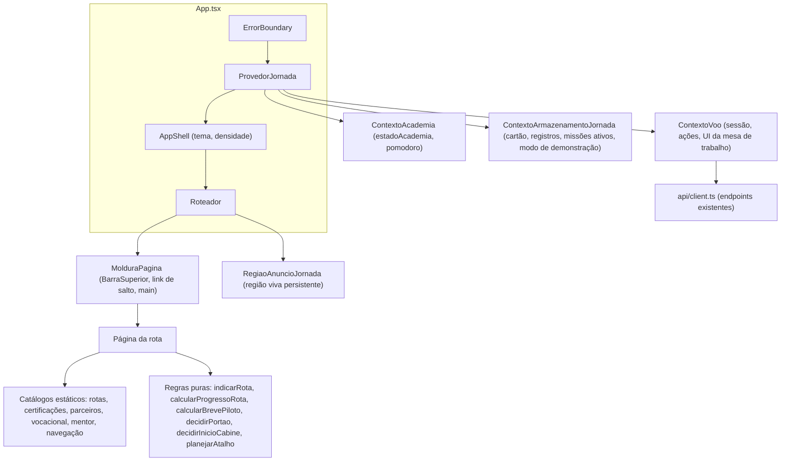
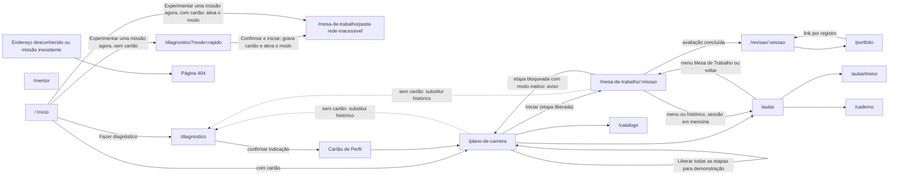

# Design Document

## Overview

Este documento descreve como o frontend do IT Career Simulator passa de uma tela única com estado interno (`WorkstationInner` e `TelaInicial` em `src/frontend/src/App.tsx` e `src/frontend/src/workstation/TelaInicial.tsx`) para uma Jornada de Missão com páginas reais, endereços próprios, título de documento, foco gerenciado, portões leves e catálogos de dados. O backend não muda.

Fonte de leitura: código da branch `main` (lido por `git show main:<caminho>`), o `requirements.md` deste diretório, `docs/design/DESIGN.md` (commit `7ab7c22`, branch `design-system-docs`, seções 3 e 4) e o catálogo de referência `src/frontend/src/home/catalogoVocacional.ts` da branch `home-vocacional`, somente leitura.

### Decisões confirmadas dos requisitos

| Decisão | Confirmação no design |
| --- | --- |
| Desbloqueio de etapa | Uma Etapa é liberada quando a Etapa anterior é Escala_Cumprida: Registro de Missão para todas as suas Missões disponíveis. Registro de Missão exige avaliação do Juiz_360 com `concluida: true`. O frontend não exige aprovação nem calcula nota: só verifica a existência do registro (Requirement 5.5 e 9.5). |
| Etapa sem Missão disponível | Confirmada: não trava a Etapa seguinte. Ela conta como Escala_Cumprida para o portão, e a Etapa seguinte mostra que está liberada porque as Missões da anterior estão em preparação. Hoje isso vale para Help Desk N1, então Service Desk N1 Jr já começa liberada (Requirement 5.9). |
| Causa em preparação | Confirmada: não bloqueia a Missão. A Missão continua disponível com as Causas que o backend oferece, o botão Iniciar segue o estado da Etapa e a Mesa de Trabalho envia só o identificador da Missão, sem Causa, para o backend escolher (Requirement 6.8 e 7.7). |
| Causas no Plano de Carreira | Confirmada: o Plano de Carreira mostra só a quantidade de Causas disponíveis e em preparação, sem nome nem descrição. Por isso o catálogo guarda de cada Causa só o código e o status (Requirement 6.8). |
| Convite informativo | O Convite_Copiloto é texto de catálogo, sem campo, sem botão de envio e sem requisição de rede (Requirement 6.11). |
| Rota indisponível | Quando a indicação aponta para Rota em preparação ou futura, a página mostra o status em texto e ícone e oferece o perfil na Rota Suporte de TI. O Cartão de Perfil guarda as duas: a Rota indicada e a Rota de perfil (Requirement 4.8). |
| Tom do diagnóstico | O texto diz que a indicação é um ponto de partida e que a decisão é do participante. A página mostra a regra de indicação em linguagem simples. Os limites do guia vêm do catálogo (Requirement 3.2 e 4.10). |
| Certificações e parceiros | Certificações aparecem pelo nome público, como referência de mercado, com aviso fixo de que não há parceria, equivalência ou emissão. Parceiros não têm campo de nome: só tipo e descrição genérica (Requirement 10.5 e 10.6). |
| Revisão com resumo local | Se o backend responde 404 ou 410 e existe Registro de Missão da sessão, a página mostra o resumo local identificado como tal, sem eventos (Requirement 8.3). |
| Publicação | O frontend publicado é a Vercel, e `src/frontend/vercel.json` já reescreve `/(.*)` para `/index.html`. `render.yaml` só descreve a API e não muda (detalhes em Publicação). |
| Modo de demonstração | Escolha guardada só no frontend, na chave `itfs_modo_demonstracao`, com leitura defensiva (valor inválido equivale a inativo). Com o modo ativo, o portão de Etapa não se aplica, mas o portão de Cartão de Perfil continua. O modo não cria Registro de Missão e não chega ao backend (Requirement 5 e 17, detalhes em Decisão 8). |
| Diagnóstico rápido | Um único passo: a página mostra as três respostas padrão explícitas, a indicação Suporte de TI calculada pelas mesmas Regras_de_Indicação e o botão "Confirmar e iniciar" (Requirement 17.12 e 17.13). |
| Atalho "Experimentar uma missão agora" | Sem cartão, leva ao Diagnóstico Rápido. Com cartão válido, ativa o modo e abre `/mesa-de-trabalho/pasta-rede-inacessivel` sem refazer o diagnóstico e sem trocar o cartão (Requirement 17.14). |

### Escopo de entrega

De 7,5 a 10 dias de trabalho até 30 de novembro de 2026. A escolha do roteador, o reaproveitamento das telas e a ausência de dependências novas foram decididos com esse prazo como critério principal.

## Architecture

### Decisão 1: roteamento

Foram comparadas duas opções.

| Critério | react-router (série 7, modo biblioteca) | Roteador próprio pela History API |
| --- | --- | --- |
| Tamanho | Dependência nova em `dependencies`, com código de terceiros no bundle e dependências transitivas que o projeto não usa (na série 7, `cookie` e `set-cookie-parser`). Tamanho exato não medido nesta fase. | Cerca de 200 linhas próprias em 4 arquivos, sem dependência nova. |
| Prazo de 7,5 a 10 dias | Exige aprender a API atual, decidir entre modo biblioteca e modo de dados e adaptar o estado de sessão em memória. | Cobre exatamente as 12 páginas e os 4 parâmetros desta jornada. Nada a configurar. |
| Acessibilidade (foco e título) | Não move o foco nem define título por conta própria. O código de foco e título teria de ser escrito de qualquer forma. | O mesmo código de foco e título, escrito uma vez dentro do próprio navegador. |
| Testabilidade em Vitest | Boa, com `MemoryRouter`. | Boa: a resolução de endereço é função pura testada por propriedade; a parte de histórico usa `history.pushState` e `popstate` do jsdom. |
| Risco | Supply chain e atualizações de versão maior, em produto de hackathon com prazo curto. | Casos de borda de links (teclas modificadoras, `target`, origem externa) ficam por nossa conta. Mitigação: regra única em `LinkInterno` e testes dedicados. |

Escolha: roteador próprio pela History API. Ele atende foco, título e testes com menos risco e sem dependência nova. O ganho do react-router (rotas aninhadas, carregadores de dados) não é usado por esta jornada. Se o produto passar de cerca de 20 páginas ou precisar de carregamento de dados por rota, a troca fica isolada em `src/frontend/src/jornada/navegacao/`.

### Visão geral dos módulos



O `ContextoArmazenamentoJornada` não importa `api/client.ts`, e o `ContextoVoo` não lê o modo de demonstração. As duas ausências de ligação são conferidas por teste (Testing Strategy).

Princípios:

- O motor determinístico do backend continua como autoridade única. O frontend envia ações do participante pelos endpoints que já existem em `src/frontend/src/api/client.ts` e exibe a projeção devolvida.
- Toda regra nova do frontend (indicação, progresso, portões, decisão de abertura da mesa de trabalho, classificação de falha, agrupamento do Brevê) é função pura em módulo próprio, testada sem DOM.
- Os componentes de página leem catálogos e regras. Nenhum componente guarda lista própria de rotas, etapas, missões, certificações ou parceiros (Requirement 10.3).

### Navegação da jornada



### Decisão 2: endereços, títulos, chaves e distribuição

#### Endereços finais

| Página | Endereço | Nome da Página (h1 e título) | Item do menu ou fluxo de origem |
| --- | --- | --- | --- |
| Início | `/` | Início | Item Início |
| Diagnóstico | `/diagnostico` (opcionais `?motivo=sem-cartao` e `?modo=rapido`) | Diagnóstico | Fluxo a partir do Início, do Plano de Carreira, dos portões e do Atalho_Experimentar |
| Plano de Carreira | `/plano-de-carreira` | Plano de Carreira | Item Plano de Carreira |
| Mesa de Trabalho | `/mesa-de-trabalho/:missao` (opcionais `?semente=N`, `?causa=C1`, `?nova=1`) | Mesa de Trabalho | Item Mesa de Trabalho, visível com missão ativo |
| Revisão | `/revisao/:sessao` | Revisão | Fluxo a partir da Mesa de Trabalho e do Brevê |
| Brevê | `/portfolio` | Brevê | Item Brevê |
| Catálogo | `/catalogo` | Catálogo | Item Catálogo |
| Aulas | `/aulas` (opcionais `?nivel=n1`, `?modo=cards`, `?aula=<id>`) | Aulas | Item Aulas |
| Treino de explicação | `/aulas/treino` | Treino de explicação | Fluxo a partir de Aulas |
| Caderno | `/caderno` | Caderno de estudos | Item Caderno |
| Mentor | `/mentor` | Mentor | Item Mentor |
| 404 | qualquer outro caminho | Página não encontrada | Nenhum |

Regras de endereço:

- Endereços em ASCII, minúsculos, sem acento (`/portfolio`, não `/brevê`). Caminho com barra final é aceito e a URL é reescrita com `history.replaceState` para a forma sem barra.
- `:missao` precisa existir no Catálogo_de_Rotas. Caso contrário a rota resolve para a Página_404 com o identificador informado (Requirement 13.2).
- `:sessao` precisa casar com `^[A-Za-z0-9-]{1,64}$`. Fora disso, Página_404. O identificador é passado ao cliente com `encodeURIComponent`.
- `?motivo=sem-cartao` e `?modo=rapido` são independentes. Qualquer outro valor de `motivo` ou de `modo` é ignorado, e a rota resolve para o Diagnóstico comum.
- O modo de demonstração não aparece na URL. Ele é estado local do navegador, para que um link compartilhado não ative o modo em outra máquina.
- `?nova=1`, `?semente` e `?causa` só são lidos na criação da sessão. Depois da criação a Mesa de Trabalho reescreve a URL para `/mesa-de-trabalho/:missao` com `replaceState`, para que uma recarga não crie outra sessão.
- O botão Iniciar nunca leva `?causa` nem `?semente` (Requirement 7.7). Só as opções avançadas do Plano de Carreira, sujeitas aos parâmetros de teste do backend, montam `?causa`, e só com Causa disponível no catálogo. `?causa` com Causa em preparação ou fora do catálogo é ignorado por `resolverEndereco`, e a sessão é criada sem Causa.
- A página Treino de explicação recebe a `MentorView` atual. Ela sai do menu principal porque o nome Mentor passa a ser um papel do Mentor, e a `MentorView` exibe pontuação de Feynman e STAR, o que o Mentor não pode fazer (Requirement 11.5).

#### Formato do título do documento

`tituloDocumento(nome) = nome + ", IT Career Simulator"`. Exemplos: `Plano de Carreira, IT Career Simulator`, `Página não encontrada, IT Career Simulator`. O título fixo de `src/frontend/index.html` (hoje com travessão) passa a `IT Career Simulator`, usado só antes do primeiro render.

#### Chaves de Armazenamento_Local

| Chave | Conteúdo | Status |
| --- | --- | --- |
| `itfs_cartao_embarque` | Cartão de Perfil, `versao: 1` | Nova |
| `itfs_registros_missao` | `{ versao: 1, registros: RegistroDeVoo[] }` | Nova |
| `itfs_missoes_ativas` | `{ versao: 1, ultimaMissao, porMissao: { [missao]: sessaoId } }` | Nova, necessária para o Requirement 7.2 |
| `itfs_modo_demonstracao` | `{ versao: 1, ativo, origem, alteradoEm }` | Nova, necessária para o Requirement 17 |
| `itfs_academia_v3` | Estado da Academia (`catalogoEducacional.ts`) | Existente, sem mudança |
| `itfs_jornada_sessoes` | Lista de sessões para o resumo de carreira | Existente, sem mudança |

#### Distribuição dos 7 cenários pelas 4 etapas

Segue a distribuição confirmada nos requisitos, pela divisão de responsabilidades do mercado. A triagem de engenharia social sai do N1 e vai para a N3-C, porque é responsabilidade do time de segurança.

| Etapa | Vertente | Missão | Status | Causas registradas |
| --- | --- | --- | --- | --- |
| Help Desk N1 | nenhuma | `reset-senha-desbloqueio` (novo) | em preparação | SENHA_ESQUECIDA, CONTA_BLOQUEADA e SENHA_EXPIRADA, em preparação |
| Service Desk N1 Jr | nenhuma | `pasta-rede-inacessivel` | disponível | C1, C2 e C3 disponíveis; C4 em preparação |
| N2 Pleno | nenhuma | `incidente-massivo` | disponível | GATEWAY disponível; EMAIL_PROVEDOR e DOMINIO_SUSPENSO em preparação |
| N3 Sênior | N3-A Redes e Nuvem | `sre-cloud-latencia` | disponível | OOM_KILLED, POOL_EXHAUSTED e CERT_EXPIRED, disponíveis |
| N3 Sênior | N3-B Data Center e Backup | `falha-backup-restore` (novo) | em preparação | REPOSITORIO_CHEIO e CADEIA_CORROMPIDA, em preparação |
| N3 Sênior | N3-C Segurança e Dados | `triagem-engenharia-social`, depois `diagnostico-sql-readonly` | disponível | nenhuma |

Os cenários e as Causas novas são implementados no backend pela spec `cenarios-por-etapa`. Quando o backend passar a oferecer um item, só o status muda no catálogo.

O cartão da missão no Plano de Carreira mostra `titulo` e `desc` do nível de `LEVELS`, não o campo `cargo`. A busca usa `LEVELS.find((l) => l.cenarioId === id)` e não `nivelPorCenarioId`, cujo fallback devolveria o nível de `triagem-engenharia-social` para os cenários novos. Sem nível em `LEVELS`, o cartão usa `titulo` e `descricao` da própria Missão no catálogo.

### Decisão 3: publicação

- `src/frontend/vercel.json` na `main` já tem `rewrites: [{ source: "/(.*)", destination: "/index.html" }]`. A Vercel verifica arquivos estáticos antes de aplicar reescritas, então `/assets/*` continua servido e qualquer outro caminho recebe o documento da aplicação. O Requirement 1.5 já está atendido sem alteração.
- `render.yaml` descreve só o serviço `it-flight-simulator-api` (Docker, `/health/live`). Não serve o frontend. Não precisa mudar.
- No ambiente local, o servidor de desenvolvimento do Vite usa fallback de SPA por padrão (`appType` padrão), então o Playwright consegue abrir endereços profundos sem configuração extra.
- Limitação conhecida: endereços desconhecidos respondem HTTP 200 com o documento, e a Página_404 é exibida no cliente. Isso é comportamento normal de SPA e não afeta os requisitos.
- Persistência de sessões: o `requirements.md` e o `render.yaml` concordam. O backend publicado usa o Event Store com `EventStore__Provedor: Postgres` e `Sessao__TtlDias: "30"`, e o provedor em memória só vale em desenvolvimento local sem provedor configurado. Depois do prazo ou de um reinício local, o backend devolve 404 (`sessao_nao_encontrada`) ou 410 (`sessao_expirada`) nas linhas 222, 223, 245 e 246 de `Program.cs`. O frontend trata os dois códigos igualmente, e o Aviso_Honesto diz que a sessão "não está mais disponível no servidor", sem afirmar que o servidor reiniciou. Nada muda no backend.

## Components and Interfaces

### Navegação (`src/frontend/src/jornada/navegacao/`)

#### `rotas.ts` (puro)

```ts
export type IdPagina =
  | 'inicio' | 'diagnóstico' | 'plano-de-carreira' | 'mesa de trabalho' | 'caixa-preta' | 'portfólio'
  | 'catálogo' | 'aulas' | 'treino' | 'caderno' | 'mentor' | 'nao-encontrada'

export type RotaResolvida =
  | { pagina: 'inicio' }
  | { pagina: 'diagnóstico'; motivo: 'sem-cartao' | null; rapido: boolean } // rapido: ?modo=rapido
  | { pagina: 'plano-de-carreira' }
  | { pagina: 'mesa de trabalho'; missao: IdMissao; semente: number | null; causa: string | null; nova: boolean }
  | { pagina: 'caixa-preta'; sessao: string }
  | { pagina: 'portfólio' }
  | { pagina: 'catálogo' }
  | { pagina: 'aulas'; nivel: NivelId | null; modo: 'lesson' | 'cards'; aula: string | null }
  | { pagina: 'treino' }
  | { pagina: 'caderno' }
  | { pagina: 'mentor' }
  | { pagina: 'nao-encontrada'; caminho: string; missaoDesconhecida: string | null }

export const NOME_PAGINA: Record<IdPagina, string> = {
  inicio: 'Início',
  'diagnóstico': 'Diagnóstico',
  'plano-de-carreira': 'Plano de Carreira',
  mesa de trabalho: 'Mesa de Trabalho',
  'caixa-preta': 'Revisão',
  portfólio: 'Brevê',
  catálogo: 'Catálogo',
  aulas: 'Aulas',
  treino: 'Treino de explicação',
  caderno: 'Caderno de estudos',
  mentor: 'Mentor',
  'nao-encontrada': 'Página não encontrada',
}

/** Total: todo par (caminho, busca) resolve para exatamente uma rota. */
export function resolverEndereco(caminho: string, busca: string): RotaResolvida
/** Inversa de resolverEndereco para rotas válidas. Omite parâmetros nulos ou padrão. */
export function enderecoDe(rota: RotaResolvida): string
export function tituloDocumento(nome: string): string // `${nome}, IT Career Simulator`
```

#### `navegador.ts` (histórico)

```ts
export type OrigemNavegacao = 'inicial' | 'interna' | 'historico'
export interface LocalAtual {
  caminho: string
  busca: string
  origem: OrigemNavegacao
  chave: number // incrementa a cada navegação, usado para foco e para reiniciar o limite de erro
}
export function navegar(href: string, opcoes?: { substituir?: boolean }): void
export function useLocalAtual(): LocalAtual // useSyncExternalStore sobre popstate e evento interno
```

- `navegar` chama `history.pushState` (ou `replaceState` com `substituir`), atualiza o instantâneo com `origem: 'interna'` e rola para o topo.
- O ouvinte de `popstate` atualiza o instantâneo com `origem: 'historico'` e deixa a rolagem com o navegador.
- O primeiro instantâneo tem `origem: 'inicial'`.

#### `LinkInterno.tsx`

Elemento `a` com `href` real. O clique só é interceptado quando todas estas condições valem: botão principal, nenhuma tecla Ctrl, Meta, Shift ou Alt, sem atributo `target`, `href` começando com `/` e mesma origem. Nos demais casos o navegador segue o comportamento padrão (nova aba, por exemplo). Aceita `substituir` e repassa `aria-current`.

#### `Roteador.tsx` e `useTituloEFoco.ts`

- `Roteador` lê `useLocalAtual()`, chama `resolverEndereco`, aplica `decidirPortao` e renderiza a página. Se o portão pede redirecionamento, chama `navegar('/diagnostico?motivo=sem-cartao', { substituir: true })` dentro de `useEffect` (Requirement 5.1).
- `useTituloEFoco(nome, local)` define `document.title = tituloDocumento(nome)`. Quando `local.origem` não é `'inicial'`, localiza `#conteudo-pagina h1`, garante `tabindex="-1"` e chama `focus()` (Requirement 2.1 e 2.2).
- Toda página renderiza o seu h1 de forma síncrona, antes de qualquer carregamento, para que o foco tenha alvo.
- O CSS ganha a regra `#conteudo-pagina h1:focus { outline: var(--focus-ring-width) solid var(--focus-ring); outline-offset: var(--focus-ring-offset); }`. A regra usa `:focus` e não `:focus-visible` porque o foco programático depois de um clique de mouse não ativa `:focus-visible` no Chromium (Requirement 2.4).
- A página fica dentro de um limite de erro com `key={local.chave}`. Um erro em uma página não derruba o menu, e a próxima navegação limpa o erro.
- `Roteador` renderiza uma única `RegiaoAnuncioJornada` (`<p role="status" aria-live="polite" class="sr-only">`) fora do limite de erro com `key`, para que a região continue montada entre páginas. Um texto colocado nela imediatamente antes de uma navegação é anunciado na página de destino. A região começa vazia. O texto continua na página de destino e é limpo quando a pessoa sai dela, para que o mesmo anúncio não se repita.

#### `portoes.ts` (puro)

```ts
export type DecisaoPortao =
  | { tipo: 'exibir' }
  | { tipo: 'redirecionar'; para: string } // sempre com substituição de histórico
  | { tipo: 'aviso-missao-em-preparacao' }
  | { tipo: 'aviso-etapa-bloqueada'; escalaNecessaria: IdEscala }

export function decidirPortao(
  rota: RotaResolvida,
  cartao: CartaoPerfil | null,
  registros: readonly RegistroDeVoo[],
  modoDemonstracao: boolean,
): DecisaoPortao
```

As regras são avaliadas nesta ordem:

1. Sem cartão válido em `plano-de-carreira` ou `mesa de trabalho`: redirecionar para `/diagnostico?motivo=sem-cartao`, com o modo ativo ou inativo (Requirement 5.1). O modo de demonstração nunca dispensa o Cartão de Perfil.
2. Em `mesa de trabalho` com Missão de status em preparação: aviso de missão em preparação, com o modo ativo ou inativo, e a Mesa de Trabalho não chama `criarSessao` (Requirement 5.8). Causa em preparação não entra nesta regra.
3. Em `mesa de trabalho` com missão de Escala_Bloqueada e modo inativo: aviso, e a Mesa de Trabalho não chama `criarSessao` (Requirement 5.4). A etapa bloqueada é calculada por `calcularProgressoRota(rota, registros, { modoDemonstracao: false })`.
4. Em `mesa de trabalho` com o modo ativo: exibir, para Missões disponíveis de qualquer Etapa e Vertente (Requirement 5.7).
5. Nas demais páginas: exibir.

### Estado de sessão (Decisão 4: refatoração do `App.tsx`)

#### Diagnóstico

`WorkstationInner` guarda hoje 20 variáveis de estado e alterna entre duas árvores: `TelaInicial` (que tem navegação interna própria entre home, aulas, caderno, mentor e credencial) e a Workstation. `TelaInicial` e `WorkstationInner` não são telas. São orquestradores de navegação, e mantê-los como componentes de rota faria a mesma URL exibir conteúdos diferentes, contra o Requirement 1.7. As telas que eles montam são reaproveitadas sem reescrita.

#### Extração em três contextos (`src/frontend/src/jornada/ProvedorJornada.tsx`)

1. `ContextoAcademia`: `estadoAcademia`, `atualizarEstadoAcademia`, `resumoCarreira`, `apelido`, `atualizarResumoCarreira` e `pomodoro`. O código sai de `WorkstationInner` e de `TelaInicial` sem mudança de lógica. `usePomodoro` sobe para o provedor para o cronômetro sobreviver à troca de página.
2. `ContextoVoo`: todo o estado da Workstation hoje em `WorkstationInner` (`sessaoId`, `sessao`, `aba`, `gaveta`, `tutorMsgs`, `tutorInput`, `ocupado`, `aviso`, `replay`, `nivel1Passos`, `historicoTerminal`, estado de KB) e as funções `executarAcao`, `enviarChat`, `carregarReplay`, `abrirKbDoItsm` e `fecharArtigoKb`, movidas como estão. `iniciarSessao` vira `abrirVoo`, descrita abaixo. O provedor fica acima do `Roteador`, então a sessão continua em memória quando a pessoa vai para Aulas, Caderno ou Mentor e volta (Requirement 12.3).
3. `ContextoArmazenamentoJornada`: lê e grava Cartão de Perfil, Registros de Missão, missões ativos e Modo_de_Demonstração pelos módulos de `armazenamento/`, com `Storage` injetável para teste. Os quatro valores são lidos uma vez na montagem do provedor, por estado com inicialização preguiçosa, então qualquer Página aberta por link direto ou recarga já recebe o modo restaurado (Requirement 17.5). Quando uma gravação falha, o valor novo fica em memória até a próxima recarga e a página mostra o aviso não bloqueante de Error Handling. Detalhes do modo em Decisão 8.

```ts
export type ResultadoAberturaVoo =
  | { tipo: 'pronto'; sessaoId: string; retomada: boolean }
  | { tipo: 'sessao-indisponivel'; sessaoId: string }
  | { tipo: 'rede'; mensagem: string }
  | { tipo: 'erro'; mensagem: string }

interface ValorVoo {
  // estado movido de WorkstationInner, sem mudança de forma
  sessaoId: string | null
  sessao: SessaoProjecao | null
  ocupado: boolean
  aviso: string | null
  registroRecente: RegistroDeVoo | null
  abrirVoo(missao: IdMissao, opcoes: { semente?: number; causa?: string; nova: boolean }): Promise<ResultadoAberturaVoo>
  executarAcao(tipo: string, dados?: Record<string, unknown>): Promise<void>
  enviarChat(persona: 'cliente' | 'techlead', mensagem: string): Promise<void>
  carregarReplay(): Promise<void>
  // demais campos e setters de UI da mesa de trabalho movidos como estão
}
```

#### `abrirVoo` e `decidirInicioCabine` (puro)

```ts
export type DecisaoInicioCabine =
  | { tipo: 'usar-memoria' }                   // sessão em memória já é desta missão
  | { tipo: 'retomar'; sessaoId: string }      // há sessão registrada para a missão
  | { tipo: 'criar' }

export function decidirInicioCabine(
  missao: IdMissao,
  emMemoria: { cenarioId: string } | null,
  missoesAtivas: MissoesAtivas,
  nova: boolean,
): DecisaoInicioCabine
```

- `abrirVoo` e `decidirInicioCabine` não recebem o Modo_de_Demonstração. Quem decide se a Mesa de Trabalho pode abrir é `decidirPortao`. Depois do portão, a abertura da missão é a mesma com o modo ativo ou inativo, e as requisições enviadas ao backend são idênticas (Requirement 17.8).
- `nova: true` sempre cria.
- Sessão em memória da mesma missão: usar sem requisição.
- Entrada em `missoesAtivas.porMissao[missao]`: `obterSessao`. Sucesso retoma. 404 ou 410 devolve `sessao-indisponivel`. Erro de rede devolve `rede`.
- Nenhum dos casos: `criarSessao`, depois `obterSessao`, grava `missoesAtivas` e `itfs_jornada_sessoes`.
- O provedor guarda uma promessa em andamento por missão (`Map<IdMissao, Promise<ResultadoAberturaVoo>>`). A dupla execução de efeitos do `StrictMode` em desenvolvimento não cria duas sessões.

#### Gravação do Registro de Missão

Este é o único caminho do código que grava Registro de Missão, com o modo de demonstração ativo ou inativo. Depois de `executarAcao`, quando todos os chamados da projeção estão `Resolvido` ou `Encerrado` (mesmo teste que já existe para `labsDone`), o provedor chama `apiClient.obterAvaliacao(sessaoId)`, um endpoint que já existe. Se `concluida` é `true`, chama `criarRegistro` e `gravarRegistro`, que são idempotentes por `sessaoId`, e preenche `registroRecente`. A Mesa de Trabalho exibe então um Aviso_Honesto em região viva com o link para `/revisao/:sessao` (Requirement 7.5). Falha nessa consulta não bloqueia o turno: a Mesa de Trabalho mostra aviso com botão "Tentar registrar de novo".

#### Mapa de páginas e componentes

| Página | Componentes reaproveitados | Novo |
| --- | --- | --- |
| Início `/` | Textos de `catalogoVocacional.ts` (de `home-vocacional`): `TEXTOS_HOME`, `JORNADA`, limites, pergunta `foco` e `RESPOSTAS_FOCO` para a demonstração | `PaginaInicio`, `DemonstracaoDiagnóstico` (sem gravação), `BotaoExperimentar` (Atalho_Experimentar), `PainelMentor` (Consultor) |
| Diagnóstico `/diagnostico` | Limites do catálogo vocacional | `PaginaDiagnóstico`, `reduzirDiagnóstico`, `indicarRota`, `DiagnósticoRapido` (com `?modo=rapido`), `CartaoPerfil`, `AvisoHonesto`, `PainelMentor` (Consultor) |
| Plano de Carreira `/plano-de-carreira` | `PrimeiroVoo` (próximo passo; os callbacks viram navegação), `ETAPAS_MISSAO_ZERO` e glossário de `TelaInicial`, dados de `LEVELS`, classes CSS de `TabelaMissoes` (`missao-linha`, `missao-texto`) | `PaginaPlanoDeCarreira`, `ListaEscalas`, `GrupoVertente`, `CartaoMissao`, `SeloStatus`, `SeloDemonstracao`, `ControleModoDemonstracao`, `ConviteMentor`, opções avançadas (semente e demo rápida como links para a Mesa de Trabalho), `PainelMentor` (Instrutor) |
| Mesa de Trabalho `/mesa-de-trabalho/:missao` | `SplitLabWorkspace`, `MissionGuide`, `ItsmApp`, `ChatApp`, `SimuDeskApp`, `IntranetApp`, gavetas de notas e tutor, `BarraSuperior` com `slotDireitoSessao`, tudo movido de `WorkstationInner` | `PaginaMesa` (cabeçalho com h1, estados de carregamento, portão e sessão indisponível). O dock "Juiz 360º e Replay" vira link para `/revisao/:sessao`. A gaveta "Mentor da missão" vira "Mentor", papel Assistente |
| Revisão `/revisao/:sessao` | `ReplayView` com `CriteriaPanel`, `TimelineReplay`, `CredentialCard`, e `IntranetApp` para os links de KB (a lógica de `abrirArtigoKb` e `kbRetornoLinkUri` sai de `WorkstationInner`) | `PaginaRevisão`, `ResumoLocalDoVoo`, `AvisoHonesto`, `PainelMentor` (Mentor) |
| Brevê `/portfolio` | `CredencialView` (com `nivelTitulo={2}`) | `PaginaPortfolio`, `agruparRegistros`, `calcularBrevePiloto`, `SecaoBrevePiloto`, estado vazio, `PainelMentor` (Mentor). Não lê o Modo_de_Demonstração (Requirement 9.10 e 17.9) |
| Catálogo `/catalogo` | Seção "Transparência do escopo" de `TelaInicial` | `PaginaCatalogo`, `SeloStatus`, `GrupoVertente`, modelos de visão dos catálogos, com as Missões agrupadas por Etapa e Vertente |
| Aulas `/aulas` | `AulasView` (com `nivelTitulo={2}`). A lógica `abrirAula`, `abrirFlashcards` e `aulaAlvo` de `TelaInicial` vira parâmetros de endereço | `PaginaAulas` (h1 Aulas, seletor de nível por links, link para Treino) |
| Treino `/aulas/treino` | `MentorView` (com `nivelTitulo={2}`) | `PaginaTreino` (h1) |
| Caderno `/caderno` | `CadernoView`, que já tem h1 "Caderno de estudos" | `PaginaCaderno` (moldura) |
| Mentor `/mentor` | Limites do catálogo vocacional | `PaginaMentor` (quatro papéis, limites, páginas onde cada papel atua) |
| 404 | Nenhum | `Pagina404` |

Telas fora da navegação:

- `TelaInicial.tsx` sai do código no fim da migração. As partes que ela monta continuam em uso pelas páginas acima.
- `TabelaMissoes.tsx` deixa de ser montado. A escolha livre de qualquer nível e o botão "Iniciar" contradizem o Requirement 5.3. O conteúdo por nível vem de `LEVELS`, e a semente e a demo rápida passam para as opções avançadas do Plano de Carreira, sujeitas aos portões. O arquivo é removido junto com `TelaInicial.tsx`.

Mudança mínima em telas existentes: `AulasView`, `MentorView` e `CredencialView` ganham a propriedade opcional `nivelTitulo?: 1 | 2`, com padrão 1. As páginas passam 2, e o h1 da página fica com o nome da página (Requirement 2.3). Os testes atuais dessas telas continuam válidos sem mudança.

### Catálogos (Decisão 5, `src/frontend/src/jornada/catalogos/`)

#### Status comum

```ts
export type StatusDisponibilidade = 'disponivel' | 'em-preparacao' | 'futuro'

export const APRESENTACAO_STATUS: Record<StatusDisponibilidade, { texto: string; icone: NomeIcone }> = {
  disponivel: { texto: 'Disponível', icone: 'status-disponivel' },
  'em-preparacao': { texto: 'Em preparação', icone: 'status-preparacao' },
  futuro: { texto: 'Futuro', icone: 'status-futuro' },
}
```

#### `catalogoRotas.ts`

```ts
export type IdMissao =
  | 'reset-senha-desbloqueio' | 'pasta-rede-inacessivel' | 'incidente-massivo' | 'sre-cloud-latencia'
  | 'falha-backup-restore' | 'triagem-engenharia-social' | 'diagnostico-sql-readonly'
export type IdVertente = 'n3-a-redes-nuvem' | 'n3-b-data-center-backup' | 'n3-c-seguranca-dados'

export interface Causa {
  codigo: string                // código do cenário no backend, por exemplo C1 ou GATEWAY. Nunca exibido no Plano de Carreira
  status: StatusDisponibilidade
}
export interface Missao {
  id: IdMissao                  // identificador de cenário do backend
  status: StatusDisponibilidade // disponível: o backend oferece hoje; em preparação: ainda não
  causas: readonly Causa[]      // vazio quando o catálogo não registra Causas da Missão
  titulo?: string               // obrigatórios quando LEVELS não tem nível para o cenário
  descricao?: string
}
export interface Vertente { id: IdVertente; nome: string; missoes: readonly Missao[] }
export interface Etapa {
  id: string
  nome: string
  descricao: string
  missoes: readonly Missao[]     // Etapas 1 a 3; vazio na N3 Sênior
  vertentes: readonly Vertente[] // só na N3 Sênior, na ordem N3-A, N3-B, N3-C; vazio nas demais
}
export interface Rota {
  id: string
  nome: string
  descricao: string
  status: StatusDisponibilidade
  etapas: readonly Etapa[] // ordem do array é a ordem da rota
}

export const CATALOGO_ROTAS = [
  {
    id: 'suporte-ti',
    nome: 'Suporte de TI',
    descricao: 'Atendimento de chamados, investigação de causa e comunicação com o usuário na Aurora Logística.',
    status: 'disponivel',
    etapas: [
      { id: 'help-desk-n1', nome: 'Help Desk N1', descricao: '...', vertentes: [], missoes: [
        { id: 'reset-senha-desbloqueio', status: 'em-preparacao', titulo: 'Reset de senha e desbloqueio de conta',
          descricao: 'Verificar a identidade antes de agir.', causas: [
            { codigo: 'SENHA_ESQUECIDA', status: 'em-preparacao' },
            { codigo: 'CONTA_BLOQUEADA', status: 'em-preparacao' },
            { codigo: 'SENHA_EXPIRADA', status: 'em-preparacao' },
          ] },
      ] },
      { id: 'service-desk-n1-jr', nome: 'Service Desk N1 Jr', descricao: '...', vertentes: [], missoes: [
        { id: 'pasta-rede-inacessivel', status: 'disponivel', causas: [
          { codigo: 'C1', status: 'disponivel' }, { codigo: 'C2', status: 'disponivel' },
          { codigo: 'C3', status: 'disponivel' }, { codigo: 'C4', status: 'em-preparacao' },
        ] },
      ] },
      { id: 'n2-pleno', nome: 'N2 Pleno', descricao: '...', vertentes: [], missoes: [
        { id: 'incidente-massivo', status: 'disponivel', causas: [
          { codigo: 'GATEWAY', status: 'disponivel' },
          { codigo: 'EMAIL_PROVEDOR', status: 'em-preparacao' },
          { codigo: 'DOMINIO_SUSPENSO', status: 'em-preparacao' },
        ] },
      ] },
      { id: 'n3-senior', nome: 'N3 Sênior', descricao: '...', missoes: [], vertentes: [
        { id: 'n3-a-redes-nuvem', nome: 'N3-A Redes e Nuvem', missoes: [
          { id: 'sre-cloud-latencia', status: 'disponivel', causas: [
            { codigo: 'OOM_KILLED', status: 'disponivel' },
            { codigo: 'POOL_EXHAUSTED', status: 'disponivel' },
            { codigo: 'CERT_EXPIRED', status: 'disponivel' },
          ] },
        ] },
        { id: 'n3-b-data-center-backup', nome: 'N3-B Data Center e Backup', missoes: [
          { id: 'falha-backup-restore', status: 'em-preparacao', titulo: 'Falha de backup e restauração',
            descricao: '...', causas: [
              { codigo: 'REPOSITORIO_CHEIO', status: 'em-preparacao' },
              { codigo: 'CADEIA_CORROMPIDA', status: 'em-preparacao' },
            ] },
        ] },
        { id: 'n3-c-seguranca-dados', nome: 'N3-C Segurança e Dados', missoes: [
          { id: 'triagem-engenharia-social', status: 'disponivel', causas: [] },
          { id: 'diagnostico-sql-readonly', status: 'disponivel', causas: [] },
        ] },
      ] },
    ],
  },
  { id: 'infraestrutura-nuvem', nome: 'Infraestrutura e nuvem', descricao: '...', status: 'em-preparacao', etapas: [] },
  { id: 'desenvolvimento', nome: 'Desenvolvimento de software', descricao: '...', status: 'futuro', etapas: [] },
  { id: 'dados', nome: 'Dados e análise', descricao: '...', status: 'futuro', etapas: [] },
] as const satisfies readonly Rota[]

export type IdRota = (typeof CATALOGO_ROTAS)[number]['id']
export function rotaPorId(id: string): Rota | null
export function escalaDaMissao(missao: string):
  { rota: Rota; etapa: Etapa; indice: number; vertente: Vertente | null; missao: Missao } | null
/** Missões da Etapa na ordem do catálogo, com a Vertente de cada uma (nula nas Etapas 1 a 3). */
export function missoesDaEscala(etapa: Etapa): readonly { missao: Missao; vertente: Vertente | null }[]

/** Missão_de_Demonstração, aberta pelo Atalho_Experimentar (Requirement 17.13 e 17.14). */
export const MISSAO_DEMONSTRACAO = 'pasta-rede-inacessivel' as const satisfies IdMissao
```

`pasta-rede-inacessivel` fica na etapa Service Desk N1 Jr, a segunda da rota. Com o catálogo atual ela já começa liberada, porque Help Desk N1 não tem Missão disponível. O atalho ativa o modo do mesmo jeito (Requirement 17.13 e 17.14), para que o caminho da banca não dependa do status do catálogo. Um teste de catálogo confere que `escalaDaMissao(MISSAO_DEMONSTRACAO)` não é nulo e que a Missão está disponível.

Os nomes de rotas futuras seguem as áreas do `catalogoVocacional.ts` da branch `home-vocacional` (Desenvolvimento de software, Dados e análise, Infraestrutura e nuvem).

#### `catalogoCertificacoes.ts`

```ts
export interface Certificacao {
  id: string
  nome: string            // nome público da certificação, usado só como referência
  descricao: string       // o que a etapa exercita que se relaciona com a referência
  rotaId: IdRota
  etapaIds: readonly string[]
  status: StatusDisponibilidade // estado do mapeamento de conteúdo neste produto
}
export const AVISO_CERTIFICACOES =
  'Referências de mercado. Os nomes pertencem aos respectivos emissores. O IT Career Simulator não tem parceria com emissores, não equivale a nenhuma prova e não emite certificado.'
```

Itens iniciais:

| Certificação de referência | Etapa | Status |
| --- | --- | --- |
| CompTIA A+ | Help Desk N1 | disponível |
| ITIL 4 Foundation | Service Desk N1 Jr e N2 Pleno | disponível |
| CompTIA Network+ | Service Desk N1 Jr | em preparação |
| CompTIA Security+ | N3 Sênior | futuro |
| Fundamentos de nuvem de provedores públicos (referência genérica) | N3 Sênior | futuro |

O texto de cada certificação não usa "oficial", "parceiro", "equivalente", "credenciado" nem "certificado pelo". Um teste varre o catálogo atrás desses termos (Requirement 10.5).

#### `catalogoParceiros.ts`

```ts
export interface Parceiro {
  id: string
  tipo: 'ensino' | 'empregador' | 'comunidade'
  descricao: string // genérica, sem nome de empresa
  status: StatusDisponibilidade
}
```

O tipo não tem campo de nome. Um nome real só pode entrar com uma mudança de tipo depois de acordo registrado, fora deste escopo (Requirement 10.6). Itens iniciais, todos com status futuro: "Instituições de ensino técnico em TI", "Empresas com vagas de estágio em suporte" e "Comunidades de profissionais de suporte".

#### Profissão nova só por dado

1. Acrescentar a Rota em `CATALOGO_ROTAS` com `status: 'em-preparacao'` ou `'futuro'` e `etapas: []`. O Catálogo e a indicação do diagnóstico passam a mostrá-la. O tipo `IdRota` acompanha automaticamente.
2. Acrescentar pesos para a nova Rota nas opções de `ROTEIRO_CHECKIN` e a justificativa em `JUSTIFICATIVAS`. A propriedade de totalidade (Property 4) falha se faltar justificativa.
3. Quando existirem cenários no backend, preencher `etapas` e mudar o status para `'disponivel'`. O teste de catálogo exige pelo menos uma Missão registrada (disponível ou em preparação) por etapa de Rota disponível, e que cada Missão tenha nível em `LEVELS` ou `titulo` e `descricao` próprios. Uma Missão ou Causa que o backend passa a oferecer só troca o status de `'em-preparacao'` para `'disponivel'` (Requirement 10.9).

Nenhum componente muda em nenhum desses passos (Requirement 10.7).

#### `catalogoVocacional.ts` e `regrasIndicacao.ts`

Os textos `TEXTOS_HOME`, `JORNADA`, os limites e a pergunta de demonstração vêm do arquivo da branch `home-vocacional`, copiados para `src/frontend/src/jornada/catalogos/catalogoVocacional.ts`. O Roteiro_de_Diagnóstico é novo:

```ts
export const VERSAO_ROTEIRO = 'diagnostico-v1'
export interface OpcaoDiagnóstico { id: string; rotulo: string; pesos: Partial<Record<IdRota, number>> }
export interface PerguntaDiagnóstico { id: 'interesse' | 'situacao' | 'ritmo'; enunciado: string; opcoes: readonly OpcaoDiagnóstico[] }
export const ROTEIRO_CHECKIN: { versao: string; perguntas: readonly PerguntaDiagnóstico[] }
```

| Pergunta | Opções e pesos |
| --- | --- |
| interesse: "Que tipo de problema você gosta de resolver?" | ajudar pessoas com tecnologia (suporte-ti 2), construir programas (desenvolvimento 2), encontrar padrões em números (dados 2), manter servidores e redes funcionando (infraestrutura-nuvem 2) |
| situacao: "Um colega não consegue abrir a pasta da equipe. O que você faz primeiro?" | pergunto o que aparece na tela e desde quando (suporte-ti 2), penso em automatizar a verificação (desenvolvimento 2), procuro registros do que mudou (dados 1, infraestrutura-nuvem 1), verifico o servidor e a rede (infraestrutura-nuvem 2) |
| ritmo: "Como você prefere começar?" | estudar um pouco antes (sem peso), ir direto para o chamado (sem peso) |

São 4 vezes 4 vezes 2, ou 32 combinações.

Identificadores das opções usadas pelo Diagnóstico Rápido, fixados neste design para que o catálogo e os testes usem os mesmos valores: `ajudar-pessoas` (interesse), `perguntar-o-que-aparece` (situacao) e `praticar` (ritmo). As outras opções de ritmo e as demais opções seguem o padrão de identificador em ASCII minúsculo com hífen.

```ts
/** Respostas padrão do Diagnóstico Rápido. Mostradas por extenso na página, nunca escondidas. */
export const CHECKIN_RAPIDO = {
  respostas: { interesse: 'ajudar-pessoas', situacao: 'perguntar-o-que-aparece', ritmo: 'praticar' },
  explicacao:
    'Atalho para avaliação. Usamos as respostas padrão abaixo, que indicam a rota Suporte de TI. Para uma indicação a partir das suas respostas, faça o diagnóstico completo.',
} as const satisfies { respostas: Readonly<Record<PerguntaDiagnóstico['id'], string>>; explicacao: string }
```

Com essas respostas, `indicarRota` soma 4 pontos para `suporte-ti` e 0 para as demais rotas, então a indicação é Suporte de TI pela regra comum, sem caso especial no código. O teste de catálogo confere que cada resposta padrão existe nas opções da sua pergunta e que `indicarRota(CHECKIN_RAPIDO.respostas).rotaId` é `suporte-ti`.

```ts
export interface Indicacao { rotaId: IdRota; justificativa: string; ritmo: 'estudar' | 'praticar' }
/** Soma os pesos. Maior soma vence; empate pela ordem de CATALOGO_ROTAS (Suporte de TI primeiro). */
export function indicarRota(respostas: Readonly<Record<PerguntaDiagnóstico['id'], string>>): Indicacao
```

A justificativa junta o texto fixo da Rota vencedora, os rótulos das duas respostas que pesaram e o texto do ritmo. A página mostra a regra: "A indicação soma pontos fixos por resposta. Não usa IA e não avalia você." Sem rede, sem IA, sem aleatoriedade (Requirement 4.3 a 4.6).

#### `reduzirDiagnóstico.ts` (puro)

```ts
export interface EstadoDiagnóstico {
  indice: number // pergunta atual
  respostas: Partial<Record<PerguntaDiagnóstico['id'], string>>
  fase: 'perguntas' | 'indicacao' | 'cartao'
}
export type AcaoDiagnóstico =
  | { tipo: 'responder'; opcaoId: string }
  | { tipo: 'voltar' }
  | { tipo: 'confirmar' }
  | { tipo: 'reiniciar' }
export function reduzirDiagnóstico(estado: EstadoDiagnóstico, acao: AcaoDiagnóstico): EstadoDiagnóstico
```

`voltar` na indicação retorna à última pergunta mantendo as respostas. `confirmar` só tem efeito na fase indicação. A gravação do cartão acontece no componente, depois de `confirmar` (Requirement 4.2 e 4.7).

### Menu e `BarraSuperior` (Decisão 6)

`src/frontend/src/jornada/catalogos/catalogoNavegacao.ts`:

```ts
export interface ItemMenu {
  id: 'inicio' | 'plano' | 'mesa de trabalho' | 'portfólio' | 'catálogo' | 'aulas' | 'caderno' | 'mentor'
  rotulo: string
  icone: NomeIcone
  grupo: 'principal' | 'mais'
  pagina: IdPagina // página que o item marca como atual
}
export const ITENS_MENU: readonly ItemMenu[]
export function hrefDoItem(item: ItemMenu, contexto: { missaoAtiva: IdMissao | null }): string | null // null oculta o item
export function itemAtivoDoMenu(pagina: IdPagina): ItemMenu['id'] | null
```

| Item | Grupo | Endereço |
| --- | --- | --- |
| Início | principal | `/` |
| Plano de Carreira | principal | `/plano-de-carreira` |
| Mesa de Trabalho | principal | `/mesa-de-trabalho/<missão ativa>`, só com missão ativo em memória ou em `itfs_missoes_ativas` |
| Brevê | principal | `/portfolio` |
| Catálogo | mais | `/catalogo` |
| Aulas | mais | `/aulas` |
| Caderno | mais | `/caderno` |
| Mentor | mais | `/mentor` |

Diagnóstico, Revisão, Treino e 404 não marcam item. São páginas de fluxo de origem (Requirement 1.7).

Mudanças em `src/frontend/src/educacao/BarraSuperior.tsx`:

- As propriedades `visaoAtual`, `onSelecionarVisao`, `onEntrarLaboratorio` e `credencialAtiva` dão lugar a `paginaAtual: IdPagina` e `missaoAtiva: IdMissao | null`. Continuam `estado`, `xpOficial`, `onMudarFoco`, `slotDireitoSessao`, `conteudoPerfil` e `rotuloLocal`. `onAbrirCurriculo` passa a navegar para `/portfolio` fora da Mesa de Trabalho e para `/revisao/:sessao` dentro dela.
- Cada destino é `LinkInterno` (elemento `a` com `href`) com classe `nav-item`, e o item ativo recebe `aria-current="page"`. A indicação visível que não depende só de cor é a barra de 2 px já existente (`.nav-item.active::before`) mais o rótulo em peso semibold (Requirement 1.6).
- A barra de contexto mostra `IT Career Simulator / {NOME_PAGINA[paginaAtual]}`.
- Nova propriedade `modoDemonstracao: boolean`. Com o modo ativo, a barra de contexto mostra `IndicadorModoDemonstracao`: o texto "Modo de demonstração ativo" com o ícone `demonstracao`, como `LinkInterno` para `/plano-de-carreira`, onde fica o controle para desativar. Com o modo inativo, o indicador não aparece. Assim o estado fica visível em toda Página, em texto e ícone (Requirement 14.5).

Desktop (768 px ou mais): o trilho de 56 px mostra os 8 itens em ordem, com separador visual entre os grupos `principal` e `mais`. Oito alvos de 44 px somam 352 px de altura mais as margens, o que cabe em 800 px de altura.

Celular (abaixo de 768 px, incluindo 375 px):

- A barra inferior existente (mesmo `nav`, reposicionado por CSS) mostra os itens `principal` e um botão "Mais". São no máximo 5 células: 375 / 5 = 75 px por célula, acima dos 44 px de `--touch-target`. Sem missão ativo, são 4 células.
- "Mais" é `button` com `aria-expanded` e `aria-controls="nav-mais"`. Ele abre a lista `ul#nav-mais` posicionada acima da barra inferior (`position: fixed`, `bottom` igual à altura da barra), com Catálogo, Aulas, Caderno, Mentor e o `AlternadorTema` (hoje oculto no celular junto com `.shell-rail-rodape`).
- Ao abrir, o foco vai para o primeiro link. Escape fecha e devolve o foco ao botão. Clique em link ou fora da lista também fecha.
- Quando a página atual está no grupo `mais`, o botão "Mais" recebe a mesma barra de 2 px e o link dentro da lista recebe `aria-current="page"`.
- Rótulos abaixo do ícone com `text-overflow: ellipsis`. O conteúdo principal mantém o `padding-bottom` reservado para a barra, então nada fica coberto por ela.
- O destino Credencial, hoje `so-desktop`, deixa de existir como item: a Credencial fica no Brevê.

### Mentor por fase (Decisão 7)

`src/frontend/src/jornada/mentor/`:

```ts
export type PapelComandante = 'consultor' | 'instrutor' | 'assistente' | 'mentor'
export interface DefinicaoPapel {
  id: PapelComandante
  nome: 'Consultor' | 'Instrutor' | 'Assistente' | 'Mentor'
  resumo: string
  faz: readonly string[]
  naoFaz: readonly string[]
  abertura: Partial<Record<IdPagina, string>>
  sugestoes: readonly { pergunta: string; resposta: string }[]
}
export const PAPEL_POR_PAGINA: Partial<Record<IdPagina, PapelComandante>> = {
  inicio: 'consultor',
  'diagnóstico': 'consultor',
  'plano-de-carreira': 'instrutor',
  mesa de trabalho: 'assistente',
  'caixa-preta': 'mentor',
  portfólio: 'mentor',
}
export function papelPorPagina(pagina: IdPagina): PapelComandante | null

export interface ContextoComandante {
  readonly pagina: IdPagina
  readonly dicaMissao: string | null // só na Mesa de Trabalho
}
/** Pura: não lê nem grava armazenamento, não chama a API. */
export function responderComandante(papel: PapelComandante, pergunta: string, contexto: ContextoComandante): string
```

- `PainelMentor` mostra "Mentor" e o nome do papel em texto, por exemplo "Mentor, papel Instrutor", com o ícone `mentor` (Requirement 11.2). Ele aparece nas seis páginas do mapa acima. Aulas, Caderno, Catálogo, Treino e 404 não têm painel. A página Mentor mostra os quatro papéis.
- Na Mesa de Trabalho, o painel ocupa a gaveta hoje chamada "Mentor da missão". A dica vem de `obterProximaDicaMissao(sessao, nivel1Passos)`, que sai de `App.tsx` para `src/frontend/src/lab/dicaMissao.ts` sem mudança. É uma função pura de leitura da projeção que o backend já devolveu. Para perguntas livres, `responderComandante` usa `responderMentor` de `catalogoEducacional.ts`, que é local.
- O Mentor não importa `apiClient`, não chama `executarAcao` nem `enviarChat` (os dois geram eventos no backend) e não recebe funções de gravação de cartão ou registro. As pistas (`PistaSolicitada`) continuam como ação do participante no ITSM e no chat, fora do Mentor.
- Na Revisão e no Brevê, o Mentor explica como ler a linha do tempo e repete o texto fixo "Quem avalia é o Juiz 360º da plataforma, não este guia". Ele não mostra nota, aprovação nem reprovação (Requirement 11.5 e 11.6).
- Isso respeita a regra do AGENTS.md de que `Simulador.Dialogo` não decide nada: nesta entrega o Mentor nem chega ao backend.

### Modo de demonstração e Diagnóstico Rápido (Decisão 8)

Motivo: a regra 7.4 do regulamento do Hack Brasil 2026 permite que a banca avalie pela demonstração. Sem um atalho, o jurado teria de concluir Service Desk N1 Jr antes de ver N2 Pleno, e N2 Pleno antes de ver N3 Sênior. O modo de demonstração libera o acesso às Etapas e não muda nada do que o backend recebe, grava ou avalia.

#### Módulo e tipo (`src/frontend/src/jornada/armazenamento/modoDemonstracao.ts`)

```ts
export const CHAVE_MODO_DEMONSTRACAO = 'itfs_modo_demonstracao'

export type OrigemModoDemonstracao = 'plano-de-carreira' | 'atalho-experimentar'

export interface ModoDemonstracao {
  versao: 1
  ativo: boolean
  origem: OrigemModoDemonstracao   // onde a última escolha foi feita, só informativo
  alteradoEm: string               // ISO 8601, relógio injetável
}

/** Pura e total: nunca lança. Devolve null para qualquer texto fora do formato da versão 1. */
export function analisarModoDemonstracao(texto: string | null): ModoDemonstracao | null
export function serializarModoDemonstracao(modo: ModoDemonstracao): string

/** Leitura defensiva: devolve false em qualquer falha. Nunca lança e nunca grava. */
export function lerModoDemonstracao(armazenamento: Pick<Storage, 'getItem'>): boolean

/** Grava só a chave itfs_modo_demonstracao. Devolve false se setItem lançar. */
export function gravarModoDemonstracao(armazenamento: Pick<Storage, 'setItem'>, modo: ModoDemonstracao): boolean
```

Leitura defensiva, na ordem:

1. `getItem` dentro de `try`. Se lançar (por exemplo `SecurityError` com armazenamento bloqueado), o modo é inativo.
2. Texto `null`: inativo, que é o padrão de quem nunca escolheu.
3. `JSON.parse` dentro de `try`. JSON inválido: inativo.
4. O valor precisa ser objeto, com `versao === 1`, `ativo` booleano, `origem` em `'plano-de-carreira' | 'atalho-experimentar'` e `alteradoEm` texto. Qualquer diferença, inclusive versão maior que 1: inativo.
5. Valor válido: devolve `ativo`.

O padrão em caso de dúvida é inativo, porque assim os portões continuam valendo. A leitura não apaga nem corrige o valor inválido e não mostra aviso, como os demais dados locais (Requirement 5.6). A próxima escolha do participante sobrescreve o valor.

Desativar grava `{ versao: 1, ativo: false, ... }` em vez de apagar a chave, para que a escolha fique registrada (Requirement 17.6).

O módulo importa só tipos. Não importa `api/client.ts`, `registrosMissao.ts`, `cartaoPerfil.ts` nem `missoesAtivas.ts`.

#### Estado no provedor

`ContextoArmazenamentoJornada` ganha:

```ts
interface ValorArmazenamentoJornada {
  // campos existentes: cartao, registros, missoesAtivas e funções de gravação
  modoDemonstracao: boolean
  definirModoDemonstracao(ativo: boolean, origem: OrigemModoDemonstracao): boolean // false se a gravação falhou
}
```

`definirModoDemonstracao` faz três coisas e só elas: atualiza o estado em memória, chama `gravarModoDemonstracao` e coloca na `RegiaoAnuncioJornada` o texto do novo estado (Requirement 17.17):

- Ativado: "Modo de demonstração ativado. Todas as etapas estão liberadas. A liberação não conta como missão concluído."
- Desativado: "Modo de demonstração desativado. As etapas seguem os missões concluídos."

Os textos ficam em `src/frontend/src/jornada/demonstracao/textosDemonstracao.ts`, junto do rótulo do controle, da explicação, do texto do selo e dos textos do Atalho_Experimentar e do Diagnóstico Rápido.

#### Cálculo de etapa liberada com o modo

`calcularProgressoRota` recebe o modo como opção. O cálculo por registros continua igual e é feito sempre. O modo só muda o estado exibido e a permissão de perfil:

```ts
export function calcularProgressoRota(
  rota: Rota,
  registros: readonly RegistroDeVoo[],
  opcoes: { modoDemonstracao: boolean },
): readonly VisaoEscala[]
```

Para cada Etapa i:

1. `estadoPorRegistros` é calculado só pelos registros, pela regra de Escala_Cumprida descrita em Data Models (etapa 0 liberada, etapa i liberada quando a etapa i menos 1 é cumprida).
2. Com o modo inativo: `estado` é igual a `estadoPorRegistros`, `liberadaPorDemonstracao` e `seloDemonstracao` são falsos.
3. Com o modo ativo: `estado` é `liberada` quando `estadoPorRegistros` é `bloqueada`, e igual a `estadoPorRegistros` nos outros casos. `liberadaPorDemonstracao` é verdadeiro quando `estadoPorRegistros` é `bloqueada`. `seloDemonstracao` é verdadeiro em toda Etapa. `escalaNecessaria` é nula e `liberadaPorPreparacao` é falso.
4. Missões, com o modo ativo ou inativo: Missão com status em preparação tem estado `em-preparacao` e `podeEmbarcar` falso (Requirement 6.7 e 17.3). Missão disponível tem estado `concluida` se e somente se existe registro dela (Requirement 17.10). Nas demais, `disponivel` e `podeEmbarcar` verdadeiro quando `estado` da etapa não é `bloqueada`; `bloqueada` e `podeEmbarcar` falso no outro caso. As Causas não entram nesse cálculo.

Consequências:

- Com o modo inativo, o resultado é exatamente o de antes do Requirement 17, então as Properties 11 e 12 continuam valendo sem mudança.
- Desativar o modo volta ao cálculo por registros, sem resíduo da ativação, porque nada do modo é guardado na visão nem nos registros (Requirement 17.6).
- O selo aparece em toda Etapa com o modo ativo, inclusive em Etapa concluída, conforme o Requirement 17.4. O texto de estado continua ao lado do selo ("Concluída", por exemplo), então a pessoa vê as duas informações. A diferença entre Etapa liberada pelos missões e Escala_Liberada_por_Demonstração fica no campo `liberadaPorDemonstracao`, usado pelo texto de apoio "Liberada só para demonstração. Conclua {etapa anterior} para liberar pelos missões."

#### Selo "Liberada para demonstração"

`SeloDemonstracao.tsx` usa a mesma estrutura de `SeloStatus`: elemento `span` com classe `selo-status selo-demonstracao`, ícone `demonstracao` em 16 px com `aria-hidden="true"` e o texto "Liberada para demonstração". A cor vem de um token existente de informação, com contraste WCAG_AA nos dois temas, conferido por `e2e/contraste.spec.ts`. O selo não usa a cor de sucesso, para não ser confundido com Etapa concluída. O estado é dado pelo texto e pelo ícone, não só pela cor (Requirement 14.5).

#### Controle no Plano de Carreira (`ControleModoDemonstracao.tsx`)

- Fica no topo da Página Plano de Carreira, abaixo do h1 e antes da lista de Etapas, em uma seção com `id="modo-demonstracao"` e h2 "Modo de demonstração".
- É um `button type="button" role="switch"` com `aria-checked` igual ao estado e nome acessível igual ao rótulo visível "Liberar todas as etapas para demonstração" (Requirement 17.1 e 17.16).
- Mostra o estado em texto ao lado do rótulo, "Ativado" ou "Desativado", com os ícones `modo-ativo` ou `modo-inativo` (Requirement 14.5).
- `aria-describedby` aponta para o parágrafo de explicação: "Atalho de avaliação para a banca do Hack Brasil 2026. Libera o perfil em todas as etapas. A liberação não conta como missão concluído e não muda a avaliação do Juiz 360º."
- Altura mínima `var(--touch-target)` e foco pelas regras de `--focus-ring` já existentes (Requirement 17.15).
- O clique e as teclas Espaço e Enter chamam `definirModoDemonstracao(!ativo, 'plano-de-carreira')`. A lista de Etapas renderiza de novo a partir de `calcularProgressoRota` com o novo valor.

#### Diagnóstico Rápido (`/diagnostico?modo=rapido`)

Caminho com o menor número de passos: uma confirmação. A pessoa vê as respostas padrão por extenso e confirma com um clique ou uma tecla.

Conteúdo, nesta ordem:

1. h1 "Diagnóstico" (mesmo nome de página, título "Diagnóstico, IT Career Simulator").
2. h2 "Diagnóstico rápido" e o texto `CHECKIN_RAPIDO.explicacao`.
3. Lista de descrição com as três perguntas do `ROTEIRO_CHECKIN` e o rótulo da resposta padrão de cada uma, lidos do catálogo pelos identificadores de `CHECKIN_RAPIDO.respostas`.
4. A indicação Suporte de TI com a justificativa de `indicarRota(CHECKIN_RAPIDO.respostas)` e o texto de ponto de partida do Requirement 4.10.
5. Botão principal "Confirmar e iniciar".
6. Link secundário "Fazer o diagnóstico completo" para `/diagnostico`.
7. `PainelMentor` com o papel Consultor, como no Diagnóstico comum.

Sem cartão válido, "Confirmar e iniciar" executa `planejarConclusaoDiagnósticoRapido(agora)`. Com cartão válido (por exemplo, quem abriu `/diagnostico?modo=rapido` por link), a página mostra antes da lista o aviso "Você já tem Cartão de Perfil. Para experimentar uma missão sem trocar o cartão, use o botão abaixo.", e o botão principal passa a "Experimentar uma missão agora", que executa `planejarAtalho(cartao)`. Assim nenhum caminho do modo rápido substitui um cartão existente sem a pessoa refazer o diagnóstico completo.

#### Planejamento puro do atalho (`src/frontend/src/jornada/demonstracao/planoDemonstracao.ts`)

```ts
export interface PlanoDemonstracao {
  gravarCartao: CartaoPerfil | null // null: não toca no cartão
  ativarModo: boolean
  destino: string
  substituirHistorico: boolean
}

/** Atalho_Experimentar no Início (e no Diagnóstico Rápido com cartão). */
export function planejarAtalho(cartao: CartaoPerfil | null): PlanoDemonstracao
/** Conclusão do Diagnóstico Rápido sem cartão. */
export function planejarConclusaoDiagnósticoRapido(agora: Date): PlanoDemonstracao
```

| Situação | `gravarCartao` | `ativarModo` | `destino` | `substituirHistorico` |
| --- | --- | --- | --- | --- |
| Atalho sem cartão válido | `null` | falso | `/diagnostico?modo=rapido` | falso |
| Atalho com cartão válido | `null` | verdadeiro | `/mesa-de-trabalho/pasta-rede-inacessivel` | falso |
| Conclusão do Diagnóstico Rápido | cartão rápido | verdadeiro | `/mesa-de-trabalho/pasta-rede-inacessivel` | verdadeiro |

O cartão rápido tem `versao: 1`, `versaoRoteiro: VERSAO_ROTEIRO`, `origem: 'diagnostico-rapido'`, `respostas` iguais a `CHECKIN_RAPIDO.respostas`, `rotaIndicadaId` e `rotaId` iguais a `indicarRota(CHECKIN_RAPIDO.respostas).rotaId` (Suporte de TI), `primeiraEtapaId` igual à primeira etapa da rota e `emitidoEm` igual a `agora.toISOString()`.

O atalho sem cartão não ativa o modo antes do diagnóstico. Se a pessoa desistir no Diagnóstico Rápido, o modo continua como estava.

A conclusão substitui a entrada do histórico: o botão voltar na Mesa de Trabalho leva ao Início, não a um formulário já confirmado.

O componente executa o plano com `executarPlanoDemonstracao(plano, valorArmazenamento)`, nesta ordem, no mesmo manipulador de evento: `gravarCartao` (se houver), `definirModoDemonstracao(true, 'atalho-experimentar')` (se `ativarModo`) e `navegar(destino, { substituir: substituirHistorico })`. O React agrupa as atualizações de um evento discreto, então o `Roteador` avalia o portão da Mesa de Trabalho já com o cartão e o modo novos. Um teste de render confirma que esse caminho não passa por `/diagnostico?motivo=sem-cartao`. Se a gravação falhar, os valores ficam em memória e a missão abre do mesmo jeito.

Na Mesa de Trabalho, a `RegiaoAnuncioJornada` anuncia "Modo de demonstração ativado...", colocado por `definirModoDemonstracao` antes da navegação (Requirement 17.17). Se já existe sessão ativa de `pasta-rede-inacessivel` em `itfs_missoes_ativas`, a Mesa de Trabalho retoma essa sessão pela regra comum de `decidirInicioCabine`, sem criar outra.

#### Atalho no Início (`BotaoExperimentar.tsx`)

- `button type="button"` com o texto "Experimentar uma missão agora" e ícone `iniciar`, no bloco de ações do topo da Página Início, ao lado de "Fazer diagnóstico" e, com cartão, de "Ir para o plano de missão" (Requirement 17.11).
- É botão e não link porque, com cartão, a ação também ativa o modo.
- Texto de apoio abaixo, ligado por `aria-describedby`: "Atalho para a banca: diagnóstico rápido com respostas padrão e uma missão na etapa Service Desk N1 Jr, com todas as etapas liberadas. Não conta como missão concluído."
- Altura mínima `var(--touch-target)` e foco por `--focus-ring` (Requirement 17.15).
- O clique executa `planejarAtalho(cartao)` com o cartão do contexto.

#### Garantias de isolamento

O modo não cria Registro de Missão:

- `registrosMissao.ts` só é gravado pelo fluxo de avaliação descrito em "Gravação do Registro de Missão", que exige `concluida: true` vindo do Juiz_360. Nenhum módulo de `demonstracao/` nem `modoDemonstracao.ts` importa `registrosMissao.ts`.
- `definirModoDemonstracao` chama `setItem` só com a chave `itfs_modo_demonstracao`.
- `agruparRegistros` e `PaginaPortfolio` não recebem nem leem o modo. O Brevê mostra exatamente os registros do armazenamento (Requirement 17.9).
- O estado `concluida` de missão depende só de registro (Requirement 17.10).

O modo não chega ao backend:

- O valor não aparece na URL, em cabeçalho, em corpo de requisição nem em parâmetro.
- `ContextoVoo`, `abrirVoo`, `decidirInicioCabine` e `api/client.ts` não recebem o modo. A permissão de abrir a Mesa de Trabalho é decidida antes, em `decidirPortao`.
- Nenhum módulo de `demonstracao/` nem `modoDemonstracao.ts` importa `api/client.ts`.
- Como o backend recebe as mesmas requisições com o modo ativo ou inativo, a avaliação do Juiz_360 é a mesma (Requirement 17.8). O Juiz_360 continua a única fonte de avaliação (Requirement 11.6).

Cada garantia tem teste próprio em Testing Strategy.

### Ícones novos (`src/frontend/src/ui/catalogoIcones.ts`)

Entradas novas com componentes do `lucide-react`, que já é dependência: `status-disponivel` (CircleCheck), `status-preparacao` (Hourglass), `status-futuro` (CalendarClock), `bloqueada` (Lock), `iniciar` (PlaneTakeoff), `diagnóstico` (Compass), `plano-de-carreira` (Map), `catálogo` (Warehouse), `rota` (Route), `portfólio` (Award, reaproveitado de `conquista`), `mais` (Ellipsis), `pendente` (CircleDashed), `demonstracao` (Presentation), `modo-ativo` (ToggleRight) e `modo-inativo` (ToggleLeft). Tamanhos 16 e 20 apenas (Requirement 16.3).

### `api/client.ts`

Duas classes de erro novas, sem mudar endpoints:

```ts
export class SessaoIndisponivelError extends Error { readonly status: 404 | 410 }
export class ErroDeRede extends Error {}
export type ClasseFalha = 'sessao-indisponivel' | 'rede' | 'conflito' | 'outro'
export function classificarFalha(erro: unknown): ClasseFalha
```

`extrairErro` lança `SessaoIndisponivelError` para 404 e 410, preservando a mensagem atual de 410. `fetchComRetry` embrulha em `ErroDeRede` a falha final depois das tentativas (`TypeError` do `fetch` ou 502, 503 e 504 repetidos). `ConflitoSeqError` continua igual.

## Data Models

```ts
// src/frontend/src/jornada/armazenamento/cartaoPerfil.ts
export interface CartaoPerfil {
  versao: 1
  versaoRoteiro: string             // 'diagnostico-v1'
  rotaIndicadaId: IdRota            // resultado de indicarRota
  rotaId: IdRota                    // rota de perfil, sempre com status disponível
  primeiraEtapaId: string
  respostas: Readonly<Record<'interesse' | 'situacao' | 'ritmo', string>>
  origem: 'diagnostico' | 'diagnostico-rapido' // diagnostico-rapido: respostas padrão do CHECKIN_RAPIDO
  emitidoEm: string                 // ISO 8601
}

// src/frontend/src/jornada/armazenamento/registrosMissao.ts
export interface ResultadoJuizCopiado {
  concluida: true
  resumo: string
  xpTotal: number
  incidenteSeguranca: boolean
  criterios: readonly { id: string; descricao: string; atendido: boolean }[]
}
export interface RegistroDeVoo {
  versao: 1
  sessaoId: string
  missao: IdMissao
  versaoCenario: string             // meta.versaoManifesto da projeção
  rotaId: IdRota
  etapaId: string
  vertenteId: IdVertente | null     // preenchida quando a Etapa é N3 Sênior
  concluidoEm: string               // ISO 8601, relógio injetável
  resultado: ResultadoJuizCopiado   // cópia campo a campo de AvaliacaoResponse
}
export interface ArquivoRegistros { versao: 1; registros: readonly RegistroDeVoo[] }

// src/frontend/src/jornada/armazenamento/missoesAtivas.ts
export interface MissoesAtivas { versao: 1; ultimaMissao: IdMissao | null; porMissao: Partial<Record<IdMissao, string>> }
```

Funções de cada módulo de armazenamento, todas com `Storage` injetável:

```ts
export function lerCartao(armazenamento: Pick<Storage, 'getItem'>): CartaoPerfil | null
export function gravarCartao(armazenamento: Pick<Storage, 'setItem'>, cartao: CartaoPerfil): boolean // false se falhou
export function analisarCartao(texto: string | null): CartaoPerfil | null // pura, nunca lança
export function serializarCartao(cartao: CartaoPerfil): string
```

Regras de validade (Requirement 5.6):

- Texto ausente, JSON inválido, `versao` diferente de 1, campo obrigatório ausente ou de tipo errado: tratado como ausente.
- Cartão com `rotaId` fora do catálogo ou com status diferente de disponível: inválido.
- Em registros, cada item é validado individualmente: itens inválidos são descartados e os válidos mantidos. `missao` fora do catálogo descarta o item.
- `etapaId` e `vertenteId` são gravados por `criarRegistro` a partir de `escalaDaMissao`, mas os cálculos de progresso, Brevê e agrupamento usam a Etapa e a Vertente atuais do catálogo pela `missao`. Assim um registro de `triagem-engenharia-social` gravado com uma distribuição anterior do catálogo conta para a N3-C, e valores divergentes não descartam o item.
- `gravarRegistro` substitui o registro de mesma `sessaoId`, mantendo um por sessão.
- Gravar o cartão não toca a chave de registros (Requirement 4.9).
- Cartão com `origem` fora de `'diagnostico' | 'diagnostico-rapido'`: inválido. Com `origem: 'diagnostico-rapido'`, o Plano de Carreira mostra junto do cartão o texto "Cartão gerado pelo diagnóstico rápido, com respostas padrão." e um link "Fazer o diagnóstico completo", para que a pessoa saiba que a indicação não veio das suas respostas.
- Modo de demonstração: regras de leitura defensiva na Decisão 8. Valor inválido equivale a modo inativo.

Modelos de visão (puros, usados pelas páginas):

```ts
export type EstadoEscala = 'liberada' | 'bloqueada' | 'concluida'
export type EstadoMissao = 'disponivel' | 'em-preparacao' | 'bloqueada' | 'concluida'
export interface VisaoMissao {
  missao: IdMissao
  vertenteId: IdVertente | null
  estado: EstadoMissao
  podeEmbarcar: boolean
  causas: { disponiveis: number; emPreparacao: number } // contagem; nomes e códigos não saem do catálogo
}
export interface VisaoGrupoMissoes {
  vertente: Vertente | null         // nula nas Etapas 1 a 3, um grupo por Vertente na N3 Sênior
  missoes: readonly VisaoMissao[]
}
export interface VisaoEscala {
  etapa: Etapa
  estadoPorRegistros: EstadoEscala  // calculado só pelos registros, igual com o modo ativo ou inativo
  estado: EstadoEscala              // exibido: com o modo ativo, nunca é 'bloqueada'
  cumprida: boolean                 // Escala_Cumprida pelos registros, inclusive sem Missão disponível
  semMissaoDisponivel: boolean
  liberadaPorPreparacao: boolean    // modo inativo, liberada e etapa anterior sem Missão disponível (Requirement 5.9)
  liberadaPorDemonstracao: boolean  // modo ativo e estadoPorRegistros 'bloqueada'
  seloDemonstracao: boolean         // modo ativo, em toda etapa (Requirement 17.4)
  escalaNecessaria: Etapa | null   // preenchida só quando estado é 'bloqueada'
  grupos: readonly VisaoGrupoMissoes[]
  certificacoes: readonly VisaoItemCatalogo[]
}
export function calcularProgressoRota(
  rota: Rota,
  registros: readonly RegistroDeVoo[],
  opcoes: { modoDemonstracao: boolean },
): readonly VisaoEscala[]

export interface VisaoItemCatalogo { id: string; titulo: string; descricao: string; statusTexto: string; statusIcone: NomeIcone }
export function visaoDoHangar(rotas: readonly Rota[], certificacoes: readonly Certificacao[], parceiros: readonly Parceiro[]): {
  rotas: readonly VisaoItemCatalogo[]
  missoes: readonly { etapa: Etapa; vertente: Vertente | null; itens: readonly VisaoItemCatalogo[] }[] // Suporte de TI
  certificacoes: readonly VisaoItemCatalogo[]
  parceiros: readonly VisaoItemCatalogo[]
}
/** Ex.: "3 causas disponíveis e 1 em preparação". Usa "e", nunca o símbolo E comercial. */
export function textoCausas(contagem: VisaoMissao['causas']): string

export interface GrupoBreve {
  etapa: Etapa
  vertente: Vertente | null // grupo por Vertente na N3 Sênior
  registros: readonly RegistroDeVoo[]
  linkRevisão: (r: RegistroDeVoo) => string
}
export function agruparRegistros(rota: Rota, registros: readonly RegistroDeVoo[]): readonly GrupoBreve[]

export interface ExigenciaBreve {
  etapaId: string              // uma exigência por Etapa da Rota, na ordem do catálogo
  rotulo: string                // na N3 Sênior: "Ao menos uma missão em uma das vertentes da N3 Sênior"
  cumprida: boolean
  aguardaPreparacao: boolean    // pendente e a Etapa sem Missão disponível (Requirement 9.9)
}
export interface VisaoBrevePiloto { conquistado: boolean; exigencias: readonly ExigenciaBreve[] }
/** Pura. Não recebe o Modo_de_Demonstração e não lê armazenamento (Requirement 9.10). */
export function calcularBrevePiloto(rota: Rota, registros: readonly RegistroDeVoo[]): VisaoBrevePiloto
```

`calcularProgressoRota`, regra de `estadoPorRegistros`:

- Uma etapa é cumprida quando toda Missão disponível dela, somando as Vertentes na N3 Sênior, tem registro. Sem nenhuma Missão disponível, a etapa também é cumprida (verdade vazia), conforme o Requirement 5.9.
- A etapa 0 é liberada. A etapa i é liberada quando a etapa i menos 1 é cumprida, e bloqueada no outro caso, com `escalaNecessaria` igual à etapa i menos 1. A regra olha só a etapa anterior, como nos requisitos.
- Uma etapa liberada é concluída quando tem ao menos uma Missão disponível e todas as disponíveis têm registro. Etapa sem Missão disponível nunca aparece como concluída.
- As três Vertentes da N3 Sênior não têm estado próprio: seguem o estado da etapa (Requirement 5.10).
- Em etapa liberada ou concluída, a Missão disponível pode ser embarcada ou refeita. Missão em preparação nunca pode.

Com o catálogo atual e sem registros: Help Desk N1 liberada e sem Missão disponível, Service Desk N1 Jr liberada com `liberadaPorPreparacao`, N2 Pleno e N3 Sênior bloqueadas. O efeito do modo de demonstração sobre `estado`, `podeEmbarcar` e os selos está em Decisão 8, "Cálculo de etapa liberada com o modo".

`calcularBrevePiloto`: a exigência de uma etapa é cumprida quando existe registro de alguma Missão que o catálogo coloca nessa etapa, em qualquer Vertente na N3 Sênior. O Portfólio_de_Piloto é conquistado quando as quatro exigências são cumpridas. Consequência do catálogo atual: enquanto `reset-senha-desbloqueio` estiver em preparação, a exigência de Help Desk N1 fica pendente com `aguardaPreparacao` verdadeiro, e o Portfólio_de_Piloto não pode ser conquistado. A página diz isso em texto, pelo Requirement 9.9.

### Renderização das vertentes e das causas

Plano de Carreira (`ListaEscalas`, `GrupoVertente`, `CartaoMissao`):

- Cada etapa é uma `section` com h2 do nome e o estado em texto e ícone. Etapa com `semMissaoDisponivel` mostra "As missões desta etapa estão em preparação no simulador." Etapa com `liberadaPorPreparacao` mostra "Liberada porque as missões de {etapa anterior} estão em preparação." (Requirement 5.9).
- Na N3 Sênior, cada Vertente é um `div` com `role="group"` e `aria-labelledby` apontando para o h3 com o nome da Vertente, na ordem N3-A, N3-B, N3-C (Requirement 6.2 e 14.8). Nas outras etapas não há grupo intermediário.
- `CartaoMissao` mostra nome, etapa, Vertente quando houver e o estado em texto (Requirement 6.6). Missão em preparação mostra `SeloStatus` "Em preparação" e "Este cenário ainda não está disponível no simulador.", sem botão Iniciar, com o modo ativo ou inativo (Requirement 6.7). Missão bloqueada mostra o botão Iniciar desabilitado (Requirement 5.3).
- Quando `causas.emPreparacao` é maior que 0, o cartão mostra `textoCausas(causas)` em uma linha de apoio, sem código, nome ou descrição de Causa, e o botão Iniciar segue `podeEmbarcar` (Requirement 6.8).
- O `href` do Iniciar é `enderecoDe({ pagina: 'mesa de trabalho', missao, semente: null, causa: null, nova: false })` (Requirement 7.7).

Catálogo: a seção "Missões de Suporte de TI" tem h3 por etapa e, na N3 Sênior, um `role="group"` por Vertente com h4, cada Missão com `SeloStatus` em texto e ícone, inclusive as em preparação, e a mesma linha de `textoCausas` (Requirement 10.8). Os dados vêm de `visaoDoHangar`, sem lista no componente.

Brevê: `SecaoBrevePiloto` mostra o estado conquistado ou pendente com texto e ícone (`portfólio` ou `pendente`), e a lista das quatro exigências com "Cumprida" ou "Pendente" e ícone (`status-disponivel` ou `pendente`). Exigência com `aguardaPreparacao` acrescenta "Aguarda missão em preparação no simulador." Os grupos de registros seguem `agruparRegistros`, com h3 por etapa e h4 por Vertente na N3 Sênior (Requirement 9.1, 9.6 a 9.9).

## Correctness Properties

*A property is a characteristic or behavior that should hold true across all valid executions of a system, essentially a formal statement about what the system should do. Properties serve as the bridge between human-readable specifications and machine-verifiable correctness guarantees.*

### Property 1: Resolução de endereço total e única

Para todo par (caminho, busca), incluindo textos arbitrários, `resolverEndereco` devolve exatamente uma `RotaResolvida` sem lançar erro. Todo caminho que casa com um padrão conhecido resolve para a Página desse padrão. Todo caminho que não casa resolve para `nao-encontrada` com o caminho informado. Todo `/mesa-de-trabalho/:missao` com missão fora do catálogo resolve para `nao-encontrada` com `missaoDesconhecida` igual ao identificador.

**Validates: Requirements 1.1, 1.4, 1.7, 12.1, 13.1, 13.2**

### Property 2: Ida e volta de endereço

Para toda rota válida gerada a partir do catálogo (missões do catálogo, identificadores de sessão no formato aceito, níveis e aulas existentes, sementes inteiras não negativas, `causa` nula ou igual a uma Causa disponível da missão, Diagnóstico com `motivo` e `rapido` em todas as combinações), `resolverEndereco` aplicado ao resultado de `enderecoDe(rota)` devolve uma rota igual à original. Para todo `?causa` com Causa em preparação ou fora do catálogo, a rota resolvida tem `causa` nula.

**Validates: Requirements 1.1, 1.4, 7.7, 12.1**

### Property 3: Título do documento

Para toda `IdPagina`, `tituloDocumento(NOME_PAGINA[p])` é igual ao nome seguido de ", IT Career Simulator", e nenhum nome de página nem título contém o símbolo E comercial.

**Validates: Requirements 2.1, 2.3, 13.3, 16.1**

### Property 4: Indicação total e determinística

Para toda combinação de respostas do Roteiro_de_Diagnóstico (as 32, enumeradas de forma exaustiva) e em chamadas repetidas, `indicarRota` devolve exatamente uma Rota existente em `CATALOGO_ROTAS`, com justificativa não vazia, e o mesmo resultado para a mesma combinação.

**Validates: Requirements 4.3, 4.4, 4.5**

### Property 5: Cartão emitido sempre embarca em rota disponível

Para toda combinação de respostas, o Cartão de Perfil emitido depois da confirmação do Diagnóstico comum tem `rotaId` com status disponível, `rotaIndicadaId` igual à rota de `indicarRota` e `origem` igual a `diagnostico`. Quando a rota indicada não está disponível, a rota oferecida e gravada é `suporte-ti`.

**Validates: Requirements 4.7, 4.8**

### Property 6: Ida e volta do armazenamento

Para todo Cartão de Perfil válido (com as duas origens), todo arquivo de Registros de Missão válido, todo `MissoesAtivas` válido e todo `ModoDemonstracao` válido, analisar o texto produzido pela serialização devolve um valor igual ao original. Para o modo, `lerModoDemonstracao` sobre um armazenamento com esse texto devolve o campo `ativo` do original.

**Validates: Requirements 4.7, 7.2, 7.5, 9.1, 17.2, 17.5, 17.6**

### Property 7: Dado inválido é tratado como ausente

Para todo texto arbitrário (JSON inválido, JSON de outro formato, `versao` diferente de 1, campos com tipo errado, rota, missão ou origem fora do catálogo), `analisarCartao` e `analisarModoDemonstracao` devolvem `null`, e a análise de registros e de missões ativos devolve somente itens válidos, sem lançar erro. Para todo texto que não é um `ModoDemonstracao` válido com `ativo` verdadeiro, e para todo armazenamento cujo `getItem` lança, `lerModoDemonstracao` devolve falso sem lançar e sem chamar `setItem` nem `removeItem`.

**Validates: Requirements 5.6**

### Property 8: Refazer o diagnóstico preserva os registros

Para todo armazenamento com Registros de Missão e para quaisquer dois cartões válidos, gravar o segundo cartão deixa a chave de registros com o mesmo conteúdo e faz `lerCartao` devolver o segundo cartão.

**Validates: Requirements 4.9**

### Property 9: Demonstração do diagnóstico no Início não grava nada

Esta propriedade trata da `DemonstracaoDiagnóstico` do Requirement 3.4, não do Modo_de_Demonstração.


Para toda sequência de respostas na `DemonstracaoDiagnóstico`, o armazenamento falso não recebe nenhuma chamada de `setItem`.

**Validates: Requirements 3.4**

### Property 10: Redutor do diagnóstico

Para toda sequência de ações `responder`, `voltar` e `reiniciar`, o índice fica entre 0 e o número de perguntas menos 1, a fase indicação só é alcançada com todas as perguntas respondidas e a resposta de cada pergunta é a última escolhida para ela.

**Validates: Requirements 4.1, 4.2**

### Property 11: Progresso da rota

Para toda atribuição de status disponível ou em preparação às Missões e Causas do catálogo e todo conjunto de Registros de Missão, `calcularProgressoRota` com `modoDemonstracao: false` devolve as 4 etapas na ordem do catálogo, com um grupo por Vertente na N3 Sênior, na ordem N3-A, N3-B, N3-C. A etapa 0 nunca fica bloqueada. Uma etapa é cumprida se e somente se toda Missão disponível dela tem registro, o que inclui a etapa sem Missão disponível. Uma etapa i maior que 0 fica bloqueada se e somente se a etapa i menos 1 não é cumprida, e nesse caso `escalaNecessaria` é a etapa i menos 1. `liberadaPorPreparacao` é verdadeiro se e somente se a etapa i está liberada e a etapa i menos 1 não tem Missão disponível. Toda Missão em preparação tem estado em-preparacao e `podeEmbarcar` falso. Toda Missão disponível de etapa bloqueada tem estado bloqueada e `podeEmbarcar` falso. Toda Missão disponível com registro tem estado concluída. Na N3 Sênior, todas as Missões disponíveis sem registro das três Vertentes têm o mesmo `podeEmbarcar`.

**Validates: Requirements 5.2, 5.3, 5.9, 5.10, 6.1, 6.2, 6.6, 6.7, 10.7, 10.9**

### Property 12: Liberação monotônica

Para todo conjunto de registros R e todo registro novo r, com o modo inativo, nenhuma etapa liberada ou concluída com R fica bloqueada com R mais r. Se r completa a última Missão disponível sem registro da etapa i, a etapa i mais 1 passa a liberada.

**Validates: Requirements 5.5**

### Property 13: Portões da jornada

Para toda rota resolvida, todo cartão (presente ou ausente), todo conjunto de registros e todo valor do modo de demonstração, `decidirPortao` devolve redirecionar para `/diagnostico?motivo=sem-cartao` se e somente se a página é `plano-de-carreira` ou `mesa de trabalho` e não há cartão válido, com o mesmo resultado para o modo ativo e inativo. Com cartão, devolve aviso de missão em preparação para uma `mesa de trabalho` se e somente se a Missão tem status em preparação, com o mesmo resultado para o modo ativo e inativo e para qualquer status das Causas. Com cartão e Missão disponível, devolve aviso de etapa bloqueada se e somente se o modo está inativo e a missão pertence a uma etapa bloqueada pelos registros. Nos demais casos devolve exibir, então, com o modo ativo e cartão válido, toda `mesa de trabalho` de Missão disponível do catálogo devolve exibir.

**Validates: Requirements 5.1, 5.4, 5.7, 5.8, 6.8, 17.3**

### Property 14: Abertura da mesa de trabalho nunca duplica sessão

Para toda missão, toda sessão em memória e todo `MissoesAtivas`, `decidirInicioCabine` com `nova` falso nunca devolve criar quando existe sessão em memória da mesma missão ou entrada em `porMissao` para ela. Devolve usar-memoria quando a sessão em memória é da missão, retomar com o identificador gravado quando só existe a entrada, e criar só quando nenhum dos dois existe. Com `nova` verdadeiro, devolve sempre criar.

**Validates: Requirements 7.1, 7.2, 7.4, 12.3**

### Property 15: Classificação de falha

Para todo status HTTP entre 400 e 599 e todo tipo de erro lançado pelo cliente, `classificarFalha` devolve sessao-indisponivel exatamente para 404 e 410, rede exatamente para `ErroDeRede`, conflito para `ConflitoSeqError` e outro nos demais casos.

**Validates: Requirements 7.3, 8.2, 8.4**

### Property 16: Registro fiel ao Juiz e idempotente

Para toda `AvaliacaoResponse` com `concluida` verdadeiro e toda projeção de sessão, o `resultado` de `criarRegistro` tem `resumo`, `xpTotal`, `incidenteSeguranca` e a lista de critérios (id, descrição, atendido) iguais aos da resposta, sem campo calculado pelo frontend. Para toda sequência de gravações, o arquivo tem no máximo um registro por `sessaoId`, igual ao último gravado.

**Validates: Requirements 7.5, 9.5, 11.6**

### Property 17: Agrupamento do Brevê

Para todo conjunto de registros válidos, `agruparRegistros` preserva a quantidade total, coloca cada registro no grupo da etapa e, na N3 Sênior, da Vertente que o catálogo atual dá à sua missão, independentemente de `etapaId` e `vertenteId` gravados, ordena os grupos pela ordem das etapas e das Vertentes e gera para cada registro o link `/revisao/` seguido do `sessaoId`.

**Validates: Requirements 9.1, 9.3**

### Property 18: Catálogo refletido sem cópia

Para toda atribuição de status aos itens dos três catálogos, inclusive às Missões, `visaoDoHangar` e as certificações de `calcularProgressoRota` devolvem para cada item o texto e o ícone de `APRESENTACAO_STATUS[status]` do próprio item, com texto e ícone sempre definidos. As Missões de `visaoDoHangar` aparecem todas, inclusive as em preparação, uma vez cada, no grupo da sua etapa e Vertente.

**Validates: Requirements 6.10, 10.1, 10.7, 10.8, 14.5**

### Property 19: Item ativo do menu

Para toda `IdPagina`, `itemAtivoDoMenu` devolve no máximo um item. Quando devolve um item, o endereço desse item resolve para a própria página.

**Validates: Requirements 1.6, 1.7**

### Property 20: Papel do Mentor por página

Para toda `IdPagina`, `papelPorPagina` devolve consultor para início e diagnóstico, instrutor para plano de missão, assistente para mesa de trabalho, mentor para caixa-preta e Brevê, e nulo para as demais.

**Validates: Requirements 11.1**

### Property 21: Mentor só orienta

Para todo papel, toda pergunta (texto arbitrário) e todo contexto, `responderComandante` não altera o contexto recebido, não chama armazenamento nem rede, e devolve um texto de catálogo (abertura, sugestão ou resposta de `responderMentor`) ou o prefixo "Próximo passo: " seguido de `dicaMissao`.

**Validates: Requirements 11.4, 11.5**

### Property 22: Progresso com o modo de demonstração

Para todo conjunto de Registros de Missão e todo valor do modo, `calcularProgressoRota(rota, registros, { modoDemonstracao })` cumpre:

- `estadoPorRegistros` de cada etapa é igual ao `estado` devolvido com `modoDemonstracao: false`, ou seja, o modo não muda o cálculo por registros.
- Com o modo inativo, `estado` é igual a `estadoPorRegistros` e `liberadaPorDemonstracao` e `seloDemonstracao` são falsos em toda etapa.
- Com o modo ativo, nenhuma etapa tem `estado` bloqueada, toda etapa tem `seloDemonstracao` verdadeiro e `escalaNecessaria` nula, `liberadaPorDemonstracao` é verdadeiro se e somente se `estadoPorRegistros` é bloqueada, toda Missão disponível tem `podeEmbarcar` verdadeiro e toda Missão em preparação tem `podeEmbarcar` falso.
- Com o modo ativo ou inativo, uma Missão disponível tem estado concluída se e somente se existe Registro de Missão dessa missão.
- Para toda sequência de valores do modo terminada em inativo, o resultado é igual ao de uma chamada com o modo inativo e os mesmos registros.

**Validates: Requirements 5.3, 5.7, 6.7, 17.3, 17.4, 17.6, 17.10**

### Property 23: O modo não toca registros nem rede

Para todo armazenamento falso inicial (com ou sem cartão, registros e missões ativos, válidos ou corrompidos) e para toda sequência de chamadas a `definirModoDemonstracao` com valores e origens gerados, o armazenamento recebe `setItem` somente com a chave `itfs_modo_demonstracao`, nunca recebe `removeItem`, o texto das chaves `itfs_cartao_embarque`, `itfs_registros_missao` e `itfs_missoes_ativas` fica igual ao inicial, o último valor gravado tem `ativo` igual ao último valor pedido, e o `fetch` simulado não recebe nenhuma chamada.

**Validates: Requirements 17.2, 17.6, 17.7, 17.8**

### Property 24: Planejamento do atalho e do Diagnóstico Rápido

Para todo estado de cartão (ausente, cartão válido gerado com qualquer origem e respostas, texto inválido analisado como ausente), `planejarAtalho` devolve `gravarCartao` nulo em todos os casos. Sem cartão válido, devolve `ativarModo` falso e destino `/diagnostico?modo=rapido`. Com cartão válido, devolve `ativarModo` verdadeiro e destino `/mesa-de-trabalho/pasta-rede-inacessivel`.

Para todo instante `agora`, `planejarConclusaoDiagnósticoRapido(agora)` devolve `ativarModo` verdadeiro, destino `/mesa-de-trabalho/pasta-rede-inacessivel`, `substituirHistorico` verdadeiro e um cartão que `analisarCartao(serializarCartao(cartao))` aceita, com `rotaId` e `rotaIndicadaId` iguais a `suporte-ti` e a `indicarRota(CHECKIN_RAPIDO.respostas).rotaId`, `respostas` iguais a `CHECKIN_RAPIDO.respostas`, `origem` igual a `diagnostico-rapido` e `emitidoEm` igual a `agora.toISOString()`.

Todo destino devolvido pelos dois planejadores resolve, por `resolverEndereco`, para uma página diferente de `nao-encontrada`.

**Validates: Requirements 17.12, 17.13, 17.14**

### Property 25: Brevê de analista

Para toda atribuição de status às Missões do catálogo e todo conjunto de Registros de Missão, `calcularBrevePiloto` devolve uma exigência por etapa, na ordem do catálogo. A exigência de uma etapa é cumprida se e somente se existe registro de alguma Missão que o catálogo coloca nessa etapa, em qualquer Vertente na N3 Sênior. `conquistado` é verdadeiro se e somente se as quatro exigências são cumpridas. `aguardaPreparacao` é verdadeiro se e somente se a exigência está pendente e a etapa não tem Missão disponível. O resultado é o mesmo para o mesmo conjunto de registros, independentemente do valor gravado em `itfs_modo_demonstracao`.

**Validates: Requirements 9.6, 9.7, 9.8, 9.9, 9.10, 17.9**

### Property 26: Causas não mudam o perfil

Para toda atribuição de status às Causas do catálogo, com os status das Missões e os registros fixos, `calcularProgressoRota` devolve para cada Missão o mesmo `estado` e o mesmo `podeEmbarcar` que com todas as Causas disponíveis, e `causas.disponiveis` e `causas.emPreparacao` iguais às contagens de Causas da Missão com cada status. `textoCausas` não contém nenhum código de Causa nem o símbolo E comercial.

**Validates: Requirements 6.8, 10.2**

## Error Handling

| Situação | Comportamento | Requisito |
| --- | --- | --- |
| Sem cartão em `/plano-de-carreira` ou `/mesa-de-trabalho/:missao` | `navegar('/diagnostico?motivo=sem-cartao', { substituir: true })`. O Diagnóstico mostra Aviso_Honesto em `role="status"`: "Para ver o plano de missão, faça o diagnóstico. Leva cerca de um minuto." | 5.1, 14.7 |
| Mesa de Trabalho de etapa bloqueada | Aviso_Honesto com o nome da etapa necessária e link para `/plano-de-carreira`. Nenhuma chamada a `criarSessao` | 5.4 |
| Mesa de Trabalho de Missão em preparação | Aviso_Honesto: "Este cenário ainda está em preparação no simulador." Link para `/plano-de-carreira`. Nenhuma chamada a `criarSessao`, com o modo ativo ou inativo | 5.8 |
| Mesa de Trabalho retomada com 404 ou 410 | Aviso_Honesto: "Esta sessão não está mais disponível no servidor." Botão "Refazer a missão" chama `navegar('/mesa-de-trabalho/:missao?nova=1', { substituir: true })` | 7.3, 7.4 |
| Revisão com 404 ou 410 | Aviso_Honesto. Com registro local: `ResumoLocalDoVoo` com o título "Resumo guardado neste navegador", só com os campos do registro, e botão "Refazer a missão". Sempre: link para `/portfolio` | 8.2, 8.3 |
| Erro de rede (Mesa de Trabalho ou Revisão) | Aviso_Honesto com a mensagem e botão "Tentar de novo", que repete a mesma requisição | 8.4 |
| Servidor acordando | Depois de 2 s de `ocupado`, o banner atual "Acordando o servidor da API na nuvem..." (movido de `TelaInicial`) | 14.7 |
| Falha ao consultar a avaliação no fim da missão | O turno continua. Aviso com botão "Tentar registrar de novo" | 7.5 |
| `localStorage` indisponível ou cota esgotada | As gravações devolvem `false`. A página mostra aviso não bloqueante: "Não foi possível guardar neste navegador. Você pode continuar, mas o Brevê não vai lembrar deste missão." | 5.6 |
| Dado local corrompido ou de versão desconhecida | Tratado como ausente. Sem aviso, porque o participante não tem o que fazer | 5.6 |
| `itfs_modo_demonstracao` ausente, corrompido, de versão desconhecida ou ilegível | Modo inativo, portões valendo. Sem aviso e sem apagar o valor | 5.6, 17.5 |
| Falha ao gravar o modo de demonstração | O modo muda em memória e vale até a recarga. Aviso não bloqueante: "Não foi possível guardar a escolha do modo de demonstração neste navegador. Ela vale até você recarregar a página." | 17.2, 17.6 |
| Atalho ou Diagnóstico Rápido com falha ao gravar o cartão | O cartão fica em memória, o modo é ativado e a Mesa de Trabalho abre. Aviso não bloqueante igual ao de `localStorage` indisponível | 17.13 |
| `/mesa-de-trabalho/:missao` sem cartão com o modo ativo | Mesmo redirecionamento para `/diagnostico?motivo=sem-cartao`. O modo não dispensa o cartão | 5.1 |
| `/diagnostico?modo=rapido` aberto com cartão válido | Aviso de que já existe cartão e botão "Experimentar uma missão agora", que não troca o cartão | 17.14 |
| Parâmetros de teste recusados pelo backend (400 `parametros_teste_desabilitados`) | Mensagem do backend em Aviso_Honesto, com link para iniciar sem semente | 7.1 |
| Erro de renderização em uma página | O limite de erro da página mostra a mensagem e "Recarregar esta página". O menu continua funcionando | 1.4 |

Todo Aviso_Honesto usa o componente `AvisoHonesto` (`role="status"` e `aria-live="polite"`, ou `role="alert"` para falha que bloqueia a página), com ícone `alerta` ou `info` e pelo menos uma ação de continuação. Nenhum aviso inventa causa.

## Testing Strategy

### Propriedades sem dependência nova

`fast-check` não está no `package.json` da `main` (devDependencies: `@playwright/test`, `@testing-library/jest-dom`, `@testing-library/react`, `axe-core`, `jsdom`, `oxlint`, `typescript`, `vite`, `vitest` e tipos). Decisão: escrever um auxiliar próprio em `src/frontend/src/testes/propriedade.ts`, com cerca de 60 linhas:

```ts
export interface Gerador {
  inteiro(min: number, max: number): number
  escolher<T>(itens: readonly T[]): T
  texto(maximo: number): string // inclui acentos, barras, espaços e caracteres de controle
  lista<T>(gerar: (g: Gerador) => T, maximo: number): T[]
}
export function criarGerador(semente: number): Gerador // mulberry32, determinístico
export function paraTodo<T>(
  nome: string,
  gerar: (g: Gerador) => T,
  verificar: (valor: T) => void,
  opcoes?: { execucoes?: number; semente?: number }, // padrão: 100 execuções, semente 20261130
): void // falha com o nome, a execução, a semente e o valor em JSON
```

Contrapartida: não há redução automática do contraexemplo. Mitigações: geradores pequenos, semente fixa impressa na falha e enumeração exaustiva onde o espaço é finito (as 32 combinações do diagnóstico e as 12 páginas). Se uma propriedade falhar com contraexemplos grandes com frequência, `fast-check` pode entrar como devDependency, sem efeito no bundle.

Cada teste de propriedade tem no mínimo 100 execuções e um comentário no formato `Feature: jornada-de-carreira, Property N: <texto>`.

### Vitest (`npm.cmd test -- --run`)

| Arquivo | Conteúdo |
| --- | --- |
| `jornada/navegacao/rotas.test.ts` | Properties 1, 2, 3 e 19 |
| `jornada/navegacao/navegador.test.tsx` | `pushState` acrescenta entrada, `popstate` atualiza a origem para histórico, `LinkInterno` não intercepta Ctrl, Meta, Shift, `target` nem origem externa, foco no h1 depois de navegação interna e não na carga inicial |
| `jornada/catalogos/regrasIndicacao.test.ts` | Properties 4 e 5, e chamada nenhuma a `fetch` |
| `jornada/catalogos/catalogos.test.ts` | Exemplos de invariante de dado: os 7 cenários em exatamente uma etapa e, na N3 Sênior, em exatamente uma Vertente, conforme a tabela de distribuição; status das Missões e das Causas iguais aos do Requirement 6.4 e 6.5; três Vertentes na ordem N3-A, N3-B, N3-C; em cada etapa, `missoes` ou `vertentes` vazio, nunca os dois preenchidos; cada etapa de rota disponível com pelo menos uma Missão registrada; cada Missão com nível em `LEVELS` ou com `titulo` e `descricao`; só Suporte de TI disponível, varredura de termos proibidos em certificações, ausência de E comercial e de emoji nos textos de catálogo |
| `jornada/diagnostico/reduzirDiagnóstico.test.ts` | Property 10 |
| `jornada/armazenamento/*.test.ts` | Properties 6, 7, 8 e 16 (parte de idempotência) |
| `jornada/progressoRota.test.ts` | Properties 11, 12, 18, 25 e 26, com geradores de status de Missões e Causas. Exemplo com o catálogo atual sem registros: Service Desk N1 Jr liberada com `liberadaPorPreparacao`, N2 e N3 bloqueadas, Portfólio_de_Piloto pendente com Help Desk N1 aguardando preparação |
| `jornada/navegacao/portoes.test.ts` | Property 13, com o modo gerado |
| `jornada/armazenamento/modoDemonstracao.test.ts` | Properties 6 e 7 para o modo. Exemplos: `getItem` que lança devolve inativo, `setItem` que lança faz `gravarModoDemonstracao` devolver falso, desativar grava `ativo: false` em vez de apagar |
| `jornada/progressoRota.test.ts` (acréscimo) | Property 22 |
| `jornada/demonstracao/isolamento.test.ts` | Property 23 com armazenamento falso e `fetch` simulado. Varredura por `import.meta.glob('/src/**/*.{ts,tsx}', { query: '?raw', import: 'default', eager: true })`, sem os arquivos de teste: nenhum arquivo de `demonstracao/` nem `armazenamento/modoDemonstracao.ts` importa `api/client` ou `registrosMissao`, e nenhum arquivo de `api/` ou de `jornada/mesa-de-trabalho/` contém `modoDemonstracao` ou `itfs_modo_demonstracao`. Teste do `ContextoVoo` com `fetch` simulado: abrir `pasta-rede-inacessivel` com semente fixa e executar a mesma ação com o modo ativo e inativo produz URLs, métodos, cabeçalhos e corpos iguais |
| `jornada/demonstracao/planoDemonstracao.test.ts` | Property 24 |
| `jornada/catalogos/catalogos.test.ts` (acréscimo) | Cada resposta de `CHECKIN_RAPIDO.respostas` existe nas opções da sua pergunta, `indicarRota(CHECKIN_RAPIDO.respostas).rotaId` é `suporte-ti`, `escalaDaMissao(MISSAO_DEMONSTRACAO)` não é nulo, textos de `textosDemonstracao.ts` sem E comercial e sem emoji |
| `jornada/mesa-de-trabalho/decidirInicioCabine.test.ts` | Property 14 |
| `api/client.test.ts` | Property 15 com `fetch` simulado |
| `jornada/registros.test.ts` | Property 16 (fidelidade) e Property 17 |
| `jornada/mentor/mentor.test.ts` | Properties 20 e 21, e varredura por `import.meta.glob` de que nenhum módulo de `mentor/` importa `api/client` |
| `jornada/paginas/*.test.tsx` | Exemplos de render: Início com e sem cartão e sem gravação na demonstração (Property 9), Diagnóstico completo só com teclado, Plano de Carreira com etapa bloqueada, Plano de Carreira com `getByRole('group', { name: 'N3-A Redes e Nuvem' })` e as outras duas Vertentes na ordem, `reset-senha-desbloqueio` e `falha-backup-restore` com "Em preparação" e sem botão Iniciar, texto de liberação por preparação em Service Desk N1 Jr, linha de contagem de Causas em `pasta-rede-inacessivel` e `incidente-massivo` sem os códigos C4, EMAIL_PROVEDOR e DOMINIO_SUSPENSO, `href` do Iniciar sem `causa`; Mesa de Trabalho em `StrictMode` com `criarSessao` chamado uma vez e com corpo só com o identificador da Missão; Mesa de Trabalho de `reset-senha-desbloqueio` com o aviso de preparação e sem `criarSessao`, com o modo ativo e inativo; Revisão com 404 e registro local; Brevê vazio e sem requisição, Brevê com as quatro exigências e o texto de aguardo da Help Desk N1, grupos por Vertente; Catálogo com as Missões agrupadas por etapa e Vertente, inclusive as em preparação; Mentor; 404 |
| `jornada/paginas/demonstracao.test.tsx` | Exemplos de render do Requirement 17: no Plano de Carreira, `getByRole('switch', { name: 'Liberar todas as etapas para demonstração' })` com `aria-checked="false"`, o texto de explicação ligado por `aria-describedby`, ativar por clique e por Espaço muda `aria-checked`, mostra quatro selos "Liberada para demonstração", habilita Iniciar nas Missões disponíveis de N2 Pleno e das três Vertentes da N3 Sênior, mantém `reset-senha-desbloqueio` e `falha-backup-restore` sem Iniciar, mantém "Concluída" só nas missões com registro e coloca o texto de ativação na região `role="status"`; desativar volta a "Bloqueada" e grava `ativo: false`. Com a chave semeada como ativa, a página abre com o controle ativado (17.5). No Início, "Experimentar uma missão agora" sem cartão leva a `/diagnostico?modo=rapido`; com cartão leva a `/mesa-de-trabalho/pasta-rede-inacessivel` e o texto de `itfs_cartao_embarque` fica igual ao de antes. No Diagnóstico Rápido, as três respostas padrão aparecem em texto, "Confirmar e iniciar" grava o cartão com `origem: 'diagnostico-rapido'`, ativa o modo, termina em `/mesa-de-trabalho/pasta-rede-inacessivel` sem passar por `/diagnostico?motivo=sem-cartao` e sem aumentar `history.length`. No Brevê com o modo ativo e sem registros, aparece o estado vazio. Na Mesa de Trabalho de `incidente-massivo` sem registros, `criarSessao` é chamado uma vez com o modo ativo e nenhuma vez com o modo inativo. Em todas as páginas com o modo ativo, a barra de contexto mostra "Modo de demonstração ativo" |
| Testes existentes | `App.test.tsx`, `EstadoInicial.test.tsx` e `progressoNivel.test.tsx` passam a navegar por links (`getByRole('link', ...)`) e a semear o cartão no armazenamento. `EstudoViews.test.tsx`, `ReplayView.test.tsx` e `SplitLab.test.tsx` continuam como estão |

### Playwright (`npm.cmd run test:e2e`)

- `e2e/navegacao.spec.ts` (projeto `chromium`), novo:
  - Cada item do menu muda a URL e acrescenta entrada ao histórico.
  - `goBack` e `goForward` por Início, Plano de Carreira e Catálogo exibem a página certa.
  - `page.reload()` e `page.goto` direto em cada endereço da tabela.
  - Depois de cada navegação interna, `document.activeElement` é o h1, o texto do h1 é igual ao início do `document.title` e o `outline` computado não é `none`.
  - `/plano-de-carreira` sem cartão termina em `/diagnostico` sem aumentar `history.length`.
  - `/nao-existe` e `/mesa-de-trabalho/inexistente` mostram a Página_404 com o caminho.
  - Fluxo só com teclado: Diagnóstico, Cartão, Plano de Carreira, Iniciar, Mesa de Trabalho.
  - A recarga da Mesa de Trabalho não faz novo `POST /api/sessoes`, contado por `page.on('request')`.
  - Ir para Aulas e voltar pelo menu Mesa de Trabalho não faz `POST`.
  - Revisão e Brevê depois de uma missão concluído com o cenário `pasta-rede-inacessivel`, liberado sem registros porque Help Desk N1 não tem Missão disponível.
  - `goto('/mesa-de-trabalho/reset-senha-desbloqueio')` com cartão mostra o aviso de preparação, sem `POST /api/sessoes`.
  - No Plano de Carreira, as três Vertentes aparecem como grupos com nome acessível, conferidos por `getByRole('group', { name })`.
  - Os testes semeiam `itfs_cartao_embarque` e `itfs_registros_missao` com `page.addInitScript` quando precisam de etapas liberadas.
- `e2e/demonstracao.spec.ts` (projeto `chromium`), novo, para o Requirement 17. Cada teste começa com `localStorage` limpo e registra todas as requisições à API com `page.on('request')`:
  - Atalho sem cartão: `goto('/')`, clicar em "Experimentar uma missão agora", conferir `/diagnostico?modo=rapido` e as três respostas padrão, clicar em "Confirmar e iniciar", conferir `/mesa-de-trabalho/pasta-rede-inacessivel`, foco no h1 "Mesa de Trabalho" e o texto "Modo de demonstração ativado" na região viva. No `localStorage`: `itfs_modo_demonstracao` com `ativo: true`, `itfs_cartao_embarque` com `origem: 'diagnostico-rapido'` e `itfs_registros_missao` ausente. Exatamente um `POST /api/sessoes`.
  - Atalho com cartão: cartão semeado com `addInitScript`, clicar no atalho, conferir a Mesa de Trabalho direta, o texto de `itfs_cartao_embarque` igual ao semeado e `page.goBack()` voltando ao Início.
  - Controle no Plano de Carreira, só com teclado: Tab até o switch, Espaço, conferir `aria-checked="true"`, quatro selos, Iniciar de `sre-cloud-latencia` habilitado e `falha-backup-restore` sem Iniciar; `page.reload()` e conferir o controle ainda ativado; Espaço de novo e conferir "Bloqueada" em N2 Pleno e N3 Sênior.
  - Portão de cartão com o modo ativo: só `itfs_modo_demonstracao` semeado, `goto('/mesa-de-trabalho/incidente-massivo')` termina em `/diagnostico?motivo=sem-cartao`, sem `POST /api/sessoes`.
  - Brevê com o modo ativo e sem registros mostra o estado vazio.
  - Valor corrompido: `itfs_modo_demonstracao` semeado com `{` e `goto('/plano-de-carreira')` com cartão mostra o controle desativado, sem erro no console.
  - Isolamento: em todos os testes acima, nenhuma URL, cabeçalho ou `postData()` de requisição à API contém `demonstracao` ou `itfs_modo`.
- `e2e/visual.spec.ts` (projetos `mobile-375`, `tablet-768`, `desktop-1280` e `desktop-1440`): percorrer as páginas novas. Incluir o Plano de Carreira com o modo ativo e o Diagnóstico Rápido. O switch do modo e o botão "Experimentar uma missão agora" têm caixa com 44 px ou mais de altura e `outline` computado diferente de `none` quando focados. Em cada largura: `document.documentElement.scrollWidth` menor ou igual a `clientWidth`, caixas dos itens do menu sem interseção e com 44 px ou mais, o menu "Mais" abre, todos os itens alcançáveis em 375 px, e Escape devolve o foco ao botão. Capturas em `test-results/visual/`.
- `e2e/contraste.spec.ts`: acrescentar os endereços novos à lista medida, nos temas corporate e tactical, com o auxiliar existente `contraste.helper.ts` e o `axe-core` que já está instalado. Medir também o Plano de Carreira com o modo ativo, para cobrir o selo "Liberada para demonstração" e o indicador da barra de contexto.
- `e2e/jornadas.spec.ts`: trocar os cliques em botões de navegação por links e começar pelo diagnóstico ou por cartão semeado. As jornadas de N2 Pleno e N3 Sênior (incluindo `triagem-engenharia-social`, agora na N3-C) passam a semear `itfs_modo_demonstracao` ativo em vez de Registros de Missão falsos, e a jornada que testa o desbloqueio por registro continua semeando registros com o modo inativo, com registro de `pasta-rede-inacessivel` para liberar N2 Pleno.
- Zoom de 200 por cento: no projeto `desktop-1280`, `page.setViewportSize({ width: 640, height: 400 })` como aproximação, conferindo ausência de rolagem horizontal e o menu completo.
- Movimento reduzido: `page.emulateMedia({ reducedMotion: 'reduce' })` e conferir que nenhum elemento da jornada tem `animation-iteration-count: infinite` ativo.

### Verificações de conformidade

- `npm.cmd run lint`, `npm.cmd test -- --run` e `npm.cmd run build`, que inclui `scripts/check-bundle-secrets.mjs`.
- `dotnet test src/backend/Simulador.slnx` sem mudança no backend. `git diff --stat main -- src/backend docs/vetores-jcs-sha256.json` vazio.
- Varredura de `style={{` e de E comercial nos arquivos novos de `src/frontend/src/jornada/`.
- `git grep -n "itfs_modo_demonstracao" -- src/frontend/src` encontra a chave só em `jornada/armazenamento/modoDemonstracao.ts` e nos testes.
- Depois do deploy na Vercel, abrir `/plano-de-carreira` e `/revisao/<id>` direto e recarregar uma vez cada (verificação manual do Requirement 1.5).

### Ordem de implementação sugerida

1. Navegação pura (`rotas.ts`, `portoes.ts`) e auxiliar de propriedade.
2. Catálogos, regras de indicação, progresso e armazenamento, com propriedades.
3. Modo de demonstração puro: `modoDemonstracao.ts`, `calcularProgressoRota` com a opção do modo, `decidirPortao` com o modo, `planoDemonstracao.ts`, com as Properties 6, 7, 13, 22, 23 e 24.
4. `ProvedorJornada`, movendo o estado de `WorkstationInner` e `TelaInicial`, com `Roteador`, `RegiaoAnuncioJornada` e `MolduraPagina`.
5. `BarraSuperior` com links, menu "Mais" e `IndicadorModoDemonstracao`.
6. Páginas: Início (com `BotaoExperimentar`) e Diagnóstico (com `DiagnósticoRapido`), Plano de Carreira (com `ControleModoDemonstracao` e `SeloDemonstracao`), Mesa de Trabalho, Revisão, Brevê, Catálogo, Aulas, Treino, Caderno, Mentor, 404.
7. Atualização dos testes existentes e specs Playwright, incluindo `e2e/demonstracao.spec.ts`.
8. Remoção de `TelaInicial.tsx` e `TabelaMissoes.tsx` e varreduras finais.
9. Gravação do vídeo pelo roteiro da seção "Roteiro da demonstração para o vídeo".

## Roteiro da demonstração para o vídeo

Substitui, para a jornada nova, o roteiro cronometrado de `docs/DEPLOY_E_VIDEO.md` (seção 2, 2m50s). Mantém a duração e os destaques técnicos daquele roteiro e passa a seguir as Páginas e o modo de demonstração.

### Preparação antes de gravar

- Janela anônima ou perfil limpo, para começar com `localStorage` vazio e mostrar o portão de cartão e as etapas bloqueadas.
- Tema claro, largura 1440 px (mesma do projeto `desktop-1440`).
- Abrir antes o `/health/live` da API publicada, para que o servidor não esteja acordando durante a gravação.
- Gravar cada bloco separadamente e montar na edição. Para que cada missão saia igual em uma nova tomada, abrir as missões pelas opções avançadas do Plano de Carreira com semente fixa, o que exige `Demo__PermitirParametrosDeTeste` ligado na API (padrão `true`, segundo `docs/DEPLOY_E_VIDEO.md`).
- Textos de tela e legendas sem E comercial e sem emoji. Todos os dados são da Aurora Logística, fictícia.

### Roteiro cronometrado (2m50s)

| Tempo | Página | O que mostrar | Requisitos que aparecem |
| --- | --- | --- | --- |
| 0:00 a 0:15 | Início `/` | Time CVE-K, trilha Acesso à educação, problema do primeiro emprego em TI. Produto como orientador de carreira pela prática, limites do Mentor, dados sintéticos. Apontar os botões "Fazer diagnóstico" e "Experimentar uma missão agora", e dizer que o segundo é o atalho para a banca | 3.1, 3.2, 17.11 |
| 0:15 a 0:35 | Diagnóstico `/diagnostico` | Três perguntas, uma por vez, e voltar uma pergunta. Indicação Suporte de TI com a regra em tela: pontos fixos por resposta, sem IA, a decisão é sua. Confirmar e mostrar o Cartão de Perfil | 4.1, 4.2, 4.3, 4.7, 4.10 |
| 0:35 a 0:50 | Plano de Carreira `/plano-de-carreira` | As 4 etapas. Help Desk N1 com a Missão em preparação, Service Desk N1 Jr liberada com o texto de liberação por preparação, N2 Pleno e N3 Sênior com "Bloqueada", ícone e a etapa necessária. As três Vertentes da N3 e a contagem de Causas. Certificações como referência de mercado e convite de assistente. Ativar "Liberar todas as etapas para demonstração": selos "Liberada para demonstração" nas 4 etapas, indicador na barra de contexto e o texto de que a liberação não conta como missão concluído | 5.3, 5.9, 6.1, 6.2, 6.7, 6.8, 6.10, 6.11, 17.1, 17.3, 17.4 |
| 0:50 a 1:10 | Mesa de Trabalho, Service Desk N1 Jr | `pasta-rede-inacessivel`: validar a identidade da Maria (`AUR-1042`), SimuDesk remoto, diagnóstico antes de alterar, correção da causa e chamado resolvido. Mentor no papel Assistente | 7.1, 7.5, 11.1 |
| 1:10 a 1:30 | Mesa de Trabalho, N2 Pleno | `incidente-massivo`, liberado pelo modo: Problema ITIL com 3 chamados vinculados, `AuroraGateway` restaurado e resolução em lote | 5.7, 17.3 |
| 1:30 a 1:50 | Mesa de Trabalho, N3-C Segurança e Dados | `triagem-engenharia-social`: chamado da suposta Diretoria pedindo reset sem token, KB-001, nota interna e recusa segura | 5.7, 7.1 |
| 1:50 a 2:05 | Mesa de Trabalho, N3-A e N3-C | `sre-cloud-latencia` (N3-A) com `kubectl` e `curl -I` devolvendo 200. `diagnostico-sql-readonly` (N3-C) com `SELECT` em `pedidos` e `pagamentos` achando `DUPLICADO` em `PED-1002` e o bloqueio de escrita | 5.7, 7.6 |
| 2:05 a 2:30 | Revisão `/revisao/:sessao` e Brevê `/portfolio` | Recarregar a Revisão para mostrar o endereço próprio. Replay cronológico e Juiz 360º, Mentor no papel Mentor com "Quem avalia é o Juiz 360º da plataforma, não este guia". No Brevê, só os missões concluídos, agrupados por etapa, e o Verificador offline do Currículo Vivo (JCS, SHA-256 e ECDSA P-256 no navegador) | 1.4, 8.1, 9.1, 11.6, 17.9 |
| 2:30 a 2:50 | Encerramento | Motor determinístico com Event Sourcing em .NET 10 e PostgreSQL 17, frontend React 19 e TypeScript, modo de demonstração só no navegador e sem efeito na avaliação. Contagem de testes lida do CI no dia da gravação, sem número fixo neste documento. Links do repositório e da demo pública | 16.6, 17.8 |

### Caminho curto para a banca

Para o texto de submissão e para o README, fora do vídeo:

1. Abrir a demo pública e acionar "Experimentar uma missão agora".
2. No Diagnóstico rápido, conferir as respostas padrão e acionar "Confirmar e iniciar". A Mesa de Trabalho de `pasta-rede-inacessivel` abre com o modo de demonstração ativo.
3. Concluir o chamado e abrir a Revisão pelo link do aviso.
4. Ir ao Plano de Carreira: N2 Pleno e N3 Sênior já estão liberadas para perfil.
5. Para ver os portões funcionando, desativar o controle no Plano de Carreira: as etapas voltam a seguir os missões concluídos.

São dois cliques entre o Início e a Mesa de Trabalho.

### Divergências com `docs/DEPLOY_E_VIDEO.md`

O documento fica fora deste diretório e é atualizado pela tarefa 15.1, na fase 7. Pontos a corrigir:

- O roteiro atual cita `/verificar`, endereço que não existe na `main`. O Verificador offline fica em `CredencialView`, que passa para o Brevê.
- A Missão 0 guiada e o glossário passam do início para o Plano de Carreira.
- Os nomes "Nível 1" a "Nível 4b" passam a aparecer como etapas Help Desk N1, Service Desk N1 Jr, N2 Pleno e N3 Sênior, e a triagem de engenharia social passa para a Vertente N3-C.
- As contagens de testes (69 xUnit, 25 Vitest e 11 Playwright) mudam com os testes novos desta funcionalidade.

## Arquivos novos e alterados

Novos (todos em `src/frontend/`):

- `src/jornada/navegacao/rotas.ts`, `navegador.ts`, `LinkInterno.tsx`, `Roteador.tsx`, `useTituloEFoco.ts`, `portoes.ts`, `MolduraPagina.tsx`
- `src/jornada/ProvedorJornada.tsx` (contextos Academia, Missão e Armazenamento) e `src/jornada/mesa-de-trabalho/decidirInicioCabine.ts`
- `src/jornada/armazenamento/cartaoPerfil.ts`, `registrosMissao.ts`, `missoesAtivas.ts`, `modoDemonstracao.ts`
- `src/jornada/demonstracao/planoDemonstracao.ts` (`planejarAtalho`, `planejarConclusaoDiagnósticoRapido`, `executarPlanoDemonstracao`), `textosDemonstracao.ts`, `ControleModoDemonstracao.tsx`, `SeloDemonstracao.tsx`, `IndicadorModoDemonstracao.tsx`, `BotaoExperimentar.tsx`, `DiagnósticoRapido.tsx`
- `src/jornada/navegacao/RegiaoAnuncioJornada.tsx`
- `src/jornada/catalogos/catalogoRotas.ts` (com `MISSAO_DEMONSTRACAO`), `catalogoCertificacoes.ts`, `catalogoParceiros.ts`, `catalogoVocacional.ts` (com `CHECKIN_RAPIDO`), `catalogoNavegacao.ts`, `status.ts`, `regrasIndicacao.ts`
- `src/jornada/diagnostico/reduzirDiagnóstico.ts`
- `src/jornada/progressoRota.ts` (`calcularProgressoRota`, `visaoDoHangar`, `textoCausas`, `agruparRegistros`, `calcularBrevePiloto`)
- `src/jornada/mentor/catalogoComandante.ts`, `responderComandante.ts`, `PainelMentor.tsx`
- `src/jornada/componentes/AvisoHonesto.tsx`, `SeloStatus.tsx`, `CartaoPerfil.tsx`, `ListaEscalas.tsx`, `GrupoVertente.tsx`, `CartaoMissao.tsx`, `SecaoBrevePiloto.tsx`, `ConviteMentor.tsx`, `DemonstracaoDiagnóstico.tsx`, `ResumoLocalDoVoo.tsx`
- `src/jornada/paginas/PaginaInicio.tsx`, `PaginaDiagnóstico.tsx`, `PaginaPlanoDeCarreira.tsx`, `PaginaMesa.tsx`, `PaginaRevisão.tsx`, `PaginaPortfolio.tsx`, `PaginaCatalogo.tsx`, `PaginaAulas.tsx`, `PaginaTreino.tsx`, `PaginaCaderno.tsx`, `PaginaMentor.tsx`, `Pagina404.tsx`
- `src/lab/dicaMissao.ts` (`obterProximaDicaMissao` movida de `App.tsx`)
- `src/testes/propriedade.ts`
- Testes: os arquivos `*.test.ts` e `*.test.tsx` listados em Testing Strategy (incluindo `jornada/armazenamento/modoDemonstracao.test.ts`, `jornada/demonstracao/isolamento.test.ts`, `jornada/demonstracao/planoDemonstracao.test.ts` e `jornada/paginas/demonstracao.test.tsx`), `e2e/navegacao.spec.ts` e `e2e/demonstracao.spec.ts`

Alterados:

- `src/App.tsx`: fica com `ErrorBoundary`, `ProvedorJornada`, `AppShell` e `Roteador`
- `src/educacao/BarraSuperior.tsx`: links, `aria-current`, menu "Mais", propriedade `modoDemonstracao` e `IndicadorModoDemonstracao`
- `src/api/client.ts`: `SessaoIndisponivelError`, `ErroDeRede`, `classificarFalha`. Nada ligado ao modo de demonstração
- `src/ui/catalogoIcones.ts`: ícones novos, incluindo `pendente`, `demonstracao`, `modo-ativo` e `modo-inativo`
- `src/index.css`: classes `nav-mais`, separador de grupos no trilho, `selo-status`, `selo-demonstracao`, `grupo-vertente`, `portfólio-analista`, `controle-modo-demonstracao`, `indicador-modo-demonstracao`, `etapa`, `cartao-perfil`, `aviso-honesto`, `mesa de trabalho-titulo`, foco do h1 de página, todas por tokens existentes
- `src/educacao/AulasView.tsx`, `src/educacao/MentorView.tsx`, `src/workstation/CredencialView.tsx`: propriedade opcional `nivelTitulo`
- `index.html`: título de fallback `IT Career Simulator`
- `src/App.test.tsx`, `src/workstation/EstadoInicial.test.tsx`, `src/educacao/progressoNivel.test.tsx`, `e2e/jornadas.spec.ts`, `e2e/visual.spec.ts`, `e2e/contraste.spec.ts`

Removidos no fim da migração:

- `src/workstation/TelaInicial.tsx` e `src/workstation/TabelaMissoes.tsx`, depois que as partes deles estiverem nas páginas

Sem alteração: `src/backend/**`, `docs/vetores-jcs-sha256.json`, `render.yaml`, `src/frontend/vercel.json`, `src/frontend/package.json`.

Documentação alterada na fase 7 (tarefa 15.1): `docs/DEPLOY_E_VIDEO.md`, com os pontos listados em "Divergências com `docs/DEPLOY_E_VIDEO.md`".
