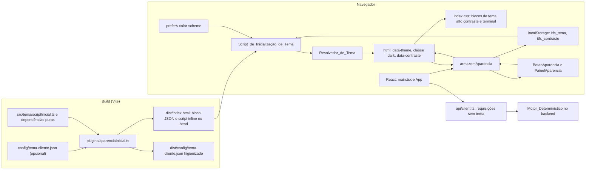
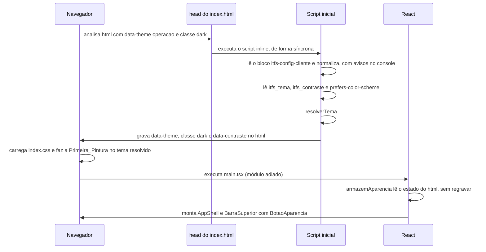

# Design Document: temas selecionáveis

## Overview

Este documento descreve como o IT Career Simulator passa de dois temas fixos para um Sistema_de_Temas com catálogo, resolução de precedência, configuração da empresa cliente, Modo_Alto_Contraste e seletor acessível. A base é a branch `main` no commit 19bbb18. Todos os caminhos de código abaixo são relativos a `src/frontend/`, salvo indicação.

A primeira entrega contém quatro temas (Operação, Corporativo, Editorial e Acolhedor) e o Modo_Alto_Contraste. Telemetria fica fora do Catálogo_de_Temas, mas os testes genéricos já passam a valer para ele quando entrar.

### Situação atual na main

Esta seção descreve a `main` como ela está hoje e, por isso, usa os identificadores `corporate` e `tactical` e a chave `itfs_theme`. No resto do documento, esses nomes só aparecem para descrever o que muda em relação à `main` (decisões, arquivos alterados, testes do exemplo sem compatibilidade e Figma). Todo código, seletor, teste e modo novo usa só os identificadores novos (D10 e D11).

- `src/index.css` declara os tokens de cor em dois blocos: `:root, [data-theme='corporate']` e `[data-theme='tactical'], .dark`. Tipografia, espaço e raio ficam só em `:root`, iguais para os dois temas. O comentário do início do arquivo cita `tactical` e `corporate` com os rótulos antigos.
- `src/shell/tema.ts` guarda o tipo `TemaShell = 'tactical' | 'corporate'`, a chave `itfs_theme`, o padrão `tactical` e os rótulos antigos. `aplicarTema` grava `data-theme` e alterna a classe `dark`.
- `src/main.tsx` aplica o tema num módulo ES, que o navegador executa de forma adiada. `index.html` traz `data-theme="tactical" class="dark"` fixos. Quem salvou `corporate` pode ver a primeira pintura em `tactical`.
- `src/shell/AppShell.tsx` lê e grava o tema num `useEffect`, inclusive na montagem. Isso regrava a escolha sem ação do aluno. O AppShell é montado duas vezes em `src/App.tsx` (Academia e Workstation). `src/shell/contextoShell.ts` expõe `tema: TemaShell` e `definirTema`.
- `src/shell/AlternadorTema.tsx` fica no rodapé do rail e no menu de perfil, com botões `aria-pressed`, as opções `tactical` e `corporate` e os ícones `tema-tatico` (mira) e `tema-corporativo`.
- `src/apps/SimuDeskApp/SimuDeskApp.tsx`, linha 371, força o terminal com `data-theme="tactical"` num elemento aninhado.
- `src/index.css` tem três desvios das regras novas: `[data-theme='tactical'] .step-box strong` (estilo por identificador de tema), `.skip:focus` com `#fff` e `#000`, e `.done .tick` com `#ffffff`. O bloco de aliases declara `--nav-text: #E2E8F0`, sem uso no código.
- `src/tokensContraste.test.ts` localiza os blocos por expressão regular fixa (`corporate` e `tactical`), tem o tipo `Tema = 'corporate' | 'tactical'` e mede o terminal "forçado em tactical dentro do tema corporate". `e2e/contraste.spec.ts` e `e2e/visual.spec.ts` têm `TEMAS = ['tactical', 'corporate']`, gravam a chave `itfs_theme` por `addInitScript`, e a spec de contraste só mede, sem falhar por limiar. `e2e/contraste.helper.ts` e `e2e/contraste.relatorio.mjs` comparam o tema com `corporate` para escolher o limiar do divisor e ordenam o relatório por `['tactical', 'corporate']`.
- `src/App.test.tsx` espera `dataset.theme` igual a `tactical` e `corporate` e lê `itfs_theme`.
- `e2e/home.visual.spec.ts` não existe na `main`. Ele existe na branch `home-vocacional` (commit 2035277) e recebe a mesma parametrização quando chegar à `main`.
- `package.json` não tem `fast-check`. O lint é só `oxlint`. Vite 8.3 usa Rolldown e não traz esbuild.
- Não há Content Security Policy em `vercel.json` nem em `nginx.conf`.

### Regra de nomenclatura

Identificadores de tema, nomes de arquivo, nomes de atributo e símbolos do Sistema_de_Temas (tipos, constantes, funções, classes de CSS, chaves de `localStorage`, nomes de modo no Figma) ficam em português e coerentes com o nome visível do tema. O Identificador_de_Tema é o nome visível em letras minúsculas e sem acento, com hífen no lugar de espaço: Operação vira `operacao`, Corporativo vira `corporativo`, Editorial vira `editorial`, Acolhedor vira `acolhedor` e Telemetria vira `telemetria`. As chaves são `itfs_tema` e `itfs_contraste`, o Atributo_de_Alto_Contraste é `data-contraste` e o atributo do terminal é `data-superficie`.

Ficam fora da regra somente os nomes fixados pelo requirements.md ou pela plataforma: o atributo `data-theme`, a classe `dark`, a propriedade `color-scheme`, a consulta `prefers-color-scheme` e os nomes de API do navegador e das bibliotecas. O teste `src/tema/catalogo.test.ts` confere que todo identificador do catálogo é igual ao nome visível normalizado (minúsculas, sem acento, espaço trocado por hífen).

### Decisões técnicas

O usuário aprovou D1 a D11 no requirements.md e delegou as escolhas abaixo. D10 e D11 tiram do design qualquer camada de compatibilidade: o produto não tem usuários, então não há preferência salva a preservar, e os identificadores `corporate` e `tactical` e a chave `itfs_theme` deixam de existir no código.

| Id | Decisão | Motivo |
|---|---|---|
| DT-01 | Novo diretório `src/tema/` com módulos puros: `catalogo.ts`, `contratoTokens.ts`, `envelopeConfiguracao.ts`, `configuracaoCliente.ts`, `resolvedor.ts`, `persistencia.ts`, `documento.ts`, `inicializacao.ts`, `scriptInicial.ts`, `armazemAparencia.ts`, `useAparencia.ts`, `blocosTokens.ts`. `src/shell/tema.ts` e `src/shell/AlternadorTema.tsx` são removidos. | Separa a lógica pura (testável sem React e sem DOM real) da interface. O mesmo código roda no script inicial e na aplicação, sem cópia. |
| DT-02 | O Contrato_de_Tokens tem 63 nomes: 33 de cor, 4 de sombra, 2 de família, 8 de tamanho, 4 de peso, 9 de espaço e 3 de raio. Os demais tokens de `:root` (altura de linha, medida, foco, alvo de toque, estrutura do shell, camadas, movimento, densidade) viram tokens estruturais, fora do contrato e iguais em todos os temas. | Na `main`, o tema hoje chamado `corporate`, que passa a ser `corporativo`, é a soma de `:root` com o bloco `:root, [data-theme='corporate']`. O Requisito 1.4 limita a variação a cor, família, tamanho, peso, raio, sombra e espaço. Sem incluir tipografia, espaço e raio no contrato, Editorial e Acolhedor não poderiam variar esses valores dentro do próprio bloco. |
| DT-03 | O Script_de_Inicialização_de_Tema é inline no `head`, gerado no build a partir de `src/tema/scriptInicial.ts` por um plugin Vite próprio (`plugins/aparenciaInicial.ts`) que chama a API `build` do Vite em modo biblioteca IIFE. | Script inline e síncrono no `head` roda antes da Primeira_Pintura e não custa requisição. A API `build` do Vite já está instalada, então não entra dependência nova. Sem CSP hoje; o plugin imprime o hash SHA-256 do script para uma CSP futura. |
| DT-04 | A Configuração_do_Cliente sai do arquivo opcional `config/tema-cliente.json` do projeto frontend. O plugin lê o arquivo no build, embute um envelope higienizado num bloco `<script type="application/json" id="itfs-config-cliente">` e publica a mesma versão higienizada em `/config/tema-cliente.json`, na mesma origem. | É a única opção simples que cumpre o Requisito 4.3 e o 4.8 ao mesmo tempo. Leitura assíncrona faz o tema trocar depois da pintura. XHR síncrono está obsoleto e gera aviso no console. Um arquivo JavaScript descumpre o formato JSON do Requisito 5.10. Quem publica a implantação altera o arquivo e refaz o build, o que Vercel e o Dockerfile já fazem a cada publicação. |
| DT-05 | Atributo_de_Alto_Contraste: `data-contraste="alto"` no elemento `html`, ausente quando o modo está desligado. Chave: `itfs_contraste` (D11), com os valores `alto` (ativo) e `padrao` (inativo). | Segue a Regra de nomenclatura: nome do atributo, chave e valores em português, coerentes com o nome visível "Alto contraste". `data-theme` continua em inglês porque o requirements.md o fixa. |
| DT-06 | O terminal do SimuDesk passa a usar `data-superficie="terminal"`. O seletor do bloco `operacao` inclui `[data-superficie='terminal']`, e o seletor do Conjunto_de_Alto_Contraste escuro inclui `html[data-contraste='alto'] [data-superficie='terminal']`. | Só o `html` carrega `data-theme`, o que simplifica o Requisito 2.1 e a Spec_de_Contraste. A regra do terminal fica dentro do Sistema_de_Temas, e nenhum componente escolhe estilo por identificador de tema. |
| DT-07 | Editorial e Acolhedor usam Inter e JetBrains Mono. A leveza do Editorial vem de `--font-weight-semibold: 500` e `--font-weight-bold: 600`, com títulos maiores e mais espaço. | Zero arquivo de fonte novo. Os pesos 400 a 700 já são carregados em `main.tsx`. O peso 300 exigiria arquivo novo e afina o traço em texto claro sobre fundo escuro, o que piora a leitura em 12 a 14 px. Os Requisitos 9.4 a 9.8 não se aplicam porque nenhum tema usa família nova. |
| DT-08 | Seletor_de_Tema com controles nativos: `fieldset` com `legend` e `input type="radio"`. Controle do Modo_Alto_Contraste: `input type="checkbox" role="switch"`. Botão_de_Aparência: `button` com `aria-expanded` e `aria-controls`. | Cumpre D9 sem biblioteca. O grupo nativo de rádios já implementa o teclado do padrão radiogroup da APG: Tab vai à opção marcada, setas movem e marcam com retorno circular, Espaço marca a opção focada, e cada marcação dispara `change`. |
| DT-09 | O estado de aparência sai do `ContextoShell` e vai para um armazém de módulo (`armazemAparencia.ts`) lido por `useSyncExternalStore`. | O AppShell é montado duas vezes em `App.tsx`. Com estado no módulo, trocar entre Academia e Workstation não relê nem regrava o tema, como exige o Requisito 2.6 e o 4.8. |
| DT-10 | Todo valor de cor em bloco de token passa a ser hexadecimal de 6 ou 8 dígitos, inclusive dentro das sombras. `rgba()` é convertido. | O Requisito 1.3 exige notação hexadecimal. O canal alfa muda no máximo 0,002, dentro da tolerância de 0,01 do Requisito 12.2. |
| DT-11 | `fast-check` entra como dependência de desenvolvimento. | O resolvedor, a normalização da configuração, a persistência e o analisador de blocos têm espaço de entrada grande. fast-check gera e reduz contraexemplos, e não vai para o bundle. O DESIGN.md exige justificativa para dependência nova, registrada aqui. |
| DT-12 | O Seletor_de_Tema mostra as opções na ordem do Catálogo_de_Temas, filtrada pelos temas permitidos. | A ordem fica igual para todo cliente, para o Figma e para a regra de esquema do Requisito 3.5. A ordem informada pelo cliente continua valendo para escolher o substituto do Requisito 5.4 e 5.9. |
| DT-13 | `prefers-color-scheme` é lido uma vez, no carregamento. Mudança do sistema operacional durante a sessão não troca o tema. | Evita troca de tema sem ação do aluno no meio de um chamado. O Requisito 2.6 só pede troca quando o Resolvedor_de_Tema determina outro tema. |
| DT-14 | A varredura de cores roda em `scripts/check-regras-estilo.ts`, chamada pelo script `postlint` do `package.json`. O script roda com a remoção de tipos nativa do Node (22.18 ou mais novo). | `npm run lint` executa `postlint` em seguida e falha se ele falhar. O CI usa Node 22 atual, o Dockerfile usa `node:22-alpine` e a máquina local tem Node 24.19. |
| DT-15 | A Spec_de_Contraste passa a falhar por limiar. Temas com Modo_Alto_Contraste desligado rodam nas quatro larguras. Com o modo ligado, rodam em 375 e 1440 px. | O Requisito 8.4 exige falha. Medir alto contraste em duas larguras cobre todas as telas sem quadruplicar o tempo da suíte. |
| DT-16 | Os projetos visuais do Playwright passam a ter altura de 900 px. Entra o projeto `zoom-200`, com janela de 640 por 450 px CSS e fator de etapa 2, que equivale a 1280 px com zoom de 200 por cento. | Requisitos 8.6 e 8.7. |
| DT-17 | Fora do Modo_Alto_Contraste, os pares de componente medidos contra 3 para 1 são `--border-control`, `--focus-ring` e `--accent-primary`. As cores base de status (`--status-success`, `--status-warning`, `--status-danger`) ficam fora desse limite. Com o modo ligado, elas entram, com mínimo de 4,5 para 1. | Fora do alto contraste, todo indicador de status vem com texto ou ícone (Requisito 8.8), então a cor não carrega a informação sozinha. O `corporativo`, com os valores do tema hoje chamado `corporate`, tem `--status-warning` com 2,91 para 1 sobre `--bg-elevated`. O Requisito 7.5 cita ícones de status de forma explícita só para o alto contraste. |
| DT-18 | O bloco `[data-theme='tactical'], .dark` da `main` vira `[data-theme='operacao']`, sem `.dark`, e o bloco `:root, [data-theme='corporate']` vira `[data-theme='corporativo']`, sem `:root`. A propriedade `color-scheme` sai dos blocos de tema e vai para regras próprias (`html.dark` e `html:not(.dark)`). | Com `.dark` no seletor, Editorial (escuro) herdaria tokens do `operacao` por empate de especificidade. Sem `color-scheme` dentro do bloco, cada bloco declara só nomes do contrato (Requisito 1.4). Sem JavaScript, o `index.html` fica com `data-theme="operacao" class="dark"`, o Tema_Padrão_do_Produto (D1). |
| DT-19 | `scripts/check-bundle-secrets.mjs` passa a varrer todo o `dist/`, inclusive `index.html` e `config/`. | O envelope da configuração fica no `index.html`, fora de `dist/assets/` (Requisitos 5.6 e 13.8). |
| DT-20 | Os ícones novos entram em `src/ui/catalogoIcones.ts`: `aparencia` (Palette), `alto-contraste` (Contrast) e `trava` (Lock). Saem `tema-tatico` (Crosshair) e `tema-corporativo` (Briefcase), sem uso depois da remoção do AlternadorTema. | A mira tem leitura militar, contrária ao tom do produto. Os três ícones existem no `lucide-react` instalado (conferido). |
| DT-21 | Troca direta dos identificadores, sem compatibilidade: nenhum módulo lê `itfs_theme`, nenhum código reconhece `corporate` ou `tactical` e não há migração de valores salvos. Um valor antigo em `itfs_tema` é só um texto fora do catálogo. | D10 e D11. O produto não tem usuários. Código de migração ficaria sem uso e exigiria teste próprio. O Requisito 4.6 já cobre qualquer valor desconhecido. |

### Interpretação registrada do Requisito 5.10

O arquivo `config/tema-cliente.json` é a única fonte da Configuração_do_Cliente. Ele chega ao navegador pela mesma origem de duas formas geradas no mesmo build: embutido no `index.html`, que é a forma lida pelo Script_de_Inicialização_de_Tema, e publicado em `/config/tema-cliente.json`, que serve para conferência. Trocar o arquivo publicado no servidor sem refazer o build não muda o tema. O procedimento de publicação deve registrar isso.

## Architecture

### Visão de componentes



O fluxo de aparência termina no elemento `html` e no `localStorage`. Nenhuma seta do Sistema_de_Temas chega ao cliente de API. Essa ausência é verificada por teste (Requisito 11).

### Sequência de carregamento



### Camadas e responsabilidades

| Camada | Arquivos | Responsabilidade | Depende de |
|---|---|---|---|
| Dados do catálogo | `src/tema/catalogo.ts`, `src/tema/contratoTokens.ts` | Temas, esquema, padrão do produto, lista de tokens | nada |
| Configuração | `src/tema/envelopeConfiguracao.ts` (build), `src/tema/configuracaoCliente.ts` (navegador) | Higienizar no build, validar e normalizar no navegador | catálogo |
| Decisão | `src/tema/resolvedor.ts` | Função pura de precedência | catálogo |
| Persistência | `src/tema/persistencia.ts` | Ler e gravar `itfs_tema` e `itfs_contraste` com tolerância a falha | catálogo |
| Documento | `src/tema/documento.ts` | Gravar atributos no `html` | catálogo |
| Orquestração | `src/tema/inicializacao.ts`, `src/tema/scriptInicial.ts`, `src/tema/armazemAparencia.ts`, `src/tema/useAparencia.ts` | Carregamento, estado em sessão, ações do aluno | camadas acima |
| Interface | `src/shell/BotaoAparencia.tsx`, `src/shell/PainelAparencia.tsx`, `src/educacao/BarraSuperior.tsx` | Botão, painel, anúncio | orquestração, `ui/Icone.tsx` |
| Estilo | `src/index.css` | Blocos de token, alto contraste, terminal, classes do painel | atributos do `html` |
| Build e regras | `plugins/aparenciaInicial.ts`, `vite.config.ts`, `scripts/check-regras-estilo.ts`, `scripts/check-bundle-secrets.mjs`, `src/tema/blocosTokens.ts` | Script inicial, envelope, varreduras | módulos puros |

Os módulos de `src/tema/` usados pelo plugin e pelos scripts de Node (`catalogo.ts`, `envelopeConfiguracao.ts`, `blocosTokens.ts`) não usam tipos de DOM e importam só uns aos outros com extensão `.ts`, para rodar também com a remoção de tipos do Node. `tsconfig.node.json` passa a incluir `plugins/**/*.ts` e `scripts/**/*.ts`.

## Components and Interfaces

### Catálogo de temas (`src/tema/catalogo.ts`)

```ts
export type EsquemaCor = 'claro' | 'escuro'

export interface Tema {
  readonly id: string
  readonly nome: string
  readonly esquema: EsquemaCor
}

export const CATALOGO_TEMAS = [
  { id: 'operacao', nome: 'Operação', esquema: 'escuro' },
  { id: 'corporativo', nome: 'Corporativo', esquema: 'claro' },
  { id: 'editorial', nome: 'Editorial', esquema: 'escuro' },
  { id: 'acolhedor', nome: 'Acolhedor', esquema: 'claro' },
] as const satisfies readonly Tema[]

export type IdTema = (typeof CATALOGO_TEMAS)[number]['id']

export const TEMA_PADRAO_PRODUTO: IdTema = 'operacao'
export const TEMA_DO_TERMINAL: IdTema = 'operacao'

export function ehIdTema(valor: unknown): valor is IdTema
export function obterTema(id: IdTema): Tema

export type CampoCatalogo = 'id' | 'nome' | 'esquema'
export interface ErroCatalogo {
  readonly indice: number
  readonly id: string | null
  readonly campo: CampoCatalogo
  readonly motivo: 'ausente' | 'repetido' | 'formato'
}
/** Regras do Requisito 1.1. Lista vazia de erros significa catálogo válido. */
export function validarCatalogo(lista: readonly unknown[]): ErroCatalogo[]
```

Regras de `validarCatalogo`:

- `id`: texto que casa com `^[a-z][a-z0-9-]{2,31}$` e não se repete.
- `nome`: texto com 1 a 40 caracteres, sem o caractere U+0026 (E comercial).
- `esquema`: `claro` ou `escuro`.
- Cada campo ausente, repetido ou fora do formato gera um `ErroCatalogo` com o índice e o identificador (quando legível).

`ehIdTema` compara com `===` contra os identificadores do catálogo. Não há normalização de maiúsculas nem de espaços (Requisito 4.6).

### Contrato de tokens (`src/tema/contratoTokens.ts`)

```ts
export type CategoriaToken = 'cor' | 'sombra' | 'familia' | 'tamanho' | 'peso' | 'espaco' | 'raio'

export interface TokenDoContrato {
  readonly nome: `--${string}`
  readonly categoria: CategoriaToken
}

export const CONTRATO_TOKENS: readonly TokenDoContrato[]
export const NOMES_DO_CONTRATO: ReadonlySet<string>
export const TOKENS_DE_COR: readonly string[]
export const TOKENS_ESTRUTURAIS: readonly string[]

/** Pares medidos pelo Teste_de_Tokens. */
export const FUNDOS_DE_TEXTO: readonly string[]       // bg-surface, bg-canvas, bg-elevated, bg-hover, accent-surface
export const TEXTOS: readonly string[]                // text-primary, text-secondary, text-muted, accent-text
export const COMPONENTES: readonly string[]           // border-control, focus-ring, accent-primary
export const ICONES_DE_STATUS: readonly string[]      // status-success, status-warning, status-danger
export const FUNDOS_DE_COMPONENTE: readonly string[]  // bg-surface, bg-canvas, bg-elevated
```

A lista completa e a categoria de cada nome estão em Data Models.

### Envelope e normalização da configuração

Lado do build (`src/tema/envelopeConfiguracao.ts`, sem DOM):

```ts
export const CAMPOS_DA_CONFIGURACAO = ['temasPermitidos', 'temaPadrao', 'travado'] as const
export type CampoConfiguracao = (typeof CAMPOS_DA_CONFIGURACAO)[number]

export interface ConfiguracaoTipada {
  readonly temasPermitidos?: readonly string[]
  readonly temaPadrao?: string
  readonly travado?: boolean
}

export type ErroEnvelope =
  | { readonly tipo: 'leitura' }
  | { readonly tipo: 'campo'; readonly campo: CampoConfiguracao }

export interface EnvelopeConfiguracao {
  readonly versao: 1
  readonly configuracao: ConfiguracaoTipada | null
  readonly camposIgnorados: readonly string[]
  readonly erro: ErroEnvelope | null
}

/** Recebe o texto do arquivo. Nunca lança exceção. */
export function criarEnvelope(texto: string): EnvelopeConfiguracao
/** JSON.stringify com a troca de cada sinal de menor por \u003c, para embutir em script. */
export function serializarParaHtml(valor: unknown): string
```

Regras de `criarEnvelope`:

1. Texto que não é JSON, ou JSON cujo valor raiz não é objeto simples: `configuracao: null`, `erro: { tipo: 'leitura' }`.
2. Campo conhecido com tipo errado (`temasPermitidos` que não é lista de textos, `temaPadrao` que não é texto, `travado` que não é booleano): `configuracao: null`, `erro: { tipo: 'campo', campo }`. O primeiro campo inválido, na ordem de `CAMPOS_DA_CONFIGURACAO`, é o informado.
3. Campos desconhecidos: só o nome vai para `camposIgnorados`, em ordem alfabética. O valor nunca entra no envelope.
4. Campos conhecidos válidos entram como vieram, sem validação contra o catálogo. A validação semântica fica no navegador, para que os avisos apareçam no console do navegador (Requisitos 5.3 a 5.8).

Lado do navegador (`src/tema/configuracaoCliente.ts`):

```ts
export type Registrar = (mensagem: string) => void

export interface ConfiguracaoNormalizada {
  /** Não vazia. Ordem informada pelo cliente, sem repetição, só com temas do catálogo. */
  readonly temasPermitidos: readonly IdTema[]
  /** Sempre contido em temasPermitidos quando não nulo. */
  readonly temaPadrao: IdTema | null
  readonly travado: boolean
}

export const CONFIGURACAO_AUSENTE: ConfiguracaoNormalizada

export const ID_BLOCO_CONFIGURACAO = 'itfs-config-cliente'
/** Lê o bloco JSON do head. Retorna null se o bloco não existe. */
export function lerEnvelopeDoDocumento(documento: Document): EnvelopeConfiguracao | 'ilegivel' | null

export function normalizarConfiguracao(
  envelope: EnvelopeConfiguracao | 'ilegivel' | null,
  registrar: Registrar,
): ConfiguracaoNormalizada
```

Passos de `normalizarConfiguracao`, na ordem:

1. `null` (bloco ausente): retorna `CONFIGURACAO_AUSENTE` sem aviso (Requisitos 5.2 e 5.11).
2. `'ilegivel'` ou `erro.tipo === 'leitura'`: aviso de leitura e `CONFIGURACAO_AUSENTE` (5.7).
3. Um aviso por nome em `camposIgnorados`, só com o nome (5.8).
4. `erro.tipo === 'campo'`, ou campo conhecido com tipo errado (defesa contra HTML alterado): aviso com o campo e `CONFIGURACAO_AUSENTE` (5.7).
5. `temasPermitidos` ausente é tratado como lista vazia. Cada ocorrência fora do catálogo ou repetida é descartada, com um aviso por ocorrência. A primeira ocorrência de cada identificador fica, e a ordem informada é preservada (5.3).
6. Lista vazia depois do passo 5: aviso de lista vazia, `temasPermitidos` recebe o catálogo inteiro na ordem do catálogo e `travado` fica falso (5.5 e 3.9).
7. `travado` ausente vale falso.
8. `temaPadrao` informado e fora da lista resultante: aviso com o identificador substituído e o primeiro tema da lista resultante vira padrão (5.4).
9. `travado` verdadeiro sem `temaPadrao`: o primeiro tema da lista resultante vira padrão (5.9).

Mensagens no console, todas por `console.warn` e com o prefixo `[Aparência]`:

| Situação | Mensagem |
|---|---|
| Leitura impossível | `[Aparência] Configuração do cliente ilegível; todos os temas do catálogo ficam permitidos.` |
| Tipo inválido | `[Aparência] Configuração do cliente ignorada: o campo "<campo>" tem tipo inválido.` |
| Campo desconhecido | `[Aparência] Campo ignorado na configuração do cliente: "<nome>".` |
| Tema fora do catálogo | `[Aparência] Tema "<id>" descartado dos temas permitidos: não existe no catálogo.` |
| Tema repetido | `[Aparência] Tema "<id>" descartado dos temas permitidos: repetido.` |
| Lista vazia | `[Aparência] Nenhum tema permitido válido; todos os temas do catálogo ficam permitidos.` |
| Padrão substituído | `[Aparência] Tema padrão "<id>" fora dos temas permitidos; substituído por "<id>".` |

Os identificadores inválidos vêm do arquivo do cliente e são só apresentação. Ao montar a mensagem, o texto é cortado em 32 caracteres para não poluir o console.

### Resolvedor de tema (`src/tema/resolvedor.ts`)

```ts
export type EsquemaNavegador = 'light' | 'dark' | 'no-preference' | null

export interface EntradasResolvedor {
  readonly configuracao: ConfiguracaoNormalizada | null
  readonly preferencia: string | null
  readonly esquemaNavegador: EsquemaNavegador
}

export interface PermissoesEfetivas {
  readonly permitidos: readonly IdTema[]
  readonly travado: boolean
  readonly padrao: IdTema | null
}

export function permissoesEfetivas(configuracao: ConfiguracaoNormalizada | null): PermissoesEfetivas
export function resolverTema(entradas: EntradasResolvedor): IdTema
```

`permissoesEfetivas` é defensiva. Ela não confia que a configuração recebida já foi normalizada: filtra a lista pelo catálogo, remove repetidos, volta ao catálogo inteiro com trava inativa se a lista ficar vazia (3.9) e anula o padrão que não está na lista (3.8).

```ts
export function resolverTema({ configuracao, preferencia, esquemaNavegador }: EntradasResolvedor): IdTema {
  const { permitidos, travado, padrao } = permissoesEfetivas(configuracao)
  const naOrdemDoCatalogo = CATALOGO_TEMAS.filter((tema) => permitidos.includes(tema.id))
  const preferenciaValida = preferencia !== null ? permitidos.find((id) => id === preferencia) ?? null : null
  if (travado) {
    if (padrao !== null) return padrao                       // 3.2
  } else {
    if (preferenciaValida !== null) return preferenciaValida // 3.3 e 3.7
    if (padrao !== null) return padrao                       // 3.4
  }
  if (esquemaNavegador === 'light' || esquemaNavegador === 'dark') {
    const esquema: EsquemaCor = esquemaNavegador === 'dark' ? 'escuro' : 'claro'
    const porEsquema = naOrdemDoCatalogo.find((tema) => tema.esquema === esquema)
    if (porEsquema !== undefined) return porEsquema.id       // 3.5
  }
  if (permitidos.includes(TEMA_PADRAO_PRODUTO)) return TEMA_PADRAO_PRODUTO // 3.6
  return naOrdemDoCatalogo[0].id                              // 3.6
}
```

O Modo_Alto_Contraste não é parâmetro. Isso garante o Requisito 3.1 pela assinatura. O resolvedor não lê relógio, armazenamento nem DOM (3.11).

Camadas e o Requisito 3.8: depois da normalização do Requisito 5, um padrão inválido já foi substituído (5.4) ou preenchido (5.9). O ramo "trava ativa sem padrão válido" do Requisito 3.8 só acontece quando o resolvedor recebe configuração não normalizada. A função cobre esse ramo mesmo assim, e o teste de propriedade o exercita.

### Persistência (`src/tema/persistencia.ts`)

```ts
export const CHAVE_TEMA = 'itfs_tema'
export const CHAVE_CONTRASTE = 'itfs_contraste'
export type EstadoContraste = 'alto' | 'padrao'

export interface ArmazenamentoChaveValor {
  getItem(chave: string): string | null
  setItem(chave: string, valor: string): void
}

/** Retorna null quando window.localStorage não existe ou o acesso lança exceção. */
export function obterArmazenamento(janela: Window): ArmazenamentoChaveValor | null
/** Valor exatamente igual a um IdTema, ou null. Exceção de leitura vira null. */
export function lerPreferenciaTema(armazenamento: ArmazenamentoChaveValor | null): IdTema | null
/** true quando gravou. Exceção de gravação vira false, sem propagar. */
export function salvarPreferenciaTema(id: IdTema, armazenamento: ArmazenamentoChaveValor | null): boolean
/** 'alto' só quando o valor salvo é exatamente 'alto'. Qualquer outro caso: 'padrao'. */
export function lerContraste(armazenamento: ArmazenamentoChaveValor | null): EstadoContraste
export function salvarContraste(estado: EstadoContraste, armazenamento: ArmazenamentoChaveValor | null): boolean
```

A leitura nunca grava. Um valor salvo inválido continua salvo como estava (Requisito 3.7). O módulo lê e grava somente `itfs_tema` e `itfs_contraste`. Não existe leitura de outra chave, não existe tabela de identificadores antigos e não existe migração (D10, D11 e DT-21). Qualquer texto em `itfs_tema` que não seja exatamente um identificador do catálogo é Preferência_do_Aluno ausente (4.6).

### Documento (`src/tema/documento.ts`)

```ts
export const ATRIBUTO_CONTRASTE = 'data-contraste'
export const VALOR_CONTRASTE_ALTO = 'alto'
export const CLASSE_ESCURO = 'dark'

/** Grava data-theme, a classe dark e data-contraste. Identificador inválido vira TEMA_PADRAO_PRODUTO. */
export function aplicarAparencia(raiz: HTMLElement, tema: string, contraste: EstadoContraste): IdTema
/** Lê o estado que o script inicial deixou no html. */
export function lerAparenciaDoDocumento(raiz: HTMLElement): { tema: IdTema | null; contraste: EstadoContraste }
```

`aplicarAparencia` usa `raiz.dataset.theme`, `raiz.classList.toggle(CLASSE_ESCURO, escuro)` e `setAttribute` ou `removeAttribute`. Não grava estilo inline. O `color-scheme` vem do CSS (`html.dark` e `html:not(.dark)`), então o valor calculado segue a classe (Requisitos 2.2, 2.3 e 13.3).

### Inicialização (`src/tema/inicializacao.ts` e `src/tema/scriptInicial.ts`)

```ts
export interface AmbienteAparencia {
  readonly documento: Document
  readonly armazenamento: ArmazenamentoChaveValor | null
  readonly consultarEsquema: () => EsquemaNavegador
  readonly registrar: Registrar
}

export interface EstadoAparencia {
  readonly tema: IdTema
  readonly contraste: EstadoContraste
  readonly configuracao: ConfiguracaoNormalizada
}

/** Só lê e calcula. Não grava nada. */
export function calcularAparencia(ambiente: AmbienteAparencia): EstadoAparencia
/** Calcula e aplica no html. Qualquer exceção mantém os atributos estáticos do index.html. */
export function inicializarAparencia(ambiente: AmbienteAparencia): EstadoAparencia | null
export function criarAmbienteDoNavegador(janela: Window, registrar: Registrar): AmbienteAparencia
```

`scriptInicial.ts` é a entrada do bundle IIFE e tem uma linha útil:

```ts
inicializarAparencia(criarAmbienteDoNavegador(window, (mensagem) => console.warn(mensagem)))
```

`consultarEsquema` usa `matchMedia('(prefers-color-scheme: dark)')` e `matchMedia('(prefers-color-scheme: light)')`. Sem `matchMedia`, retorna `null`. `inicializarAparencia` envolve tudo em `try` e `catch`. Em caso de exceção, retorna `null` e o documento segue com `data-theme="operacao" class="dark"` do `index.html` (Requisito 4.7).

### Armazém de aparência (`src/tema/armazemAparencia.ts` e `src/tema/useAparencia.ts`)

```ts
export type ModoSeletor = 'livre' | 'travado' | 'unico'

export interface InstantaneoAparencia {
  readonly tema: IdTema
  readonly contraste: EstadoContraste
  /** Temas permitidos, na ordem do catálogo (DT-12). */
  readonly temasOferecidos: readonly Tema[]
  readonly modoSeletor: ModoSeletor
}

export interface ArmazemAparencia {
  obter(): InstantaneoAparencia
  assinar(ouvinte: () => void): () => void
  /** Retorna false e não muda nada quando a trava está ativa ou o tema não é permitido. */
  escolherTema(id: IdTema): boolean
  definirContraste(ativo: boolean): void
}

export function criarArmazemAparencia(ambiente: AmbienteAparencia): ArmazemAparencia
/** Instância única da aplicação, criada sob demanda com o ambiente do navegador e registro silencioso. */
export function obterArmazemAparencia(): ArmazemAparencia

// useAparencia.ts
export interface ResultadoUseAparencia extends InstantaneoAparencia, Pick<ArmazemAparencia, 'escolherTema' | 'definirContraste'> {}
export function useAparencia(): ResultadoUseAparencia
```

Comportamento:

- Criação: calcula a configuração com registro silencioso (os avisos já saíram no script inicial). Lê o `html`. Se `data-theme` tem um tema permitido, adota esse tema e o estado de `data-contraste` sem gravar nada (Requisito 4.8). Caso contrário, por exemplo em teste com jsdom sem script inicial, calcula com `calcularAparencia` e aplica.
- `modoSeletor`: `travado` quando a configuração efetiva está travada; senão `unico` quando há um só tema permitido; senão `livre`.
- `escolherTema`: grava no `html` com `aplicarAparencia`, de forma síncrona, depois tenta `salvarPreferenciaTema`, depois notifica os ouvintes. Falha de gravação não muda o tema aplicado (4.5). Não chama rede e não toca no estado da sessão (2.5).
- `definirContraste`: mesmo padrão com `salvarContraste`. Não muda `tema` nem `itfs_tema` (7.3, 7.4 e 7.8).
- `obter` devolve o mesmo objeto até a próxima mudança, como exige `useSyncExternalStore`.

`ContextoShell` perde `tema` e `definirTema`. `AppShell` deixa de importar `tema.ts` e não tem mais `useEffect` de tema.

### Botão e painel de aparência

```tsx
// src/shell/BotaoAparencia.tsx
export function BotaoAparencia(): JSX.Element

// src/shell/PainelAparencia.tsx
export interface PainelAparenciaProps {
  readonly id: string
  readonly aoAnunciar: (texto: string) => void
}
export function PainelAparencia(props: PainelAparenciaProps): JSX.Element
```

Posição: `BarraSuperior` renderiza `BotaoAparencia` em `.barra-contexto-acoes`, entre `slotDireitoSessao` e `MenuPerfil`. O `AlternadorTema` sai do rodapé do rail e do menu de perfil. O rodapé vazio do rail é removido. `TelaInicial` e a Workstation usam `BarraSuperior`, então o botão aparece nas duas. Se a home vocacional da branch `home-vocacional` chegar à `main` sem `BarraSuperior`, ela precisa do mesmo botão.

Estrutura (estado livre):

```html
<div class="aparencia">
  <button type="button" class="botao-contexto" aria-expanded="true" aria-controls="ID">
    <svg class="icone" aria-hidden="true"><!-- aparencia, 20 px --></svg>
    <span class="botao-contexto-texto">Aparência</span>
    <svg class="icone" aria-hidden="true"><!-- expandir, 16 px --></svg>
  </button>
  <p class="sr-only" role="status" aria-live="polite">Tema ativo: Editorial</p>
  <div id="ID" class="painel-aparencia" role="region" aria-label="Aparência">
    <fieldset class="seletor-tema">
      <legend class="seletor-tema-titulo">Tema</legend>
      <label class="opcao-tema">
        <input type="radio" name="itfs-tema" value="operacao" />
        <span class="opcao-tema-nome">Operação</span>
        <span class="opcao-tema-esquema">Escuro</span>
      </label>
      <label class="opcao-tema">
        <input type="radio" name="itfs-tema" value="editorial" checked />
        <span class="opcao-tema-nome">Editorial</span>
        <span class="opcao-tema-esquema">Escuro</span>
        <svg class="icone" aria-hidden="true"><!-- confirmar, 16 px, só na opção ativa --></svg>
      </label>
    </fieldset>
    <label class="controle-contraste">
      <input type="checkbox" role="switch" />
      <svg class="icone" aria-hidden="true"><!-- alto-contraste, 16 px --></svg>
      <span>Alto contraste</span>
    </label>
  </div>
</div>
```

Estados do painel:

| Modo | Conteúdo do painel |
|---|---|
| `livre` | `fieldset` com uma opção por tema oferecido, mais o controle de alto contraste |
| `travado` | `div.tema-definido` com ícone `trava` (16 px) e dois textos: "Tema: Corporativo" e "Definido pela empresa cliente". Nenhum `input type="radio"`. Controle de alto contraste |
| `unico` | `p.tema-definido` com "Tema: Acolhedor". Nenhum `input type="radio"`. Controle de alto contraste |

Com trava ativa e um único tema, vale o modo `travado`, que também informa a origem da escolha.

Interação:

- O botão alterna o painel por clique, toque, Enter ou Espaço, que são o comportamento nativo de `button` (Requisito 6.12).
- `change` num rádio chama `escolherTema` e depois `aoAnunciar('Tema ativo: ' + nome)`. A região `role="status"` fica fora do painel, sempre montada, e recebe o texto uma vez por troca. O foco não se move (6.7).
- `change` no interruptor chama `definirContraste(checked)`. O leitor de tela anuncia ligado ou desligado pelo papel `switch` (6.6 e 7.1).
- Escape com o painel aberto fecha e devolve o foco ao botão. `focusout` no contêiner `.aparencia` com `relatedTarget` fora do contêiner fecha sem mover o foco. `pointerdown` fora do contêiner também fecha, como no `MenuPerfil` (6.10).
- O painel mantém o tema ativo ao fechar, porque a troca acontece no `change`, não no fechamento.

CSS do painel, em `src/index.css`, só com classes e tokens:

- `.aparencia { position: relative; }`.
- `.painel-aparencia`: mesmo posicionamento de `.menu-perfil-painel`, com `width: min(320px, calc(100vw - 2 * var(--space-4)))`. Em 375 px a largura útil é 343 px.
- `.seletor-tema`: `fieldset` sem borda e sem margem, `display: flex`, `flex-direction: column`, `gap: var(--space-2)`.
- `.opcao-tema`: `display: grid`, `grid-template-columns: auto minmax(0, 1fr) auto auto`, `gap: var(--space-2)`, `min-height: var(--touch-target)`, `padding: 0 var(--space-3)`, borda `1px solid var(--border-control)`, `border-radius: var(--radius-md)`. Nome e esquema podem quebrar linha, sem `text-overflow` (6.1).
- `.opcao-tema:has(input:checked)`: fundo `var(--accent-surface)`, borda `var(--accent-primary)`.
- `.opcao-tema input`, `.controle-contraste input`: anulam `min-height`, `padding` e `border` herdados da regra global de `input`, e usam `accent-color: var(--accent-primary)`. O anel de foco vem da regra global `input:focus-visible`, com `--focus-ring`, 2 px e afastamento de 2 px (6.4).
- `.controle-contraste`: `display: flex`, `gap: var(--space-2)`, `min-height: var(--touch-target)`.
- Os textos usam `--font-size-sm` ou maior, e nenhum fica abaixo de 12 px (6.11 e 9.1).

### Plugin de build (`plugins/aparenciaInicial.ts`)

```ts
import type { HtmlTagDescriptor, Plugin } from 'vite'

export interface OpcoesAparenciaInicial {
  /** Padrão: 'config/tema-cliente.json', relativo à raiz do projeto frontend. */
  readonly arquivoConfiguracao?: string
  /** Padrão: 'src/tema/scriptInicial.ts'. */
  readonly entradaScript?: string
}

export function aparenciaInicial(opcoes?: OpcoesAparenciaInicial): Plugin
/** Pura. Monta o bloco JSON (quando há envelope) e o script, nesta ordem, para 'head-prepend'. */
export function montarTagsAparencia(codigoScript: string, envelope: EnvelopeConfiguracao | null): HtmlTagDescriptor[]
```

Ganchos:

- `configResolved`: guarda a raiz e o modo.
- `transformIndexHtml`: lê o arquivo de configuração. Ausente: sem bloco JSON. Presente: `criarEnvelope(texto)`. Gera o código do script com `build()` do Vite (`configFile: false`, `logLevel: 'silent'`, `build.write: false`, `build.minify: true`, `build.target: 'es2019'`, `build.lib` com `formats: ['iife']`). Devolve as tags de `montarTagsAparencia` com `injectTo: 'head-prepend'`. O conteúdo do bloco usa `serializarParaHtml`.
- `generateBundle`: com arquivo presente e envelope sem erro, emite `config/tema-cliente.json` só com os três campos. Com erro, não emite e registra aviso no log do build.
- `configureServer`: observa o arquivo de configuração e `src/tema/`, recarrega a página quando mudam e serve `/config/tema-cliente.json` higienizado em desenvolvimento.
- No fim do build, imprime `Aparência: script inicial com N bytes, hash sha256-<base64>` para uso numa CSP futura.

`vite.config.ts` passa a ter `plugins: [react(), aparenciaInicial()]`. `vitest.config.ts` não carrega o plugin, então os testes unitários continuam sem build aninhado.

### Varreduras e testes de estrutura

```ts
// src/tema/blocosTokens.ts (sem DOM, sem dependências)
export interface BlocoCss { readonly seletores: readonly string[]; readonly corpo: string; readonly linhaInicial: number }
export interface Declaracao { readonly nome: string; readonly valor: string; readonly linha: number }
/** Blocos de nível superior, ignorando comentários. Regras dentro de @media e @supports vêm com o seletor original. */
export function lerBlocos(css: string): BlocoCss[]
export function lerDeclaracoes(bloco: BlocoCss): Declaracao[]
export function serializarBloco(seletores: readonly string[], tokens: Readonly<Record<string, string>>): string

export type TipoBloco =
  | { readonly tipo: 'tema'; readonly id: string }
  | { readonly tipo: 'alto-contraste'; readonly esquema: EsquemaCor }
  | { readonly tipo: 'outro' }
export function classificarBloco(bloco: BlocoCss): TipoBloco
export function blocosDeToken(css: string): Map<string, Record<string, string>>  // chave: id do tema, 'alto-contraste-claro' ou 'alto-contraste-escuro'

// src/tema/regrasEstilo.ts (sem DOM, importa só blocosTokens.ts)
export interface Ocorrencia { readonly arquivo: string; readonly linha: number; readonly trecho: string }
export function hexForaDeBlocos(arquivo: string, texto: string): Ocorrencia[]
export function seletoresComTemaForaDeBloco(css: string): Ocorrencia[]
```

`classificarBloco` reconhece:

- tema: o primeiro seletor é exatamente `[data-theme='<id>']`;
- alto contraste claro: `html[data-contraste='alto']:not(.dark)`;
- alto contraste escuro: o primeiro seletor é `html[data-contraste='alto'].dark`.

`hexForaDeBlocos` aplica `#[0-9a-fA-F]{3,8}\b`, aceita só comprimentos 3, 4, 6 e 8, ignora comentários e, em `src/index.css`, ignora o interior dos blocos de tema e de alto contraste. `seletoresComTemaForaDeBloco` acusa qualquer `[data-theme` que não seja o primeiro seletor de um bloco de tema (Requisitos 1.4 e 10.4).

`scripts/check-regras-estilo.ts` percorre `src/**/*.{ts,tsx,css}` sem `*.test.ts` e `*.test.tsx`, chama as duas funções e termina com código 1 listando `arquivo:linha: trecho` de cada ocorrência (Requisito 1.7). `package.json` ganha `"postlint": "node scripts/check-regras-estilo.ts"`.

### Mudanças em arquivos existentes

A lista abaixo cobre todo arquivo da `main` que usa `data-theme`, `corporate`, `tactical` ou `itfs_theme`, conferido com `git grep -n -E "corporate|tactical|itfs_theme" main -- src` e `git grep -n -E "data-theme|dataset\.theme|shell/tema" main -- src`. Depois da entrega, os três termos antigos só podem aparecer em `src/tema/persistencia.test.ts`, como entrada do exemplo sem compatibilidade, em `src/tema/regrasEstilo.test.ts`, que os procura, e nos relatórios históricos de `docs/`. O teste `src/tema/regrasEstilo.test.ts` ganha um exemplo que percorre `src/`, `e2e/`, `index.html` e `scripts/` do frontend e falha, com arquivo e linha, se encontrar `corporate`, `tactical` ou `itfs_theme` fora dessas duas exceções.

| Arquivo | Mudança |
|---|---|
| `index.html` | Troca `data-theme="tactical"` por `data-theme="operacao"`, com `class="dark"`, como estado sem JavaScript. O plugin injeta o bloco JSON e o script no início do `head`. |
| `src/shell/tema.ts` | Removido. O tipo `TemaShell = 'tactical' \| 'corporate'`, a chave `itfs_theme`, o padrão `tactical` e os rótulos "Modo Mesa de Trabalho Tático - Treinamento" e "Console Corporativo - Auditoria B2B" saem sem substituto de compatibilidade. Os papéis passam para `src/tema/catalogo.ts` (`IdTema`, `TEMA_PADRAO_PRODUTO = 'operacao'`, nomes visíveis) e `src/tema/persistencia.ts` (`CHAVE_TEMA = 'itfs_tema'`, `CHAVE_CONTRASTE = 'itfs_contraste'`). |
| `src/shell/AlternadorTema.tsx` | Removido, com as opções `tactical` e `corporate` e os ícones `tema-tatico` e `tema-corporativo`. |
| `src/main.tsx` | Remove `aplicarTema(carregarTema())` e o import de `./shell/tema`. Cria o armazém com `obterArmazemAparencia()` antes do `render`, para que o primeiro render já leia o estado do `html`. |
| `src/shell/AppShell.tsx` | Remove o import de `./tema`, o estado `TemaShell` e o efeito de tema. Mantém densidade e sessão. |
| `src/shell/contextoShell.ts` | Remove o import de `TEMA_PADRAO` e `TemaShell` e os campos `tema` e `definirTema` de `ValorShell`. |
| `src/shell/MenuPerfil.tsx` | Remove `AlternadorTema`. |
| `src/educacao/BarraSuperior.tsx` | Remove `AlternadorTema` e o rodapé do rail. Acrescenta `BotaoAparencia`. |
| `src/apps/SimuDeskApp/SimuDeskApp.tsx` | Troca `data-theme="tactical"` (linha 371) por `data-superficie="terminal"` no `.terminal-shell`. O terminal passa a receber o conjunto de `operacao` pelo seletor do bloco `operacao` (D3). |
| `src/ui/catalogoIcones.ts` | DT-20. |
| `src/index.css` | Troca `[data-theme='corporate']` por `[data-theme='corporativo']` e `[data-theme='tactical']` por `[data-theme='operacao']`, nos seletores e nos comentários (cabeçalho com os perfis temáticos e as notas de contraste das linhas 249 e 618 da `main`). Estrutura de Data Models. Remove `.dark` e `:root` dos seletores de tema, `[data-theme='tactical'] .step-box strong`, `--nav-text` e as classes `.alternador-tema*`. `.skip:focus` passa a usar `var(--text-primary)` de fundo e `var(--bg-canvas)` de texto. `.done .tick` passa a usar `--status-success-surface`, `--status-success-text` e borda `--status-success-text`. Os contêineres `.edu-card`, `.panel`, `.card-section`, `.step-box`, `.glossary-details`, `.kb-article`, `.chat`, `.painel-bloco` e `.chat-log` trocam raio e preenchimento literais por `--radius-*` e `--space-*`, para que o raio do Acolhedor e o espaço do Editorial apareçam. |
| `src/App.test.tsx` | O teste do alternador passa a usar o Botão_de_Aparência e os nomes novos. As expectativas de `dataset.theme` trocam `tactical` por `operacao` e `corporate` por `corporativo`, e a leitura de `itfs_theme` vira `itfs_tema`. |
| `src/tokensContraste.test.ts` | Passa a enumerar o catálogo (Testing Strategy). Saem o tipo `Tema = 'corporate' \| 'tactical'`, as expressões regulares fixas dos dois blocos, o `describe.each(['corporate', 'tactical'])`, as exceções e pisos indexados por `tactical` e `corporate` (que passam a ser indexados por `operacao` e `corporativo`), a regra que procura `[data-theme='tactical']` antes de classes de aviso (substituída por `seletoresComTemaForaDeBloco`) e o bloco "terminal do SimuDesk, forçado em tactical dentro do tema corporate", que passa a medir o terminal com o conjunto de `operacao` sobre as páginas de cada tema claro. |
| `e2e/contraste.spec.ts`, `e2e/visual.spec.ts` | `TEMAS = ['tactical', 'corporate']` passa a vir de `CATALOGO_TEMAS`. O `addInitScript` grava `itfs_tema` (e `itfs_contraste` na Spec_de_Contraste) em lugar de `itfs_theme`. A conferência de `data-theme` usa os identificadores novos. |
| `e2e/contraste.helper.ts` | O limiar do divisor deixa de comparar com `corporate` e `tactical` e passa a receber o identificador, o esquema e o estado de contraste; o piso sem regressão fica associado a `operacao`. |
| `e2e/contraste.relatorio.mjs` | `ORDEM_TEMA` passa a vir da ordem do catálogo. Os limiares e textos do relatório que citam `tactical` e `corporate` passam a citar `operacao` e `corporativo`, e a linha "Temas" lista o catálogo inteiro. |
| `e2e/contraste.spec.ts`, `e2e/contraste.helper.ts`, `e2e/visual.spec.ts`, `playwright.config.ts` | Parametrização pelo catálogo, alto contraste, limiares, terminal, altura de 900 px e projeto `zoom-200`. |
| `scripts/check-bundle-secrets.mjs` | Varre `dist/` inteiro (DT-19). |
| `package.json` | `fast-check` em `devDependencies` e o script `postlint`. Nenhuma dependência de produção nova. |
| `tsconfig.node.json` | Inclui `plugins/**/*.ts` e `scripts/**/*.ts`. |
| `src/backend/tests/Simulador.Api.Tests/SeparacaoAparenciaTests.cs` | Teste novo do Requisito 11.7. Nenhum arquivo do Motor_Determinístico muda. |

## Data Models

### Catálogo de temas

| Ordem | Identificador | Nome visível | Esquema | Observação |
|---|---|---|---|---|
| 1 | `operacao` | Operação | escuro | Tema_Padrão_do_Produto (D1) e tema do terminal (D3). Linha de base: valores do tema hoje, na `main`, chamado `tactical` |
| 2 | `corporativo` | Corporativo | claro | Linha de base: valores do tema hoje, na `main`, chamado `corporate` |
| 3 | `editorial` | Editorial | escuro | Títulos grandes, mais espaço, pesos mais leves |
| 4 | `acolhedor` | Acolhedor | claro | Fundo creme, cantos maiores, `--radius-lg` de 12 px |
| depois | `telemetria` | Telemetria | escuro | Fora desta entrega. Entra depois de `acolhedor` quando cumprir o Requisito 10 |

### Atributos e chaves

| Item | Valores | Quem grava | Quem lê |
|---|---|---|---|
| `html[data-theme]` | um identificador do catálogo | script inicial, `escolherTema` | CSS, armazém, testes |
| classe `dark` no `html` | presente quando o esquema do tema é escuro | `aplicarAparencia` | CSS (`color-scheme` e alto contraste escuro) |
| `html[data-contraste]` | `alto` ou ausente | script inicial, `definirContraste` | CSS, armazém |
| `[data-superficie='terminal']` | fixo no `.terminal-shell` | `SimuDeskApp.tsx` | CSS |
| `localStorage.itfs_tema` | identificador do catálogo | `escolherTema` | script inicial |
| `localStorage.itfs_contraste` | `alto` ou `padrao` | `definirContraste` | script inicial |
| `#itfs-config-cliente` | envelope JSON | plugin no build | script inicial, armazém |

### Configuração_do_Cliente

Arquivo-fonte opcional: `src/frontend/config/tema-cliente.json`. Ele não existe no repositório por padrão. Exemplo de uma implantação B2B:

```json
{
  "temasPermitidos": ["corporativo", "acolhedor"],
  "temaPadrao": "corporativo",
  "travado": false
}
```

| Campo | Tipo | Obrigatório | Ausente vale |
|---|---|---|---|
| `temasPermitidos` | lista de textos | não | lista vazia, o que libera o catálogo inteiro com trava inativa |
| `temaPadrao` | texto | não | sem padrão do cliente |
| `travado` | booleano | não | `false` |

Qualquer outro campo é ignorado e só o nome aparece no console. O arquivo não aceita segredos por contrato. O envelope embutido nunca carrega valores de campos desconhecidos, e `check-bundle-secrets.mjs` varre o `index.html` e o arquivo publicado.

Envelope embutido no `head`:

```json
{ "versao": 1, "configuracao": { "temasPermitidos": ["corporativo", "acolhedor"], "temaPadrao": "corporativo", "travado": false }, "camposIgnorados": [], "erro": null }
```

### Contrato_de_Tokens

| Categoria | Tokens | Quantidade |
|---|---|---|
| cor | `--bg-canvas`, `--bg-surface`, `--bg-elevated`, `--bg-hover`, `--border-subtle`, `--border-strong`, `--border-control`, `--text-primary`, `--text-secondary`, `--text-muted`, `--accent-primary`, `--accent-hover`, `--accent-surface`, `--accent-text`, `--accent-contrast`, `--accent-solid`, `--status-success`, `--status-warning`, `--status-danger`, `--status-success-text`, `--status-warning-text`, `--status-danger-text`, `--status-success-surface`, `--status-warning-surface`, `--status-danger-surface`, `--status-warning-border`, `--status-success-solid`, `--status-warning-solid`, `--status-danger-solid`, `--focus-ring`, `--overlay-scrim`, `--nav`, `--nav-2` | 33 |
| sombra | `--glow-accent`, `--shadow-sm`, `--shadow-md`, `--shadow-overlay` | 4 |
| família | `--font-sans`, `--font-mono` | 2 |
| tamanho | `--font-size-xs`, `--font-size-sm`, `--font-size-base`, `--font-size-md`, `--font-size-lg`, `--font-size-xl`, `--font-size-2xl`, `--font-size-3xl` | 8 |
| peso | `--font-weight-regular`, `--font-weight-medium`, `--font-weight-semibold`, `--font-weight-bold` | 4 |
| espaço | `--space-1`, `--space-2`, `--space-3`, `--space-4`, `--space-5`, `--space-6`, `--space-8`, `--space-10`, `--space-12` | 9 |
| raio | `--radius-sm`, `--radius-md`, `--radius-lg` | 3 |

Tokens estruturais, só em `:root` e iguais em todos os temas: `--line-height-tight`, `--line-height-ui`, `--line-height-read`, `--measure`, `--focus-ring-width`, `--focus-ring-offset`, `--touch-target`, `--rail-width`, `--context-bar-height`, `--bottom-bar-height`, `--z-shell`, `--z-menu`, `--z-modal`, `--duration-fast`, `--easing-standard`, `--row-height`, `--cell-padding-y`.

`--nav` e `--nav-2` não têm uso no código atual. Eles ficam no contrato porque estão no bloco `corporate` da `main`, que passa a ser `corporativo`, e no Arquivo_Figma. Remover é decisão separada.

### Estrutura de `src/index.css`

Ordem dos blocos de nível superior:

```css
/* 1. Tokens estruturais */
:root { --line-height-tight: 1.25; /* ... */ --cell-padding-y: var(--space-3); }

/* 2. Um bloco por tema, na ordem do catálogo. Cada bloco declara os 63 nomes do contrato e nada mais. */
[data-theme='operacao'],
[data-superficie='terminal'] { --bg-canvas: #0B1120; /* ... */ --radius-lg: 12px; }
[data-theme='corporativo'] { /* ... */ }
[data-theme='editorial'] { /* ... */ }
[data-theme='acolhedor'] { /* ... */ }

/* 3. Conjuntos_de_Alto_Contraste. Declaram os 33 tokens de cor e nada mais. */
html[data-contraste='alto']:not(.dark) { /* claro */ }
html[data-contraste='alto'].dark,
html[data-contraste='alto'] [data-superficie='terminal'] { /* escuro */ }

/* 4. Esquema de cor, fora dos blocos de token */
html.dark,
[data-superficie='terminal'] { color-scheme: dark; }
html:not(.dark) { color-scheme: light; }

/* 5. Densidade e aliases. Os aliases repetem o seletor do terminal para recalcular var() no elemento aninhado. */
[data-density='operacional'] { --row-height: 40px; --cell-padding-y: var(--space-2); }
:root,
[data-superficie='terminal'] { --accent: var(--accent-primary); /* ... sem --nav-text */ }
```

Especificidade: um bloco de tema tem especificidade (0,1,0). Os dois seletores de alto contraste no `html` têm (0,2,1), e o seletor do terminal com alto contraste também tem (0,2,1). Por isso o alto contraste sempre vence o tema no mesmo elemento. O terminal declara os próprios tokens, que vencem os herdados do `html` sem depender de especificidade. Dentro do terminal com alto contraste ligado, a regra `html[data-contraste='alto'] [data-superficie='terminal']` (0,2,1) vence `[data-superficie='terminal']` (0,1,0).

Por que os aliases repetem o seletor do terminal: uma propriedade personalizada com `var()` é calculada no elemento em que é declarada e herdada já calculada. Sem redeclarar `--accent` no terminal, o terminal herdaria o `--accent` calculado com as cores do tema do `html`.

### Tokens de cor por tema

Valores de `operacao` e `corporativo` iguais aos dos temas hoje, na `main`, chamados `tactical` e `corporate`, salvo a conversão de `--overlay-scrim` para hexadecimal de 8 dígitos (DT-10). AC significa Conjunto_de_Alto_Contraste.

| Token | operacao | corporativo | editorial | acolhedor | AC claro | AC escuro |
|---|---|---|---|---|---|---|
| `--bg-canvas` | #0B1120 | #F8FAFC | #141414 | #FBF8F3 | #FFFFFF | #000000 |
| `--bg-surface` | #0F172A | #FFFFFF | #1C1B1A | #FFFFFF | #FFFFFF | #000000 |
| `--bg-elevated` | #1E293B | #F1F5F9 | #262523 | #F4EFE7 | #F2F2F2 | #141414 |
| `--bg-hover` | #273449 | #E2E8F0 | #302E2B | #EAE3D8 | #E6E6E6 | #262626 |
| `--border-subtle` | #334155 | #CBD5E1 | #3D3A36 | #D9D0C2 | #767676 | #8C8C8C |
| `--border-strong` | #475569 | #A5B2C4 | #57534D | #B3A794 | #4D4D4D | #B3B3B3 |
| `--border-control` | #64748B | #64748B | #7D776E | #7A6F60 | #000000 | #FFFFFF |
| `--text-primary` | #F8FAFC | #0F172A | #F5F2EB | #2A2420 | #000000 | #FFFFFF |
| `--text-secondary` | #94A3B8 | #475569 | #C9C2B6 | #574E45 | #1A1A1A | #EDEDED |
| `--text-muted` | #8E9DB2 | #586980 | #ADA597 | #6A6056 | #333333 | #D6D6D6 |
| `--accent-primary` | #0EA5E9 | #0B6E8A | #E3A857 | #1F6F68 | #004A80 | #8FD3FF |
| `--accent-hover` | #38BDF8 | #085368 | #EDBE7C | #17544F | #00335A | #B8E3FF |
| `--accent-surface` | #0C4A6E | #E0F2FE | #3A2C17 | #E3F1EE | #E0EEFA | #002A47 |
| `--accent-text` | #7DD3FC | #0B6E8A | #F0C27F | #1A5F59 | #003E6B | #A6DCFF |
| `--accent-contrast` | #0B1120 | #FFFFFF | #141414 | #FFFFFF | #FFFFFF | #000000 |
| `--accent-solid` | #0B6E8A | #0B6E8A | #8A5A12 | #1F6F68 | #004A80 | #004A80 |
| `--status-success` | #10B981 | #059669 | #34A37A | #2E8B57 | #00602F | #5CE39A |
| `--status-warning` | #F59E0B | #D97706 | #D99A2B | #C77C12 | #7A4100 | #FFC94D |
| `--status-danger` | #EF4444 | #DC2626 | #E0625A | #C8473D | #9E0000 | #FF8F8F |
| `--status-success-text` | #34D399 | #047857 | #6FD3A8 | #1E6B41 | #00552A | #7DEBAF |
| `--status-warning-text` | #FBBF24 | #B45309 | #F2C46B | #8F5207 | #6B3900 | #FFD470 |
| `--status-danger-text` | #F87171 | #B91C1C | #F59A93 | #A3322A | #8F0000 | #FFA8A8 |
| `--status-success-surface` | #052E21 | #ECFDF5 | #10261D | #EAF6EE | #E8F5EC | #002914 |
| `--status-warning-surface` | #2A1F05 | #FFFBEB | #2B2210 | #FDF3E1 | #FFF4E0 | #2B1E00 |
| `--status-danger-surface` | #2C1212 | #FEF2F2 | #2E1715 | #FCEDEB | #FDECEC | #330000 |
| `--status-warning-border` | #78591A | #FCD34D | #7A5C1F | #E8C27A | #7A4100 | #FFC94D |
| `--status-success-solid` | #047857 | #047857 | #047857 | #1E6B41 | #00552A | #00552A |
| `--status-warning-solid` | #B45309 | #B45309 | #A15C07 | #8F5207 | #6B3900 | #6B3900 |
| `--status-danger-solid` | #B91C1C | #B91C1C | #B42318 | #A3322A | #8F0000 | #8F0000 |
| `--focus-ring` | #38BDF8 | #0B6E8A | #F0C27F | #1F6F68 | #000000 | #FFD24D |
| `--overlay-scrim` | #020617B3 | #0F172A8C | #0A0A0AB3 | #2A24208C | #000000B3 | #000000CC |
| `--nav` | #0F172A | #0F172A | #141414 | #2A2420 | #000000 | #000000 |
| `--nav-2` | #1E293B | #1E3A5F | #262523 | #3D4F4C | #1A1A1A | #141414 |

Direção visual:

- Editorial: grafite quente em vez do azul-marinho do `operacao`, texto marfim e acento âmbar suave. Sem brilho de acento (`--glow-accent: none`). A diferença em relação ao `operacao` está na cor de base, no tamanho dos títulos e no espaço.
- Acolhedor: fundo creme, texto ardósia quente e acento verde-azulado profundo. Bordas e cartões mais arredondados.
- Alto contraste: preto e branco nas superfícies e no texto, acento azul profundo (claro) ou azul-celeste (escuro), anel de foco preto (claro) ou amarelo (escuro).

### Sombras por tema

| Token | operacao | corporativo | editorial | acolhedor |
|---|---|---|---|---|
| `--glow-accent` | `0 0 0 1px #0EA5E959, 0 0 12px #0EA5E938` | `none` | `none` | `none` |
| `--shadow-sm` | `0 1px 2px #00000066` | `0 1px 2px #0F172A0F` | `0 1px 2px #00000066` | `0 1px 3px #2A24200F` |
| `--shadow-md` | `0 8px 24px #00000073` | `0 4px 12px #0F172A14` | `0 8px 24px #00000073` | `0 6px 16px #2A242014` |
| `--shadow-overlay` | `0 24px 60px #00000099` | `0 16px 40px #0F172A2E` | `0 24px 60px #00000099` | `0 16px 40px #2A24202E` |

Os Conjuntos_de_Alto_Contraste não redefinem sombras. Valem as do tema resolvido.

### Tipografia, espaço e raio por tema

`--font-sans` é `'Inter', -apple-system, BlinkMacSystemFont, 'Segoe UI', system-ui, sans-serif` em todos os temas. `--font-mono` é `'JetBrains Mono', ui-monospace, 'Cascadia Code', Consolas, monospace` em todos os temas: todas as famílias nomeadas são monoespaçadas e a lista termina em `monospace` (Requisito 9.2).

| Token | operacao | corporativo | editorial | acolhedor |
|---|---|---|---|---|
| `--font-size-xs` | 0.75rem (12 px) | 0.75rem (12 px) | 0.75rem (12 px) | 0.75rem (12 px) |
| `--font-size-sm` | 0.8125rem (13 px) | 0.8125rem (13 px) | 0.875rem (14 px) | 0.875rem (14 px) |
| `--font-size-base` | 0.875rem (14 px) | 0.875rem (14 px) | 1rem (16 px) | 0.9375rem (15 px) |
| `--font-size-md` | 1rem (16 px) | 1rem (16 px) | 1.125rem (18 px) | 1.0625rem (17 px) |
| `--font-size-lg` | 1.125rem (18 px) | 1.125rem (18 px) | 1.25rem (20 px) | 1.1875rem (19 px) |
| `--font-size-xl` | 1.375rem (22 px) | 1.375rem (22 px) | 1.625rem (26 px) | 1.5rem (24 px) |
| `--font-size-2xl` | 1.75rem (28 px) | 1.75rem (28 px) | 2.25rem (36 px) | 1.875rem (30 px) |
| `--font-size-3xl` | 2.25rem (36 px) | 2.25rem (36 px) | 3rem (48 px) | 2.375rem (38 px) |
| `--font-weight-regular` | 400 | 400 | 400 | 400 |
| `--font-weight-medium` | 500 | 500 | 500 | 500 |
| `--font-weight-semibold` | 600 | 600 | 500 | 600 |
| `--font-weight-bold` | 700 | 700 | 600 | 700 |
| `--space-1` a `--space-3` | 4, 8, 12 px | 4, 8, 12 px | 4, 8, 12 px | 4, 8, 12 px |
| `--space-4` | 16 px | 16 px | 20 px | 16 px |
| `--space-5` | 20 px | 20 px | 24 px | 24 px |
| `--space-6` | 24 px | 24 px | 32 px | 28 px |
| `--space-8` | 32 px | 32 px | 40 px | 36 px |
| `--space-10` | 40 px | 40 px | 56 px | 44 px |
| `--space-12` | 48 px | 48 px | 64 px | 56 px |
| `--radius-sm` | 4 px | 4 px | 2 px | 6 px |
| `--radius-md` | 8 px | 8 px | 4 px | 10 px |
| `--radius-lg` | 12 px | 12 px | 8 px | 12 px |

Os espaços pequenos (`--space-1` a `--space-3`) ficam iguais porque servem ao interior dos controles. O Editorial amplia só os espaços de composição. O título de 48 px do Editorial quebra linha em 375 px; a maior palavra do título principal ("Simulator") cabe em cerca de 240 px. A Spec_Visual confere a ausência de rolagem horizontal em todas as larguras.

### Razões de contraste calculadas

Cálculo com a luminância relativa da WCAG 2.x, a mesma fórmula de `src/utils/contraste.ts`, por script de verificação executado nesta revisão. O mesmo script reproduziu os valores documentados na `main` (por exemplo, `--text-muted` sobre `--bg-hover` no tema hoje chamado `tactical`, que passa a ser `operacao`: 4,55). Limites: texto 4,5 e componente 3 nos temas; texto 7 e componente 4,5 no alto contraste.

#### editorial

| Primeiro plano | `bg-canvas` | `bg-surface` | `bg-elevated` | `bg-hover` |
|---|---:|---:|---:|---:|
| `text-primary` | 16,48 | 15,38 | 13,70 | 12,11 |
| `text-secondary` | 10,42 | 9,73 | 8,66 | 7,66 |
| `text-muted` | 7,55 | 7,05 | 6,28 | 5,55 |
| `accent-text` | 11,17 | 10,42 | 9,28 | 8,20 |
| `border-control` | 4,15 | 3,88 | 3,45 | 3,05 |
| `focus-ring` | 11,17 | 10,42 | 9,28 | 8,20 |
| `accent-primary` | 8,78 | 8,19 | 7,30 | 6,45 |

| Par | Razão |
|---|---:|
| `accent-contrast` sobre `accent-primary` | 8,78 |
| `accent-contrast` sobre `accent-hover` | 10,75 |
| `text-primary` sobre `accent-surface` | 12,10 |
| `accent-text` sobre `accent-surface` | 8,20 |
| `status-success-text` sobre `status-success-surface` | 8,78 |
| `status-warning-text` sobre `status-warning-surface` | 9,62 |
| `status-danger-text` sobre `status-danger-surface` | 7,94 |
| branco sobre `accent-solid` | 5,91 |
| branco sobre `status-success-solid` | 5,48 |
| branco sobre `status-warning-solid` | 5,19 |
| branco sobre `status-danger-solid` | 6,57 |
| `border-strong` sobre `bg-surface` | 2,25 |
| `border-subtle` sobre `bg-surface` | 1,52 |

#### acolhedor

| Primeiro plano | `bg-canvas` | `bg-surface` | `bg-elevated` | `bg-hover` |
|---|---:|---:|---:|---:|
| `text-primary` | 14,45 | 15,31 | 13,38 | 12,01 |
| `text-secondary` | 7,68 | 8,14 | 7,11 | 6,38 |
| `text-muted` | 5,80 | 6,14 | 5,36 | 4,82 |
| `accent-text` | 7,02 | 7,43 | 6,49 | 5,83 |
| `border-control` | 4,64 | 4,92 | 4,30 | 3,86 |
| `focus-ring` | 5,61 | 5,95 | 5,19 | 4,67 |
| `accent-primary` | 5,61 | 5,95 | 5,19 | 4,67 |

| Par | Razão |
|---|---:|
| `accent-contrast` sobre `accent-primary` | 5,95 |
| `accent-contrast` sobre `accent-hover` | 8,69 |
| `text-primary` sobre `accent-surface` | 13,18 |
| `accent-text` sobre `accent-surface` | 6,40 |
| `status-success-text` sobre `status-success-surface` | 5,85 |
| `status-warning-text` sobre `status-warning-surface` | 5,65 |
| `status-danger-text` sobre `status-danger-surface` | 6,06 |
| branco sobre `accent-solid` | 5,95 |
| branco sobre `status-success-solid` | 6,49 |
| branco sobre `status-warning-solid` | 6,22 |
| branco sobre `status-danger-solid` | 6,89 |
| `border-strong` sobre `bg-surface` | 2,37 |
| `border-subtle` sobre `bg-surface` | 1,53 |

Acolhedor cumpre o Requisito 10.3: `--radius-lg` de 12 px, esquema claro e luminância de `--bg-canvas` (0,94) maior que a de `--text-primary` (0,02).

#### Conjunto_de_Alto_Contraste claro

| Primeiro plano | `bg-canvas` | `bg-surface` | `bg-elevated` | `bg-hover` |
|---|---:|---:|---:|---:|
| `text-primary` | 21,00 | 21,00 | 18,76 | 16,83 |
| `text-secondary` | 17,40 | 17,40 | 15,55 | 13,94 |
| `text-muted` | 12,63 | 12,63 | 11,29 | 10,12 |
| `accent-text` | 11,04 | 11,04 | 9,87 | 8,85 |
| `border-control` | 21,00 | 21,00 | 18,76 | 16,83 |
| `focus-ring` | 21,00 | 21,00 | 18,76 | 16,83 |
| `accent-primary` | 9,17 | 9,17 | 8,19 | 7,34 |

| Par | Razão |
|---|---:|
| `accent-contrast` sobre `accent-primary` | 9,17 |
| `accent-contrast` sobre `accent-hover` | 12,95 |
| `text-primary` sobre `accent-surface` | 17,78 |
| `accent-text` sobre `accent-surface` | 9,35 |
| `status-success-text` sobre `status-success-surface` | 8,02 |
| `status-warning-text` sobre `status-warning-surface` | 8,72 |
| `status-danger-text` sobre `status-danger-surface` | 8,48 |
| branco sobre `accent-solid` | 9,17 |
| branco sobre `status-success-solid` | 9,00 |
| branco sobre `status-warning-solid` | 9,50 |
| branco sobre `status-danger-solid` | 9,69 |
| `border-strong` sobre `bg-surface` | 8,45 |
| `border-subtle` sobre `bg-surface` | 4,54 |

#### Conjunto_de_Alto_Contraste escuro (também o terminal com alto contraste)

| Primeiro plano | `bg-canvas` | `bg-surface` | `bg-elevated` | `bg-hover` |
|---|---:|---:|---:|---:|
| `text-primary` | 21,00 | 21,00 | 18,42 | 15,13 |
| `text-secondary` | 17,94 | 17,94 | 15,74 | 12,93 |
| `text-muted` | 14,45 | 14,45 | 12,68 | 10,41 |
| `accent-text` | 14,30 | 14,30 | 12,55 | 10,31 |
| `border-control` | 21,00 | 21,00 | 18,42 | 15,13 |
| `focus-ring` | 14,58 | 14,58 | 12,79 | 10,51 |
| `accent-primary` | 12,93 | 12,93 | 11,34 | 9,32 |

| Par | Razão |
|---|---:|
| `accent-contrast` sobre `accent-primary` | 12,93 |
| `accent-contrast` sobre `accent-hover` | 15,47 |
| `text-primary` sobre `accent-surface` | 14,77 |
| `accent-text` sobre `accent-surface` | 10,06 |
| `status-success-text` sobre `status-success-surface` | 10,83 |
| `status-warning-text` sobre `status-warning-surface` | 11,57 |
| `status-danger-text` sobre `status-danger-surface` | 10,01 |
| branco sobre `accent-solid` | 9,17 |
| branco sobre `status-success-solid` | 9,00 |
| branco sobre `status-warning-solid` | 9,50 |
| branco sobre `status-danger-solid` | 9,69 |
| `border-strong` sobre `bg-surface` | 10,02 |
| `border-subtle` sobre `bg-surface` | 6,25 |

As cores base de status passam de 4,5 sobre `bg-canvas`, `bg-surface` e `bg-elevated` nos dois conjuntos de alto contraste, como pede o Requisito 7.5 para ícones de status.

#### Verificações cruzadas

- Todas as quatro paletas e os dois conjuntos passam em todas as regras atuais de `tokensContraste.test.ts`, generalizadas: texto sobre cinco fundos (mais `accent-surface`), hierarquia `text-secondary` acima de `text-muted`, texto de status sobre a superfície própria, contraste com os sólidos, controle e foco, ordem `border-subtle` menor que `border-strong` menor que `border-control`, e os pares de 8 para 1 do botão invertido e dos avisos. A exceção documentada do `operacao` (texto neutro sobre `accent-surface`) continua só para o `operacao`.
- Anel de foco sobre `bg-hover`: 4,72 no `corporativo`, 5,86 no `operacao`, 8,20 no `editorial`, 4,67 no `acolhedor`, 16,83 no alto contraste claro e 10,51 no escuro.
- Terminal, com valores do `operacao`: `text-primary`, `text-secondary` e `text-muted` sobre `bg-canvas` medem 18,00, 7,34 e 6,83; `text-secondary` e `text-muted` sobre `bg-elevated` medem 5,71 e 5,31. Com alto contraste: 21,00, 17,94 e 14,45 sobre `bg-canvas`.
- Borda do terminal (`--border-subtle` do `operacao`) sobre páginas claras: 10,35 sobre `bg-surface` e 9,90 sobre `bg-canvas` no `corporativo`, 10,35 e 9,77 no `acolhedor`, 10,35 e 10,35 no alto contraste claro.

### Registro de sincronização com o Figma

Arquivo_Figma: "IT Career Simulator - Design", fileKey `wa7yLJvkj6BvvnssUqDx1H`.

Limite de modos (Requisito 12.3). Registro de 2026-11-17: a página de comparação de planos da Figma ([Compare Figma plans and features](https://help.figma.com/hc/en-us/articles/360040328273-Compare-Figma-plans-and-features)) informa até 10 modos por coleção no plano Professional, e o fórum oficial ([Unable to Create Modes in Figma Education Plan](https://forum.figma.com/report-a-problem-6/unable-to-create-modes-in-figma-education-plan-55105)) informa o mesmo limite de 10 para o plano Education. O catálogo precisa de 4 modos nesta entrega e de 5 com Telemetria. Nenhum tema fica fora do Arquivo_Figma. A pessoa que criar os modos `editorial` e `acolhedor` confirma o limite no próprio arquivo; se a Figma pedir upgrade, esta seção recebe o limite real, a data e a lista de temas fora, sempre mantendo `corporativo` e `operacao`.

Estado conhecido: a coleção Cor tem os modos `corporate` e `tactical`, com os nomes da `main`. Este estado foi informado pelo usuário e não foi conferido por ferramenta nesta sessão.

Mudanças nos modos da coleção Cor, em ordem (Requisito 12.1 e D10):

1. Renomear o modo `tactical` para `operacao` e o modo `corporate` para `corporativo`. A renomeação preserva os valores das variáveis e as ligações dos componentes, então não se recria o modo.
2. Criar os modos `editorial` e `acolhedor` com os valores da tabela "Tokens de cor por tema".
3. Conferir que a coleção termina com exatamente quatro modos, `operacao`, `corporativo`, `editorial` e `acolhedor`, sem modo com nome antigo.
4. Repetir os passos 1 a 3 nas coleções Espaco e raio e Tipografia, que passam a ter um modo por tema (Requisito 12.5). Se uma delas já tiver os modos `corporate` e `tactical`, eles são renomeados; se tiver só um modo, ele vira `operacao` e os outros três são criados.

Os nomes de modo seguem a Regra de nomenclatura e são idênticos ao Identificador_de_Tema.

Os Conjuntos_de_Alto_Contraste não viram modos da coleção Cor, porque o Requisito 12.1 proíbe modo sem tema correspondente. Recomendação fora dos critérios: coleção separada "Cor alto contraste", com modos `claro` e `escuro`.

Divergências pendentes (Requisito 12.7). Enquanto durarem, vale `src/index.css`.

| Token | Tema | Valor no código | Valor no Arquivo_Figma | Estado |
|---|---|---|---|---|
| nome do modo, coleção Cor | `operacao` | `operacao` | `tactical` | pendente, renomear |
| nome do modo, coleção Cor | `corporativo` | `corporativo` | `corporate` | pendente, renomear |
| os 33 tokens de cor | `editorial` | tabela "Tokens de cor por tema" | modo ausente | pendente |
| os 33 tokens de cor | `acolhedor` | tabela "Tokens de cor por tema" | modo ausente | pendente |
| tamanho, peso, espaço e raio | `editorial`, `acolhedor` | tabela "Tipografia, espaço e raio por tema" | coleções Espaco e raio e Tipografia sem modo por tema | pendente |
| `--overlay-scrim` | `corporativo` | #0F172A8C (alfa 0,549) | rgba(15, 23, 42, 0.55), se assim estiver no arquivo | dentro da tolerância de 0,01; confirmar |
| `--overlay-scrim` | `operacao` | #020617B3 (alfa 0,702) | rgba(2, 6, 23, 0.7), se assim estiver no arquivo | dentro da tolerância de 0,01; confirmar |

Como as coleções Espaco e raio e Tipografia passam a variar entre temas, cada uma recebe um modo por tema, com os mesmos nomes da coleção Cor (Requisito 12.5). A família de fonte vai como variável de texto com o primeiro nome da lista (`Inter` e `JetBrains Mono`). Tamanhos em rem viram pixels na base de 16 px.

Exceções à sincronização (Requisito 12.6): os tokens de sombra não têm tipo de variável equivalente no Figma.

| Token | operacao | corporativo | editorial | acolhedor |
|---|---|---|---|---|
| `--glow-accent` | `0 0 0 1px #0EA5E959, 0 0 12px #0EA5E938` | `none` | `none` | `none` |
| `--shadow-sm` | `0 1px 2px #00000066` | `0 1px 2px #0F172A0F` | `0 1px 2px #00000066` | `0 1px 3px #2A24200F` |
| `--shadow-md` | `0 8px 24px #00000073` | `0 4px 12px #0F172A14` | `0 8px 24px #00000073` | `0 6px 16px #2A242014` |
| `--shadow-overlay` | `0 24px 60px #00000099` | `0 16px 40px #0F172A2E` | `0 24px 60px #00000099` | `0 16px 40px #2A24202E` |

Registro de mudanças (Requisito 12.4). A alteração que implementar esta spec acrescenta uma linha por mudança, com a confirmação do Figma.

| Data | Token ou tema | Valor anterior | Valor novo | Figma recebeu |
|---|---|---|---|---|
| 2026-11-17 | identificador do tema Operação | `tactical` | `operacao` | pendente, renomear modo |
| 2026-11-17 | identificador do tema Corporativo | `corporate` | `corporativo` | pendente, renomear modo |
| 2026-11-17 | tema `editorial` | inexistente | acrescentado | pendente |
| 2026-11-17 | tema `acolhedor` | inexistente | acrescentado | pendente |
| 2026-11-17 | `--overlay-scrim` (`corporativo`) | rgba(15, 23, 42, 0.55) | #0F172A8C | pendente |
| 2026-11-17 | `--overlay-scrim` (`operacao`) | rgba(2, 6, 23, 0.7) | #020617B3 | pendente |
| 2026-11-17 | sombras de `corporativo` e `operacao` | notação `rgba()` | mesmas cores em hexadecimal de 8 dígitos | exceção, sem variável |

## Correctness Properties

*A property is a characteristic or behavior that should hold true across all valid executions of a system-essentially, a formal statement about what the system should do. Properties serve as the bridge between human-readable specifications and machine-verifiable correctness guarantees.*

Em português: uma propriedade é uma afirmação que vale para todas as entradas válidas, não só para exemplos escolhidos. As propriedades abaixo saem da análise prévia dos critérios de aceitação e foram consolidadas para que cada uma traga validação própria. Critérios de layout, de navegador real, de Figma e de processo ficam com testes de exemplo, integração ou fumaça (ver Testing Strategy).

### Property 1: Validação do catálogo

*For any* lista de entradas de catálogo, gerada a partir de entradas válidas com defeitos injetados (campo ausente, identificador fora de `^[a-z][a-z0-9-]{2,31}$`, identificador repetido, nome vazio, nome com mais de 40 caracteres, nome com o caractere U+0026, esquema diferente de `claro` e `escuro`), `validarCatalogo` SHALL retornar exatamente um erro por defeito injetado, com o índice, o identificador quando legível e o campo, e SHALL retornar lista vazia para listas sem defeito.

**Validates: Requirements 1.1, 1.9, 13.1**

### Property 2: Ida e volta do analisador de blocos

*For any* lista de seletores do conjunto reconhecido e *for any* mapa de nomes de token para valores (hexadecimais de 3, 4, 6 e 8 dígitos, `none`, sombras, listas de famílias entre aspas, medidas em px e rem), `lerDeclaracoes(lerBlocos(serializarBloco(seletores, mapa))[0])` SHALL produzir o mesmo mapa, inclusive com comentários e linhas em branco inseridos entre as declarações.

**Validates: Requirements 1.2, 7.9, 14.4**

### Property 3: Conferência do contrato e correspondência entre catálogo e blocos

*For any* bloco derivado do Contrato_de_Tokens por remoções, esvaziamentos e acréscimos aleatórios de nomes, a conferência do contrato SHALL relatar exatamente os nomes removidos como ausentes, os esvaziados como vazios e os acrescentados como excedentes. *For any* par formado por um conjunto de identificadores de catálogo e um conjunto de identificadores de bloco, a correspondência SHALL relatar exatamente a diferença simétrica entre os dois.

**Validates: Requirements 1.6, 1.8**

### Property 4: Varredura de hexadecimais

*For any* texto CSS composto de blocos de tema, blocos de alto contraste e regras comuns, com cores hexadecimais inseridas em posições aleatórias, `hexForaDeBlocos` SHALL relatar exatamente as linhas das cores inseridas fora dos blocos de tema e de alto contraste e nenhuma das inseridas dentro deles. *For any* texto TypeScript ou TSX com cores inseridas, SHALL relatar todas as linhas inseridas fora de comentários.

**Validates: Requirements 1.3, 1.7**

### Property 5: Aplicação no documento

*For any* sequência de pares (texto qualquer como tema, estado de contraste) aplicada com `aplicarAparencia` sobre o mesmo elemento, o elemento SHALL terminar com `data-theme` igual ao último texto quando ele é um identificador do catálogo e igual a `operacao` nos demais casos, com a classe `dark` presente uma única vez se, e somente se, o esquema do tema gravado é escuro, com `data-contraste="alto"` presente se, e somente se, o último estado é `alto`, e sem atributo `style`.

**Validates: Requirements 2.1, 2.2, 2.3, 2.7, 7.8, 13.3**

### Property 6: Totalidade e determinismo do resolvedor

*For any* combinação de configuração (nula, normalizada ou com campos fora das regras), preferência (nula, identificador do catálogo ou texto qualquer) e esquema do navegador (`light`, `dark`, `no-preference` ou nulo), `resolverTema` SHALL retornar um identificador presente no catálogo e em `permissoesEfetivas(configuracao).permitidos`, e duas chamadas com as mesmas entradas SHALL retornar o mesmo identificador, mesmo com mudanças no `localStorage` entre as chamadas.

**Validates: Requirements 3.10, 3.11**

### Property 7: Precedência da trava

*For any* configuração com trava ativa e *for any* preferência e esquema, `resolverTema` SHALL retornar o padrão efetivo quando ele existe. Quando o padrão efetivo não existe, SHALL retornar o mesmo identificador que retornaria com a preferência nula.

**Validates: Requirements 3.2, 3.8**

### Property 8: Preferência e cadeia de reserva

*For any* configuração sem trava efetiva e *for any* preferência e esquema, `resolverTema` SHALL retornar, nesta ordem: a preferência quando ela está entre os permitidos; senão o padrão efetivo quando existe; senão, com esquema `light` ou `dark`, o primeiro tema permitido na ordem do catálogo com o esquema correspondente, quando existe; senão `operacao` quando permitido; senão o primeiro tema permitido na ordem do catálogo.

**Validates: Requirements 3.3, 3.4, 3.5, 3.6, 3.8**

### Property 9: Equivalências de entrada do resolvedor

*For any* configuração e esquema, resolver com uma preferência que não está entre os permitidos SHALL dar o mesmo resultado que resolver com preferência nula. *For any* configuração cuja lista não contém identificador do catálogo, com qualquer padrão e qualquer trava, resolver SHALL dar o mesmo resultado que resolver com configuração nula. Nenhuma das resoluções SHALL gravar no armazenamento.

**Validates: Requirements 3.7, 3.9**

### Property 10: Modelo do armazém de aparência

*For any* configuração normalizada e *for any* sequência de ações do aluno (escolher um identificador qualquer do catálogo, ligar ou desligar o alto contraste), com armazenamento que funciona ou que lança exceção em toda gravação, depois de cada ação: `data-theme` no `html` SHALL ser igual ao tema do modelo de referência (o último tema escolhido entre os permitidos quando não há trava, e o tema inicial quando há trava); `data-contraste` SHALL refletir o último estado de contraste; ligar ou desligar o contraste SHALL deixar o tema inalterado; com armazenamento funcional, `itfs_tema` SHALL guardar o último tema aceito e `itfs_contraste` o último estado de contraste, sem que uma chave altere a outra; e nenhuma chamada a `fetch` SHALL ocorrer.

**Validates: Requirements 2.4, 2.5, 3.1, 4.1, 4.5, 7.2, 7.3, 7.4, 7.8**

### Property 11: Ida e volta da persistência

*For any* identificador do catálogo, `lerPreferenciaTema` depois de `salvarPreferenciaTema` SHALL devolver exatamente o mesmo identificador. *For any* estado de contraste, `lerContraste` depois de `salvarContraste` SHALL devolver o mesmo estado, e o valor de `itfs_tema` SHALL continuar igual ao de antes da gravação do contraste.

**Validates: Requirements 4.4, 7.3**

### Property 12: Valores salvos inválidos

*For any* texto que não é exatamente um identificador do catálogo, inclusive variações de maiúsculas, espaços nas pontas e texto vazio, `lerPreferenciaTema` SHALL retornar nulo. *For any* texto diferente de `alto`, `lerContraste` SHALL retornar `padrao`. Nos dois casos, o valor salvo SHALL continuar igual depois da leitura.

**Validates: Requirements 4.6, 7.7, 3.7**

### Property 13: Inicialização com armazenamento indisponível

*For any* configuração e esquema do navegador, `inicializarAparencia` com um armazenamento cujo `getItem` lança exceção, ou com armazenamento nulo, SHALL concluir sem lançar exceção, SHALL deixar o contraste em `padrao` e SHALL gravar no `html` o mesmo tema que gravaria com armazenamento vazio.

**Validates: Requirements 4.7, 7.7**

### Property 14: Normalização da lista e do padrão do cliente

*For any* lista de textos (identificadores do catálogo, textos fora do catálogo e repetições, em qualquer ordem), *for any* padrão (ausente, do catálogo ou fora dele) e *for any* trava, `normalizarConfiguracao` SHALL produzir `temasPermitidos` igual à lista das primeiras ocorrências de identificadores do catálogo na ordem informada, ou ao catálogo inteiro com trava falsa quando essa lista fica vazia; SHALL registrar exatamente um aviso por ocorrência descartada, mais um aviso quando a lista fica vazia, mais um aviso quando o padrão informado é substituído; e SHALL produzir padrão contido em `temasPermitidos`, igual ao informado quando ele está na lista, igual ao primeiro da lista quando o informado foi substituído ou quando a trava está ativa sem padrão, e nulo nos demais casos.

**Validates: Requirements 5.3, 5.4, 5.5, 5.9, 3.9**

### Property 15: Higienização e tipos do envelope

*For any* valor JSON e *for any* texto que não é JSON, `criarEnvelope` SHALL nunca lançar exceção e SHALL produzir envelope cuja `configuracao` contém só os campos `temasPermitidos`, `temaPadrao` e `travado`. *For any* objeto com campos extras, nenhum valor de campo extra SHALL aparecer em `serializarParaHtml(envelope)` nem nas mensagens registradas por `normalizarConfiguracao`, e as mensagens SHALL citar o nome de cada campo extra uma vez. *For any* objeto em que um dos três campos tem tipo errado, a normalização SHALL produzir `CONFIGURACAO_AUSENTE` e registrar um aviso que cita esse campo. A saída de `serializarParaHtml` SHALL nunca conter o caractere de sinal de menor.

**Validates: Requirements 5.6, 5.7, 5.8**

### Property 16: Renderização do painel de aparência

*For any* configuração normalizada e tema ativo permitido, o `PainelAparencia` renderizado SHALL conter: no modo `livre`, um grupo com nome acessível "Tema" e uma opção por tema permitido, na ordem do catálogo, cada uma com o nome visível e o texto "Claro" ou "Escuro", com exatamente uma opção marcada, a do tema ativo, e o ícone de confirmação só nela; no modo `travado`, o nome do tema ativo e o texto "Definido pela empresa cliente", sem nenhum `input type="radio"`; no modo `unico`, só o nome do tema, sem nenhum `input type="radio"`; e, em todos os modos, um controle com papel `switch` e nome "Alto contraste" cujo estado marcado corresponde ao contraste ativo.

**Validates: Requirements 6.1, 6.2, 6.6, 6.8, 6.9, 7.1**

### Property 17: Requisições sem dados de aparência

*For any* sequência de chamadas ao cliente de `src/api/client.ts` com argumentos sintéticos fixos, intercalada aleatoriamente com ações de aparência (escolher tema, ligar e desligar o contraste), a lista de requisições capturadas pelo `fetch` falso (método, URL, cabeçalhos e corpo) SHALL ser igual à lista capturada na execução da mesma sequência sem as ações de aparência, e nenhuma requisição SHALL conter identificador do catálogo, `itfs_tema`, `itfs_contraste` ou `data-contraste`.

**Validates: Requirements 11.1**

## Error Handling

Princípio: falha de aparência nunca impede o uso do simulador e nunca mostra erro ao aluno. Os avisos destinados a quem implanta vão para o console do navegador ou para o log do build.

| Situação | Onde é detectada | Comportamento | Requisitos |
|---|---|---|---|
| `localStorage` inexistente ou bloqueado na leitura | `obterArmazenamento`, `lerPreferenciaTema`, `lerContraste` | Preferência ausente e contraste `padrao`. O resolvedor usa as demais fontes. Sem aviso. | 4.7, 7.7 |
| Gravação bloqueada ou cota cheia | `salvarPreferenciaTema`, `salvarContraste` | Retorna `false`. O tema ou o contraste continua aplicado na página até o fim da sessão. O seletor segue operante. Sem aviso ao aluno. | 4.5, 7.7 |
| Valor salvo desconhecido em `itfs_tema` | `lerPreferenciaTema` | Tratado como ausente e mantido no armazenamento sem alteração. | 3.7, 4.6 |
| Valor salvo desconhecido em `itfs_contraste` | `lerContraste` | Contraste `padrao`. | 7.7 |
| Identificador inválido chega a `aplicarAparencia` | `documento.ts` | Grava `operacao`, com classe `dark`. Não grava o recebido. | 2.7 |
| Exceção inesperada no script inicial | `inicializarAparencia` | Captura, mantém `data-theme="operacao" class="dark"` do `index.html` e deixa o carregamento seguir. | 4.7 |
| Bloco `itfs-config-cliente` ausente | `lerEnvelopeDoDocumento` | Configuração não fornecida, sem aviso. | 5.2, 5.11 |
| Bloco com JSON ilegível (HTML alterado à mão) | `lerEnvelopeDoDocumento` | Configuração não fornecida e aviso de leitura. | 5.7 |
| Arquivo do cliente com JSON inválido | plugin, no build | Envelope com `erro: leitura`, aviso no log do build e no console do navegador. Nada é publicado em `/config/`. O build continua. | 5.7 |
| Campo com tipo errado | `criarEnvelope` e `normalizarConfiguracao` | Configuração não fornecida e aviso que cita o campo. | 5.7 |
| Campos extras | `criarEnvelope` e `normalizarConfiguracao` | Valores descartados no build. Um aviso por nome no navegador. | 5.8 |
| Tema permitido fora do catálogo ou repetido | `normalizarConfiguracao` | Descartado, com um aviso por ocorrência. | 5.3 |
| Lista permitida vazia depois da validação | `normalizarConfiguracao` | Catálogo inteiro, trava inativa, aviso. | 5.5, 3.9 |
| Padrão fora da lista | `normalizarConfiguracao` | Primeiro tema da lista, aviso com o identificador substituído. | 5.4 |
| Trava sem padrão | `normalizarConfiguracao` | Primeiro tema da lista, sem aviso. | 5.9 |
| `escolherTema` com trava ativa ou tema não permitido | armazém | Retorna `false` e não muda nada. Na interface essa chamada não acontece, porque o painel travado não oferece opções. | 3.2, 6.8 |
| `matchMedia` ausente | `criarAmbienteDoNavegador` | Esquema nulo, o que leva à reserva do Requisito 3.6. | 3.6 |
| Falha ao baixar arquivo de fonte | navegador | O `@fontsource` usa `font-display: swap`. O texto aparece na família de reserva e o tema continua aplicado. | 9.7, 9.8 |
| Falha no build aninhado do script inicial | plugin | O build principal falha com mensagem que cita `aparenciaInicial`. Publicar sem o script inicial reabriria o problema da Primeira_Pintura, então não há reserva silenciosa. | 4.3 |
| Segredo encontrado em `dist/` | `check-bundle-secrets.mjs` | Código de saída 1 e mensagem com o arquivo. O comando de build falha. | 13.8, 13.9 |
| Hexadecimal fora de bloco | `check-regras-estilo.ts` | Código de saída 1 com `arquivo:linha: trecho`. `npm run lint` falha. | 1.7 |

## Testing Strategy

### Abordagem e ferramentas

- Testes unitários com Vitest 5 e jsdom, já configurados em `vitest.config.ts`. Testing Library e axe-core para os componentes.
- Testes baseados em propriedade com `fast-check`, nova dependência de desenvolvimento (DT-11). Cada propriedade da seção anterior vira um único teste, com no mínimo 100 execuções (`fc.assert(fc.property(...), { numRuns: 100 })`) e com um comentário de rastreio no formato `// Feature: temas-selecionaveis, Property N: <título da propriedade>`.
- Testes de navegador com Playwright, nos projetos já existentes e nos dois acrescentados (`zoom-200` e o uso do projeto `chromium` para a nova `e2e/aparencia.spec.ts`).
- Teste de integração do backend com xUnit e `WebApplicationFactory`, no padrão de `ApiTests.cs`.
- Os testes de exemplo cobrem casos concretos, integração entre partes e bordas que os geradores não alcançam bem. Não há teste de exemplo que repita o que uma propriedade já cobre.

O teste baseado em propriedade não se aplica à renderização visual, ao layout, ao contraste medido no navegador, à sincronização com o Figma e às configurações de build. Esses itens usam medições do Playwright, verificações sobre os arquivos reais e revisão.

### Arquivos de teste unitário e de propriedade

| Arquivo | Conteúdo | Propriedades |
|---|---|---|
| `src/tema/catalogo.test.ts` | validação do catálogo; exemplo com o catálogo real (`operacao`, `corporativo`, `editorial`, `acolhedor`, nesta ordem, com `TEMA_PADRAO_PRODUTO` e `TEMA_DO_TERMINAL` iguais a `operacao`); identificador igual ao nome visível normalizado (Regra de nomenclatura); nomes sem E comercial | 1 |
| `src/tema/blocosTokens.test.ts` | ida e volta do analisador; conferência do contrato; correspondência catálogo e blocos | 2, 3 |
| `src/tema/regrasEstilo.test.ts` | varredura de hexadecimais; seletor `[data-theme` fora de bloco; exemplo com os arquivos reais de `src/` | 4 |
| `src/tema/documento.test.ts` | aplicação no documento | 5 |
| `src/tema/resolvedor.test.ts` | totalidade, trava, cadeia, equivalências; exemplos do catálogo real sem configuração (`dark` resulta em `operacao`, `light` em `corporativo`, `no-preference` em `operacao`) | 6, 7, 8, 9 |
| `src/tema/persistencia.test.ts` | ida e volta; inválidos; exemplo sem compatibilidade: `itfs_tema` com `tactical` ou `corporate` resulta em preferência ausente e fica gravado como estava, e `itfs_theme` com `operacao` não é lido (D10, D11 e DT-21) | 11, 12 |
| `src/tema/inicializacao.test.ts` | armazenamento indisponível; exemplo com bloco no documento lido antes do resolvedor; exemplo sem bloco e sem aviso | 13 |
| `src/tema/configuracaoCliente.test.ts` | normalização; higienização e tipos; exemplo de `montarTagsAparencia` sem envelope | 14, 15 |
| `src/tema/armazemAparencia.test.ts` | modelo do armazém; exemplo de criação sem gravar atributos quando o `html` já está aplicado | 10 |
| `src/shell/PainelAparencia.test.tsx` | renderização do painel; exemplos de anúncio único sem mover foco, Escape com devolução de foco, `focusout`, `aria-expanded` e `aria-controls`; axe-core sem violações nos três modos; ícones com 16 ou 20 px; ausência de emoji | 16 |
| `src/api/client.aparencia.test.ts` | requisições sem dados de aparência | 17 |
| `src/App.test.tsx` | teste do shell refeito com o Botão_de_Aparência; estrutura igual em todos os temas (innerHTML de `#root` com painel fechado, por tema do catálogo); navegação entre Academia e Workstation sem mudar atributos | nenhuma |
| `src/dependencias.test.ts` | `package.json` sem Tailwind, shadcn, bibliotecas de animação, Radix e React Aria; `fast-check` só em `devDependencies` | nenhuma |

Geradores principais:

- identificador do catálogo: `fc.constantFrom(...CATALOGO_TEMAS.map((t) => t.id))`;
- texto qualquer de tema: união de identificador do catálogo, variações de caixa e espaço desses identificadores, `fc.string()` e texto vazio;
- configuração bruta: `fc.record` com `temasPermitidos` como lista de textos misturados, `temaPadrao` opcional e `travado` opcional, mais variantes com tipos errados e com campos extras gerados por `fc.dictionary`;
- esquema do navegador: `fc.constantFrom('light', 'dark', 'no-preference', null)`;
- ações do aluno: `fc.array(fc.oneof(escolher(id), contraste(booleano)))`;
- armazenamento: implementação em memória e uma variante cujos métodos lançam `DOMException`.

### Teste_de_Tokens (`src/tokensContraste.test.ts`)

A enumeração deixa de usar expressão regular fixa:

1. Lê `src/index.css` do disco, como hoje, e chama `blocosDeToken(css)`.
2. Conjunto esperado de blocos: os identificadores de `CATALOGO_TEMAS` mais `alto-contraste-claro` e `alto-contraste-escuro`. Diferença em qualquer direção falha e lista os identificadores (Requisitos 1.8 e 8.11).
3. `describe.each(CATALOGO_TEMAS)` para cada tema:
   - contrato completo, sem vazio e sem excedente (1.2, 1.6);
   - todo valor de cor é hexadecimal de 6 ou 8 dígitos;
   - texto (4 tokens) sobre os 5 fundos de texto com 4,5 ou mais; a exceção atual do `operacao` sobre `accent-surface` continua restrita a ele (8.1);
   - hierarquia `text-secondary` acima de `text-muted`;
   - texto de status sobre a superfície própria, branco sobre os sólidos, `accent-contrast` sobre `accent-primary` e `accent-hover`;
   - `border-control`, `focus-ring` e `accent-primary` sobre 3 fundos com 3 ou mais (DT-17);
   - `border-strong` com 2 ou mais; `border-subtle` com o piso atual no `operacao` (1,71 e 1,81) e 1,4 nos demais; ordem das bordas;
   - pares de 8 para 1 do botão invertido e dos avisos;
   - `--font-size-xs` com 12 px ou mais e todo `--font-size-*` com 12 px ou mais (9.1, 10.6);
   - `--font-mono` com famílias da lista fechada `JetBrains Mono`, `ui-monospace`, `Cascadia Code`, `Consolas`, terminando em `monospace` (9.2);
   - primeira família de `--font-sans` igual a `Inter` e de `--font-mono` igual a `JetBrains Mono`. Outra família exige o registro do Requisito 9.5 nesta spec e uma lista de exceções explícita no teste (9.4 a 9.6).
4. Para os dois conjuntos de alto contraste: os 33 tokens de cor e nada mais (7.9); texto com 7 ou mais sobre os 5 fundos; componente e ícone de status com 4,5 ou mais sobre 3 fundos (7.5, 8.12).
5. Terminal: pares de texto do `operacao` sobre `bg-canvas` e `bg-elevated` com 4,5 ou mais, e do alto contraste escuro com 7 ou mais (14.4). Borda do terminal sobre as páginas de esquema claro com 2 ou mais.
6. Acolhedor: `--radius-lg` igual a `12px`, esquema claro e luminância de `--bg-canvas` maior que a de `--text-primary` (10.3).
7. Regras: `seletoresComTemaForaDeBloco(css)` vazio (1.4, 10.4); os testes atuais de regras que dependem de tokens continuam, com o acréscimo de `.skip:focus`, `.done .tick` e dos contêineres migrados para `--radius-*` e `--space-*`.

Toda mensagem de falha segue o formato `<tema>: <token> sobre <token> = <razão> (mínimo <limite>)` (8.2).

### Spec_de_Contraste (`e2e/contraste.spec.ts` e `e2e/contraste.helper.ts`)

- `TEMAS` passa a vir de `CATALOGO_TEMAS`. A matriz é tema por contraste. Contraste `padrao` em todos os projetos visuais. Contraste `alto` em `mobile-375` e `desktop-1440` (DT-15).
- `preparar` grava `itfs_tema` e `itfs_contraste` por `addInitScript` e confere `data-theme` e `data-contraste`.
- O estudo ganha a célula "Painel de Aparência" com o painel aberto (6.11).
- `ct.limiar` recebe o esquema e o estado de contraste em vez de comparar o identificador com `corporate`, como faz hoje na `main`. Divisor: 1,4 nos temas claros e nos escuros novos; o piso atual no `operacao`.
- Texto: regra `color-contrast` do axe com contraste `padrao` e `color-contrast-enhanced` com contraste `alto`.
- Tamanho mínimo: todo nó de texto visível com `font-size` calculado abaixo de 12 px vira violação (9.1).
- Status sem cor: todo `.estado` e todo elemento com classe de status precisa de texto não vazio ou de `svg.icone` (8.8).
- Terminal: com o SimuDesk aberto, `getComputedStyle` de `.terminal-shell` e `.terminal-output` precisa ter `background-color` e `color` iguais aos valores de `--bg-canvas` e `--text-primary` do bloco `operacao` (contraste `padrao`) ou do conjunto escuro (contraste `alto`). Os valores esperados saem de `blocosDeToken` lido no Node. A falha informa tema, contraste, cor obtida e cor esperada (14.1, 14.2, 14.5, 14.6).
- Ao fim de cada teste, depois de gravar o JSON como hoje, `expect(violacoes, resumo).toEqual([])`, com o resumo contendo tema, tela, seletor, razão e mínimo (8.4).
- Ao fim da suíte, um teste confere que existe JSON para todo par tema e contraste esperado (8.11).

Risco conhecido: se a linha de base do ciclo 2 já registra violações nos temas atuais, a spec passa a falhar na `main`. Corrigir essas violações é pré-requisito desta entrega.

### Spec_Visual (`e2e/visual.spec.ts` e `playwright.config.ts`)

- `TEMAS` vem de `CATALOGO_TEMAS`. Capturas em todos os projetos visuais, o que inclui 375 e 1440 px (8.5).
- Altura de 900 px nos projetos `mobile-375`, `tablet-768`, `desktop-1280` e `desktop-1440` (8.6).
- Projeto `zoom-200`: janela de 640 por 450 px CSS, `deviceScaleFactor: 2`, só a Spec_Visual. Além da rolagem horizontal, confere que cada controle visível tem caixa dentro da largura da janela e que nenhum texto com `overflow: hidden` tem `scrollWidth` maior que `clientWidth` (8.7).
- Espaçamento por `gap`: para cada controle (`button`, `a.btn`, `input`, `select`, `textarea`) cujo pai tem `display` flex ou grid e outro controle como irmão, as margens calculadas precisam ser `0px` ou automáticas (10.5). Falha com seletor e margem.
- Captura extra `aparencia` com o painel aberto, em 375 e 1440 px, para revisão.
- `e2e/home.visual.spec.ts`, quando chegar à `main` com a branch `home-vocacional`, recebe a mesma troca de `TEMAS`.

### Nova `e2e/aparencia.spec.ts` (projeto `chromium`)

| Caso | Como verifica | Requisitos |
|---|---|---|
| Tema antes da Primeira_Pintura | `addInitScript` instala `MutationObserver` no `html` e registra valor de `data-theme` e `data-contraste` com `performance.now()`. Para cada tema salvo, com e sem contraste e com uma configuração de cliente de teste, todas as mutações ocorrem antes do `startTime` de `first-paint`, o valor na pintura é o resolvido e não há mutação até o AppShell montar. | 4.2, 4.3, 4.8, 7.6 |
| Configuração de cliente | Servidor de desenvolvimento com `config/tema-cliente.json` de teste (lista `corporativo` e `acolhedor`, trava ativa): painel em modo travado e avisos esperados no console. Sem arquivo: nenhum aviso com prefixo `[Aparência]`. | 5.1, 5.2, 6.8 |
| Teclado | Tab até o botão, Enter abre, Tab vai à opção marcada, setas trocam e aplicam com retorno circular, Espaço marca, Escape fecha e devolve o foco, Tab para fora fecha. | 6.5, 6.10, 6.12 |
| Tempo de aplicação | Diferença entre o clique e a mutação de `data-theme`, medida na página, com 100 ms ou menos. Mesmo para o contraste. | 2.4, 7.2, 7.4 |
| Área de toque e foco | `boundingBox` com 44 por 44 px ou mais nas opções, no interruptor e no botão; `outline` calculado de 2 px e afastamento de 2 px em foco por teclado. | 6.3, 6.4 |
| 320 px | Janela de 320 px: nenhum nome ou esquema com `scrollWidth` maior que `clientWidth`. | 6.1 |
| Sessão preservada | Inicia a missão N1, digita no terminal e num campo do ITSM, troca de tema e de contraste: rota, valores, histórico do terminal e cores do terminal iguais; nenhuma requisição para `/api` durante as trocas. | 2.5, 11.4, 14.3 |
| Requisições sem aparência | Registra todas as requisições da jornada N1 em cada tema, com e sem contraste. Nenhuma contém identificador do catálogo, `itfs_` ou `data-contraste`. A sequência normalizada (método, caminho sem o identificador da sessão, corpo) é igual entre os temas. O replay retornado tem a mesma sequência de tipos de evento e o mesmo resultado por critério. | 11.1, 11.2, 11.3 |
| Replay no tema atual | Conclui o turno, troca o tema e abre o replay: `data-theme` igual ao tema atual. | 11.6 |
| Esquema de cor | `getComputedStyle(html).colorScheme` igual a `dark` ou `light` conforme o esquema, em cada tema e com contraste ligado. Com contraste ligado, `--bg-canvas` calculado igual ao conjunto do esquema. | 2.2, 2.3, 7.8, 7.10 |
| Família monoespaçada | `font-family` calculada de `.terminal-output`, `code` e `.dado-mono` começa por `JetBrains Mono`. | 9.3 |
| Movimento reduzido | `reducedMotion: 'reduce'`: `transition-duration` calculada de `0s` em botões depois da troca. | 8.9 |
| Fonte bloqueada | `page.route` aborta arquivos `.woff2`: tema aplicado, texto visível e nenhuma mensagem ao aluno. Nenhuma requisição de fonte vai para outra origem. | 9.4, 9.8 |

### Backend (`src/backend/tests/Simulador.Api.Tests/SeparacaoAparenciaTests.cs`)

Para cada cenário de `CatalogoCenarios`, o teste cria a sessão pela API com `InMemoryEventStore`, executa a sequência de ações do roteiro de teste do cenário e lê os eventos. Cada evento é serializado em JSON e percorrido: falha se algum valor de texto for exatamente um identificador do catálogo de temas (`operacao`, `corporativo`, `editorial`, `acolhedor`, `telemetria`) ou se alguma chave for `tema`, `theme`, `contraste`, `contrast`, `itfs_tema` ou `itfs_contraste`. A mensagem cita o tipo de evento e o cenário (11.7). Os identificadores novos são palavras comuns em português, então a comparação é por valor de texto exatamente igual, sem busca por trecho. Na cópia de trabalho atual, nenhum arquivo de `src/backend` contém esses identificadores como literal de texto. A lista do teste acompanha o Catálogo_de_Temas, e Telemetria já entra nela. O teste não altera `Simulador.Dominio`, `Simulador.Avaliacao` nem `docs/vetores-jcs-sha256.json` (13.10).

Os Requisitos 11.2 e 11.3 decorrem de duas garantias: o frontend envia as mesmas requisições em qualquer tema (Property 17 e a jornada da tabela acima) e o Motor_Determinístico já é função de cenário, semente, relógio e ações, coberta por `DominioTests.cs`.

### Verificações de build e de regras

- `npm run lint`: `oxlint` e, em seguida, `postlint` com `check-regras-estilo.ts` (1.7).
- `npm test -- --run`: todos os testes unitários e de propriedade.
- `npm run build`: `tsc -b`, `vite build` com o plugin e `check-bundle-secrets.mjs` sobre `dist/` inteiro (13.8). Um teste de exemplo cria uma pasta temporária com um arquivo que contém um padrão de segredo e confere código de saída 1 (13.9).
- Build de conferência com `config/tema-cliente.json` de exemplo: `dist/index.html` contém o bloco `itfs-config-cliente` antes do script inicial, `dist/config/tema-cliente.json` só tem os três campos, e o script inicial aparece antes do primeiro `link rel="stylesheet"` (5.10, 4.3).
- `dotnet test src/backend/Simulador.slnx` sem mudanças no motor (13.10).

### Matriz de rastreio por requisito

| Requisito | Cobertura |
|---|---|
| 1 | Properties 1 a 4; Teste_de_Tokens; estrutura igual em `App.test.tsx` e ariaSnapshot por tela na Spec_Visual (1.5) |
| 2 | Property 5 e 10; `App.test.tsx` (2.6); `aparencia.spec.ts` (2.2 a 2.5) |
| 3 | Properties 6 a 9 e 10 (3.1); exemplos do catálogo real |
| 4 | Properties 10 a 13; `aparencia.spec.ts` (4.2, 4.3, 4.8); exemplo sem compatibilidade de `persistencia.test.ts` (4.6, D10 e D11) |
| 5 | Properties 14 e 15; exemplos de inicialização (5.1, 5.2, 5.11); build de conferência (5.6, 5.10) |
| 6 | Property 16; `PainelAparencia.test.tsx` (6.7, 6.10, 6.12); `aparencia.spec.ts` (6.1, 6.3 a 6.5); Spec_de_Contraste (6.11) |
| 7 | Properties 5, 10 a 13 e 16; Teste_de_Tokens (7.5, 7.9); Spec_de_Contraste (7.5); `aparencia.spec.ts` (7.6, 7.10) |
| 8 | Teste_de_Tokens (8.1, 8.2, 8.11, 8.12); Spec_de_Contraste (8.3, 8.4, 8.8, 8.11); Spec_Visual (8.5 a 8.7); `aparencia.spec.ts` (8.9); 8.10 sem animação nos temas, garantido pelos blocos só com nomes do contrato |
| 9 | Teste_de_Tokens (9.1, 9.2, 9.4 a 9.6); Spec_de_Contraste (9.1); `aparencia.spec.ts` (9.3, 9.4, 9.8); `font-display: swap` do `@fontsource` (9.7) |
| 10 | Teste_de_Tokens (10.3, 10.4, 10.6); Spec_Visual (10.5); 10.1, 10.2 e 10.7 entram automaticamente pela parametrização quando Telemetria entrar no catálogo |
| 11 | Property 17; `aparencia.spec.ts` (11.1 a 11.4, 11.6); `SeparacaoAparenciaTests.cs` (11.7); 11.5 fora de escopo (D5) |
| 12 | Registro de sincronização com o Figma neste documento (12.3, 12.4, 12.6, 12.7); conferência dos modos e valores no Arquivo_Figma pela pessoa designer ou pelo servidor MCP do Figma, com os valores lidos por `blocosDeToken` (12.1, 12.2, 12.5) |
| 13 | Property 1 (13.1); `PainelAparencia.test.tsx` (13.2); Property 5 e varredura de `style=` nos arquivos novos (13.3); `dependencias.test.ts` (13.4, 13.5); build (13.8, 13.9); CI (13.10); 13.6 e 13.7 por revisão |
| 14 | Teste_de_Tokens (14.4); Spec_de_Contraste (14.1, 14.2, 14.5, 14.6); `aparencia.spec.ts` (14.3) |

### Itens de entrega fora do código

- Corrigir o DESIGN.md (`docs/design/DESIGN.md`, hoje na cópia de trabalho `it-career-simulator-hackbrasil-design`): `operacao` (Operação) como Tema_Padrão_do_Produto em lugar de `corporate`; troca de `tactical` e `corporate` por `operacao` e `corporativo` em todo o documento (D10); catálogo com os quatro temas e os nomes visíveis novos; tabelas de cor de Editorial e Acolhedor; a regra 3.1 e o checklist da seção 7 passam de "nos dois temas" para "em todos os temas do catálogo, com e sem alto contraste".
- Documentar no README do frontend o arquivo `config/tema-cliente.json`, o exemplo, os campos e o aviso de que mudar o arquivo publicado sem refazer o build não tem efeito.
- No Arquivo_Figma, renomear os modos `tactical` e `corporate` para `operacao` e `corporativo`, criar os modos `editorial` e `acolhedor`, conforme os passos do Registro de sincronização com o Figma, e atualizar o registro deste documento.

### Riscos

| Risco | Mitigação |
|---|---|
| Build aninhado do Vite deixa o servidor de desenvolvimento lento | O plugin guarda o código gerado e só refaz quando um arquivo de `src/tema/` muda. |
| Node anterior a 22.18 sem remoção de tipos | O CI e o Dockerfile usam Node 22 atual. Se for preciso, `postlint` passa a chamar uma versão `.mjs` do mesmo script, sem mudar as regras. |
| Títulos de 48 px e espaços maiores do Editorial causam rolagem em 375 px | A Spec_Visual falha nesse caso. O ajuste é feito no valor do token ou na regra do componente, nunca com regra exclusiva do Editorial. |
| Pequenas mudanças visuais em `operacao` e `corporativo` em relação aos temas da `main` | A regra `[data-theme='tactical'] .step-box strong` da `main` sai, sem equivalente em `operacao`, então o texto passa de `--accent-primary` para `--accent-text` (mais contraste). `.done .tick` passa ao par de sucesso. Raios literais de 10 px viram `--radius-lg`. As capturas antes e depois entram na PR. |
| Violações de contraste já existentes nos temas atuais | Pré-requisito desta entrega, já que a Spec_de_Contraste passa a falhar por limiar. |
