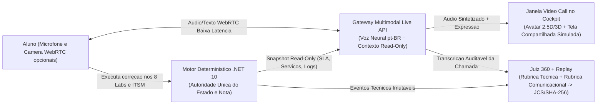
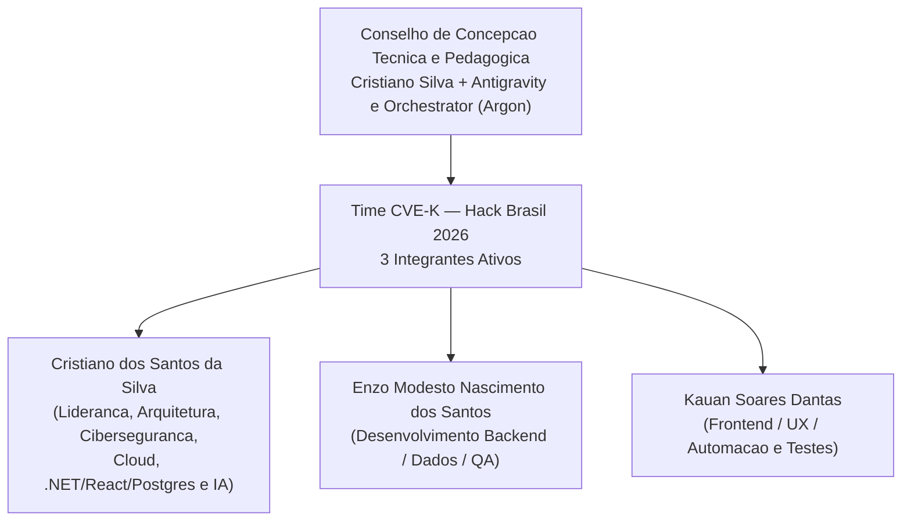
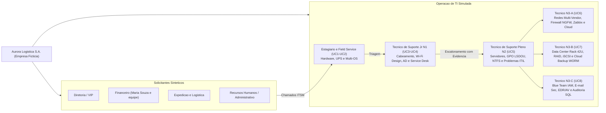

# Planejamento Pedagógico, Regulação e Matriz Curricular Técnica 560h — IT Flight Simulator

> **Documento Mestre de Engenharia Educacional, Curricular, Comercial e de Arquitetura de Produto**  
> **Deliberação Conjunta:** Cristiano dos Santos da Silva + Antigravity e Orchestrator (Argon)  
> **Data de Consolidação:** 15/11/2026  
> **Regra Inegociável de Nomenclatura:** É estritamente proibido utilizar o caractere E comercial em qualquer título, aba, página, módulo, função ou documentação do projeto; utiliza-se sempre a conjunção **"e"**.

---

## 1. Visão Geral Executiva e Posicionamento Estratégico

O **IT Flight Simulator** tem como propósito receber um aluno totalmente leigo (**"cru"**, sem vivência prévia na área de tecnologia) e formá-lo com **nível de conhecimento técnico real, rigor operacional e autonomia prática** em até **8 meses (32 semanas / 560 horas)** de treinamento intensivo, com **100% das Unidades Curriculares dotadas de laboratório simulado interativo dedicado** e simulação corporativa realista na empresa fictícia **Aurora Logística S.A.** (`aurora.local`).

Em vez de prometer formações milagrosas de "Engenheiro Sênior" em poucos dias — ou limitar a grade a poucas horas superficiais — o programa entrega a **densidade técnica e laboratorial equivalente à de um Curso Técnico profissionalizante**, operado sob formato ágil de **Curso Livre de Qualificação Profissional e Capacitação Prática** em **2 Ciclos Estratégicos**:

1. **Ciclo 1 — Prontidão Rápida para o Mercado: Do Zero ao Técnico de Suporte Júnior (N1) e Field Service (Meses 1 a 4 · Semanas 1 a 16 · 280 Horas):**
   - Desenhado para gerar **empregabilidade rápida em até 4 meses** (ou menos, em ritmo diário acelerado de imersão).
   - O estudante sai apto a atuar em **Service Desk N1**, **Help Desk** e **Field Service**, dominando eletricidade aplicada e segurança ESD, bancada física de desktops/notebooks/UPS, sistemas operacionais Windows 10/11 e Linux corporativo, **bancada de cabeamento estruturado RJ-45 T568A/B, Patch Panel e Rack `U`**, **planejamento Wi-Fi estilo UniFi Design**, Active Directory N1, Microsoft 365, impressoras/scanners SMB, certificados ICP-Brasil (A1/A3), ITIL 4, LGPD e defesa contra engenharia social.
2. **Ciclo 2 — Sustentação Corporativa: Técnico de Suporte Pleno (N2) e as 3 Vertentes Técnicas N3 (Meses 5 a 8 · Semanas 17 a 32 · +280 Horas = 560 Horas Totais):**
   - Evolução estruturada para quem deseja alcançar cargos de **Técnico de Suporte Pleno (N2)** e atuar nas frentes avançadas de **Nível 3 (N3)** em empresas de médio e grande porte ou provedores gerenciados (MSPs):
     - **UC5 — Sustentação N2, Servidores (Windows e Linux), GPO (`LSDOU`), NTFS e Automação (`80h`)**
     - **UC6 — Vertente N3-A: Redes Multi-Vendor (`Cisco`, `MikroTik`, `Ubiquiti`), Firewall NGFW/UTM (`Fortinet` — GeoIP, Content Filter, Gateway AV, IPS), Zabbix e Cloud/Kubernetes (`65h`)**
     - **UC7 — Vertente N3-B: Data Center (`Rack U`, `PDU A+B`), Virtualização (`Hyper-V/vSphere`), Storage (`RAID`, `S.M.A.R.T.`, `iSCSI`), Backup **3-2-1-1-0** Local e em Nuvem Imutável (`WORM`), Teste de Restore e DRP (`70h`)**
     - **UC8 — Vertente N3-C: Cibersegurança Operacional (Blue Team), IAM/Entra ID, Proteção de E-mail (`SPF/DKIM/DMARC/BEC`), Antivírus/EDR Corporativo e Auditoria SQL Read-Only (`65h`)**

> **Arquitetura Aberta Multi-Carreira e Fomento a Certificações:** Toda a plataforma fomenta o preparo técnico para **certificações oficiais de fabricantes e institutos** (CompTIA, Cisco, Fortinet, MikroTik, Ubiquiti, Microsoft, LPI, Zabbix, Veeam, ITIL e AWS), com trilha planejada de **simulados preparatórios 100% autorais** e **parcerias com academias oficiais (*Vendor Academies*)** mantendo arquitetura aberta para novas carreiras de TI após o Hackathon.

---

## 2. Enquadramento Legal, Regulatório (MEC / LDB / CBO) e Ritmo de Formação

### 2.1. Base Legal Brasileira para Operação como Aplicação Real

| Marco Legal ou Normativo | Aplicação Prática no IT Flight Simulator |
| :--- | :--- |
| **LDB — Lei nº 9.394/1996** *(Art. 39, parágrafo 2º, inciso I e Art. 42)* | Enquadra a formação na modalidade de Educação Profissional e Tecnológica como **Curso Livre de Qualificação Profissional e Capacitação Prática** e **cursos preparatórios livres para certificações**, abertos ao público sem exigência de credenciamento prévio no MEC/SISTEC. Permite atualização contínua dos simuladores no ritmo real do mercado. |
| **Educação Profissional Livre (LDB Art. 42 e Resolução CNE/CP nº 1/2021)** | Garante autonomia institucional para estruturar matrizes curriculares extensas por competências e emitir **Certificado de Conclusão de Curso Livre e Microcertificados Modulares** com ementa, CBO e horas práticas efetivamente medidas pelo motor determinístico. Utiliza rigorosamente *"Certificado de Conclusão de Curso Livre"* e jamais promete equivalência a *"Diploma Técnico"* ou certificação FIC institucional antes de eventual credenciamento formal. |
| **Resolução CNE/CP nº 1/2021** | Direciona o currículo ao modelo de **Educação Baseada em Competências**, integrando **saber conhecer** (teoria técnica), **saber fazer** (8 laboratórios simulados interativos) e **saber ser e comunicar** (ética, LGPD, atendimento sob pressão e entrevista técnica). |
| **LGPD — Lei nº 13.709/2018 e ECA Digital (Lei nº 15.211/2025)** | No Hackathon: operação 100% anônima, sem coleta de dados pessoais reais e com empresa/solicitantes fictícios (*Aurora Logística S.A.*). Na operação comercial: consentimento explícito, portabilidade em 1 clique (JSON), direito à exclusão integral dos dados e salvaguardas específicas de proteção à infância e adolescência no ambiente digital (**ECA Digital**) quando houver alunos menores de 18 anos. |
| **CDC — Lei nº 8.078/1990 e Decreto nº 7.962/2013** | Transparência total em carga horária (280h Ciclo 1; 560h Formação Completa), preços, **direito de arrependimento em 7 dias (Art. 49 do CDC)**, cancelamento digital sem multa oculta e distinção clara entre o **Certificado de Conclusão de Curso Livre** da plataforma e exames oficiais externos. |

### 2.2. Estratégia dos Dois Ciclos e Alinhamento Oficial com a CBO (MTE)

O programa totaliza **560 horas** (**260h de Teoria, Fixação e Estudos Guiados** + **300h de Simulação nos 8 Laboratórios Dedicados**) em **32 semanas**:

- **Ritmo Padrão Intensivo (8 Meses · ~17,5 horas/semana):** Ideal para conciliar estudo com emprego atual ou faculdade (~2h30 por dia), atingindo **Prontidão Júnior ao fim do Mês 4 (280h)** e **Formação Completa Pleno + N3 ao fim do Mês 8 (560h)**.
- **Ritmo Imersivo Acelerado (5 Meses · ~28 horas/semana):** Para estudantes em dedicação integral (4h a 5h/dia), atingindo **Prontidão Júnior em ~10 semanas (2,5 meses)** e **560h em 20 semanas**.

| Unidade Curricular | Ciclo e Janela | Ocupação Oficial (CBO / MTE) | Carga Horária | Laboratório Simulado Dedicado | Competências Técnicas Certificadas |
| :--- | :--- | :--- | :--- | :--- | :--- |
| **UC1 — Eletricidade, ESD e Manutenção Física de PC/Notebook** | **Ciclo 1 (Jr/Field)** Mês 1 · Sem. 1–4 | **CBO 3132-20** *(Téc. manutenção de equip. de informática)* | **70h** *(30h Teoria / 40h Lab)* | `HardwareWorkbenchLab` *(Bancada Física Desktop, Notebook e UPS)* | Tensão/corrente/potência, fontes ATX e Nobreaks/UPS, ESD, placa-mãe/POST/UEFI, RAM DDR4/5, SSD NVMe/SMART, pasta térmica e preventiva completa. |
| **UC2 — Sistemas Operacionais (Windows 10/11 e Linux)** | **Ciclo 1 (Jr/Field)** Mês 2 · Sem. 5–8 | **CBO 3172-10** *(Téc. suporte ao usuário de TI)* | **70h** *(35h Teoria / 35h Lab)* | `OsSystemAdminLab` *(Simulador Multi-OS Windows/Linux)* | Boot UEFI/BCD, BitLocker, Registro (`ProfileList`), Serviços, Sysinternals, `DISM`/`SFC`, BSOD, PowerShell e Linux (FHS, POSIX, `systemd`, SSH). |
| **UC3 — Redes, Cabeamento, Rack `U` e Design Wi-Fi** | **Ciclo 1 (Jr/Field)** Mês 3 · Sem. 9–12 | **CBO 3172-10 / 3132-20** *(Redes e Campo)* | **70h** *(35h Teoria / 35h Lab)* | `NetworkCablingWifiDesignLab` *(Bancada Cabeamento/Rack `U` + Estúdio Wi-Fi UniFi Design)* | Crimpagem RJ-45 T568A/B, Patch Panel, Testador 1–8, Switch PoE em Rack `U`, Mapa de Calor RF, Controladora Wi-Fi, IPv4/CIDR, DHCP/DNS/SMB e VPN. |
| **UC4 — Ambientes Corporativos, M365, Impressão, A1/A3 e ITIL** | **Ciclo 1 (Jr/Field)** Mês 4 · Sem. 13–16 | **CBO 3172-10** *(Service Desk Júnior)* | **70h** *(35h Teoria / 35h Lab)* | `CorporateWorkspaceLab` *(Workstation M365, AD, Impressão, ICP-Brasil e ITSM)* | Active Directory N1, Microsoft 365 (`.ost`/OneDrive), Spooler/`Scan-to-SMB`, ICP-Brasil A1/A3, Urgência x Impacto (SLA), LGPD e Engenharia Social + **Capstone Jr**. |
| **Subtotal Ciclo 1 (Prontidão Júnior)** | **Meses 1 a 4 (16 Semanas)** | **Técnico de Suporte Jr (N1) e Field Service** | **280h** | **4 Laboratórios Dedicados + 40 Labs** | **Microcertificado Parcial de Curso Livre Júnior (`LAB-UC1-01` a `LAB-UC4-10`)** |
| **UC5 — Sustentação N2, Servidores, GPO e Automação** | **Ciclo 2 (Pleno/N3)** Mês 5 · Sem. 17–21 | **CBO 2124-20** *(Analista de suporte computacional)* | **80h** *(35h Teoria / 45h Lab)* | `ServerSustainmentLab` *(Servidores Windows/Linux, GPO e File Server)* | Windows/Linux Server, Share vs. NTFS + FSRM, GPO (`LSDOU`/`gpresult`), Lockout (`4740`), Trust AD, Event Viewer, PowerShell/Bash e Problemas ITIL/RCA. |
| **UC6 — Vertente N3-A: Redes Multi-Vendor, NGFW, Zabbix e Cloud** | **Ciclo 2 (Pleno/N3)** Mês 6 · Sem. 22–25 | **CBO 2124-10 / 3171-05** *(Redes e Infraestrutura)* | **65h** *(30h Teoria / 35h Lab)* | `MultiVendorNetworkFirewallLab` *(Cisco/MikroTik/UniFi + Firewall Fortinet NGFW + Zabbix/K8s)* | Switches VLAN/STP/LACP, RouterOS Dual WAN, NGFW (**GeoIP, Content Filter, Gateway AV, IPS, IPsec**), Observabilidade Zabbix e Kubernetes/GMUD. |
| **UC7 — Vertente N3-B: Data Center, Rack `U`, RAID, Backup Local e Nuvem** | **Ciclo 2 (Pleno/N3)** Mês 7 · Sem. 26–29 | **CBO 3172-05 / 2124-20** *(Data Center e Continuidade)* | **70h** *(30h Teoria / 40h Lab)* | `DataCenterStorageCloudBackupLab` *(Rack 42U, RAID/iSCSI, Hypervisor e Cloud Backup WORM)* | Rack `42U`/PDU A+B, S.M.A.R.T., RAID `0/1/5/6/10`, iSCSI (`SAN Policy`/MPIO), Hypervisor Datastores/Snapshots, **Backup 3-2-1-1-0 Local e Nuvem WORM**, VSS e DRP. |
| **UC8 — Vertente N3-C: Blue Team, IAM, Antivírus/EDR e SQL** | **Ciclo 2 (Pleno/N3)** Mês 8 · Sem. 30–32 | **CBO 2123-05 / 3172-10** *(Segurança Operacional e Dados)* | **65h** *(30h Teoria / 35h Lab)* | `CyberBlueTeamSqlLab` *(Console IAM, Mail Security, EDR/AV e SQL Read-Only)* | MFA/FIDO2, Acesso Condicional/*Impossible Travel*, Break-Glass, OAuth, SPF/DKIM/DMARC, BEC/*Inbox Rules*, EDR Containment, SQL `SELECT`/`EXPLAIN` + **Capstone Final**. |
| **Subtotal Ciclo 2 (Pleno N2 e 3 Vertentes N3)** | **Meses 5 a 8 (16 Semanas)** | **Técnico Pleno (N2) e 3 Especializações N3** | **280h** | **4 Laboratórios Dedicados + 40 Labs** | **Microcertificados N2 e N3-A / N3-B / N3-C (`LAB-UC5-01` a `LAB-UC8-10`)** |
| **TOTAL INTEGRAL** | **Até 8 Meses (32 Semanas)** | **Capacitação Prática Completa em Suporte e Operações de TI** | **560h** | **8 Laboratórios Dedicados + 80 Cenários** | **Certificado de Conclusão de Curso Livre + Currículo Vivo (`JCS RFC 8785 / ECDSA P-256`) + Preparação para Certificações** |

---

## 3. Engenharia Pedagógica, Neurociência da Aprendizagem e Ferramentas do Estúdio

O aprendizado na plataforma segue o **Ciclo Cognitivo de 4 Etapas** (*Aprender → Fixar → Praticar → Explicar*), apoiado em quatro pilares científicos:

1. **Ciclo Experiencial de Kolb:** Incidente prático → Replay e Juiz 360º → Conceituação no Caderno Cornell → Nova experimentação variando semente no *Chaos Injector*.
2. **Prática Deliberada (Anders Ericsson):** Variação automática da causa raiz por semente (`SplitMix64`), impedindo memorização cega de cliques e desenvolvendo raciocínio investigativo.
3. **Instrução Direta (Barak Rosenshine):** Microaulas com analogia do cotidiano antes dos termos técnicos, exemplos guiados e checagem imediata.
4. **Teoria da Carga Cognitiva (John Sweller) e Revelação Progressiva (*Progressive Disclosure*):** Nos módulos `UC1` e `UC2`, a tela exibe apenas ferramentas essenciais; em `UC5` a `UC8`, destrava painéis multi-vendor, triggers, console EDR, rack completo e cronômetro competitivo de SLA.

### 3.1. As 5 Ferramentas Nativas do Estúdio de Estudos Integrado (Estilo Notion + Cockpit)

| Ferramenta Integrada | Base Científica | Funcionamento Real Dentro da Aplicação |
| :--- | :--- | :--- |
| **1. Caderno no Método Cornell** *(Estilo Notion + Gaveta Lateral no Lab)* | Codificação elaborativa e síntese própria | Separa **Perguntas-Chave (esquerda)**, **Anotações e Comandos (centro)** e **Resumo de 3 Linhas obrigatório (rodapé)**, abrindo em gaveta lateral dentro de qualquer um dos 8 laboratórios. |
| **2. Recordação Ativa e Repetição Espaçada (`SM-2`)** | *Testing Effect* e Curva de Ebbinghaus | Oculta alternativas ao final da aula para exigir lembrança ativa; erros cometidos nos laboratórios geram **Flashcards de Remediação** agendados (`1d → 3d → 7d → 16d → 35d`). |
| **3. Treinador Feynman e Pitch STAR** | Protégé Effect e Empregabilidade | Avaliador de explicação sem jargão (`0–100`) na aba **Mentor** + transformador de chamados resolvidos em histórias **STAR** para entrevistas, anexadas ao **Currículo Vivo**. |
| **4. Timer Pomodoro e Relógio Real de SLA** | Gestão atencional e controle emocional | Opera ciclos `25/5` na teoria e alterna para cronômetros de SLA (`P1–P4`) durante os laboratórios práticos. |
| **5. Tutor IA Socrático com Guardrail** | Descoberta guiada | Orienta por perguntas diagnósticas sem entregar respostas prontas; nunca altera estado técnico nem notas (exclusividade do motor `.NET 10`). |

---

## 4. Matriz Curricular Completa de Nível Técnico (8 Unidades · 32 Semanas · 560 Horas · 80 Laboratórios)

---

### CICLO 1 — PRONTIDÃO RÁPIDA: DO ZERO AO TÉCNICO DE SUPORTE JÚNIOR (N1) E FIELD SERVICE (MESES 1 A 4 · 280 HORAS)

#### UC1 — Eletricidade Aplicada, ESD, Arquitetura de Computadores e Bancada Física (Mês 1 · Semanas 1 a 4 · 70h)
- **Laboratório Dedicado:** `HardwareWorkbenchLab` (Bancada Desktop, Notebook, Fontes ATX e Nobreaks/UPS).
- **Cronograma Semana a Semana:**
  - **Semana 1 — Fundamentos Elétricos e Segurança ESD:** Tensão ($V$), corrente ($A$), potência real ($W$) vs. aparente ($VA$), fator de potência, aterramento elétrico, filtro DPS vs. estabilizador, Nobreaks/UPS (*Offline*, *Line-Interactive AVR* e *Online Dupla Conversão*), fontes ATX 80 Plus (`+12V, +5V, +3.3V`), Descarga Eletrostática (ESD) e EPIs (pulseira e manta).
  - **Semana 2 — Arquitetura de Processamento, Placa-Mãe e POST:** Von Neumann, x86-64 vs. ARM, núcleos/threads, caches L1/L2/L3, TDP; placa-mãe ATX/mATX/ITX, VRM, PCIe, bateria CMOS `CR2032`, **BIOS Legacy vs. UEFI**, GPT vs. MBR, *Secure Boot*, **TPM 2.0**, ciclo **POST** e *Beep Codes*.
  - **Semana 3 — Memórias, Armazenamento e Termodinâmica Aplicada:** DDR4/DDR5, *Dual Channel*, ECC, HDD mecânico vs. SSD SATA III vs. NVMe M.2 PCIe, telemetria **S.M.A.R.T.**, pressão positiva/negativa de fluxo de ar, pasta térmica, *thermal pads*, álcool isopropílico `99,8%` e soprador travando a hélice.
  - **Semana 4 — Anatomia de Notebooks, Periféricos e Laudo Preventivo:** Desmontagem segura, desconexão obrigatória da bateria antes do manuseio, conectores *flat cable* e **eDP/LVDS**, cooler radial obstruído, protocolo para **bateria inchada**, USB-C PD/DC-Jack e emissão de **Laudo Técnico Preventivo**.

| Código | Título do Laboratório Prático | Contexto Corporativo na Aurora Logística | Variações de Causa Raiz (Chaos Injector) | Ferramentas do Laboratório `UC1` | Status / Onda |
| :--- | :--- | :--- | :--- | :--- | :--- |
| **LAB-UC1-01** | Segurança ESD e Diagnóstico de Fonte e Nobreak | Estação da portaria apaga quando ar-condicionado liga | Tomada invertida vs. cabo ATX frouxo vs. bateria de Nobreak esgotada | Pulseira ESD, Multímetro, Tomada Teste, UPS | Onda 1 |
| **LAB-UC1-02** | Estação Sem Vídeo e Códigos de POST (`WF003/WF004`) | Desktop liga coolers mas não exibe imagem no monitor | **Chaos 3 causas:** RAM oxidada (3 bipes), vídeo onboard ligado com GPU dedicada ou EPS 8 pinos solto | Borracha/Limpa-contatos, Testador POST, Raio-X | Onda 1 (Base no MVP UI) |
| **LAB-UC1-03** | Superaquecimento, Fluxo de Ar e Pasta Térmica (`WF032`) | Estação da Expedição desliga a `96 °C` emitindo NF-e | Cooler obstruído + pasta térmica ressecada + exaustor travado | Soprador, Pincel ESD, Álcool 99,8%, Pasta Térmica | Onda 1 (Base no MVP UI) |
| **LAB-UC1-04** | Gargalo Disco 100%, S.M.A.R.T. e Upgrade NVMe (`WF001`) | Notebook do RH leva 4 minutos para iniciar | HDD com `Reallocated_Sector_Ct` crítico + `4 GB` RAM Single Channel | Leitor SMART, Case Clonagem, NVMe, RAM Dual Channel | Onda 1 (Base no MVP UI) |
| **LAB-UC1-05** | Bateria CMOS `CR2032`, Data/Hora e Erro UEFI (`WF041`) | PC volta para `01/01/2018` causando erro TLS/HTTPS e boot | `CR2032` esgotada + BIOS revertida para Legacy/CSM em disco GPT | Multímetro, CR2032, Setup BIOS/UEFI simulado | Onda 1 |
| **LAB-UC1-06** | Preventiva Completa de Notebook Corporativo | Notebook aquece teclado e cooler faz ruído metálico | *Thermal pad* rompido + saída radial entupida por poeira + flat solto | Bancada Modo Notebook (Chaves precisão, Espátula) | Onda 1 |
| **LAB-UC1-07** | Bateria Inchada e Falha de Carregamento USB-C/DC-Jack | Touchpad levantado e notebook apaga fora da tomada | Bateria estufada (isolamento químico seguro) vs. carregador subdimensionado | Checklist Risco Químico + Wattímetro USB-C | Onda 1 |
| **LAB-UC1-08** | Dimensionamento e Compatibilidade de Upgrade Corporativo | Pedido para atualizar 10 estações CAD sem erro de compra | Barramento DDR4 vs. DDR5, soquete CPU, M.2 `2280` e potência TDP da fonte | Matriz de Compatibilidade + Calculadora TDP | Onda 2 |
| **LAB-UC1-09** | Manutenção de Nobreak (UPS) e Autonomia de Bancada | Nobreak do caixa apita sem parar e não segura queda de luz | Baterias `12V 7Ah` sulfatadas + impressora laser ligada indevidamente no UPS | Bancada Energia (UPS, Alicate amperímetro) | Onda 2 |
| **LAB-UC1-10** | Montagem do Zero e Laudo Técnico Preventivo | Montar e homologar estação nova padrão corporativo | Montagem correta placa/CPU/RAM/NVMe + ativar TPM 2.0/Secure Boot + Laudo | Bancada Completa + Formulário Laudo PDF | Onda 2 |

---

#### UC2 — Sistemas Operacionais Corporativos a Fundo: Windows 10/11 Enterprise e Linux Essencial (Mês 2 · Semanas 5 a 8 · 70h)
- **Laboratório Dedicado:** `OsSystemAdminLab` (WinRE, Registro, Serviços, Sysinternals, BSOD, PowerShell e Linux SSH).
- **Cronograma Semana a Semana:**
  - **Semana 5 — Windows NT, UEFI/Boot e BitLocker:** Kernel vs. User Mode, NTFS, partição EFI/WinRE, **`bcdedit`/`bootrec`**, criptografia **BitLocker** e chave de recuperação de 48 dígitos.
  - **Semana 6 — Registro, Serviços, Drivers e Perfis de Usuário:** Registro (`HKLM/HKCU`), chaves `Run`, `services.msc`/`sc.exe`, rollback de driver WHQL, Modo de Segurança e recuperação de Perfil Temporário (`ProfileList`).
  - **Semana 7 — Performance, Integridade (`DISM/SFC`) e BSOD:** **Sysinternals** (`Process Explorer`, `Process Monitor`, `Autoruns`), `perfmon`, `chkdsk`, `sfc /scannow`, `DISM`, Minidumps BSOD e PowerShell essencial.
  - **Semana 8 — Linux Corporativo (Ubuntu/Debian):** FHS (`/etc`, `/var/log`, `/proc`), `chmod`/`chown`/`sudo`, `apt`, **`systemd`** (`systemctl`/`journalctl`), `ps`/`htop`/`df`/`du` e **SSH**.

| Código | Título do Laboratório Prático | Contexto Corporativo na Aurora Logística | Variações de Causa Raiz (Chaos Injector) | Ferramentas do Laboratório `UC2` | Status / Onda |
| :--- | :--- | :--- | :--- | :--- | :--- |
| **LAB-UC2-01** | Recuperação de Boot UEFI/BCD e BitLocker | Estação entra em loop de reparo automático pós-update | BCD corrompido vs. alteração AHCI/RAID exigindo chave BitLocker 48 dígitos | WinRE Console + Painel Chaves BitLocker | Onda 2 |
| **LAB-UC2-02** | Resgate de Perfil Temporário no Windows (`WF007/008`) | Usuário logou e "arquivos da Área de Trabalho sumiram" | Chave `.bak` duplicada em `ProfileList`; dados íntegros em `C:\Users` | Editor de Registro + Terminal Elevado | Onda 2 |
| **LAB-UC2-03** | Investigação CPU/Disco 100% com Sysinternals | PC trava digitando notas com cooler no máximo | Loop Windows Search vs. processo órfão vs. fila Update corrompida | Resource Monitor + Process Explorer | Onda 2 |
| **LAB-UC2-04** | Reparo de Imagem com `DISM` e `SFC` | Windows Update falha com `0x800f081f` e ferramentas quebram | `WinSxS` corrompido exigindo `DISM /RestoreHealth` antes de `sfc` | Terminal Elevado + Logs CBS | Onda 2 |
| **LAB-UC2-05** | Diagnóstico de BSOD por Driver Incompatível (`WF005`) | Notebooks reiniciam com `IRQL_NOT_LESS_OR_EQUAL` | Localizar `.sys` culpado no Minidump/Event Viewer e executar rollback | Leitor Minidump + Painel Drivers | Onda 2 |
| **LAB-UC2-06** | Limpeza de Inicialização e Persistência (`Autoruns`) | Login leva 6 minutos abrindo dezenas de processos ocultos | Excesso de entradas `HKCU\...\Run` e serviços não homologados | Autoruns + Serviços | Onda 2 |
| **LAB-UC2-07** | Destravamento de Serviço em Estado `Stopping` | Integrador ERP preso em `Stopping` impedindo reinício | Localizar PID com `sc queryex`, encerrar via `taskkill /F /PID` e reiniciar | Terminal Elevado + Console Serviços | Onda 2 |
| **LAB-UC2-08** | Disco Lotado (`/var/log`) em Servidor Linux via SSH | Aplicação Linux recusa gravação (`No space left on device`) | Log descontrolado vs. inodes esgotados (`df`, `du -sh`, `truncate`) | Terminal SSH Linux | Onda 2 |
| **LAB-UC2-09** | Permissões POSIX e Serviço `systemd` em Linux | Intranet Nginx retorna `403 Forbidden` ou daemon parado | `chmod`/`chown` incorretos em `/var/www` vs. serviço falho no `systemd` | Terminal SSH Linux (`systemctl`, `journalctl`) | Onda 2 |
| **LAB-UC2-10** | Script PowerShell de Preventiva Lógica (`WF035`) | Homologação de imagem antes da entrega a novos analistas | Corrigir script auditando RAM, SSD, EDR, BitLocker e updates | Console PowerShell + Checklist Preventiva | Onda 2 |

---

#### UC3 — Redes, Cabeamento Estruturado, Rack `U`, Wi-Fi Design e VPN (Mês 3 · Semanas 9 a 12 · 70h)
- **Laboratório Dedicado:** `NetworkCablingWifiDesignLab` (Bancada Cabeamento/Rack `U` + Estúdio Visual Wi-Fi inspirado no **Ubiquiti UniFi Design Center** e Controladora Wi-Fi + Diagnóstico TCP/IP/VPN).
- **Cronograma Semana a Semana:**
  - **Semana 9 — OSI, TCP/IP, Cabeamento Estruturado e Rack `U`:** Encapsulamento OSI, normas ABNT NBR 14565 / TIA-568, Cat5e/Cat6/Cat6A, **T568A e T568B**, crimpagem RJ-45, Keystone e **Patch Panel 24 portas (*Punch Down*)**, Testador Digital Pino a Pino (`1 a 8`), Fibra OS2 vs. OM3/OM4 (LC/SC), montagem organizada em **Rack `U`** e **PoE (`802.3af/at/bt`)**.
  - **Semana 10 — IPv4, CIDR, ARP e DHCP DORA:** Sub-redes CIDR (`/24` a `/30`), RFC 1918, `arp -a`, ciclo **DHCP DORA**, tempo de *Lease* e diagnóstico de **APIPA (`169.254.x.x`)**.
  - **Semana 11 — DNS, Portas TCP/UDP e Compartilhamentos SMB:** Registros `A/AAAA/CNAME/MX/TXT/PTR/SRV`, `nslookup`/`Resolve-DnsName`, `/flushdns`, auditoria de arquivo `hosts`, portas essenciais, `tracert`/`Test-NetConnection` e protocolo SMB/Cofre de Credenciais.
  - **Semana 12 — Planejamento Wi-Fi RF (`UniFi Design`), Controladora e VPN:** Espectro **2.4 GHz** (canais `1, 6, 11`), **5 GHz** e **6 GHz**, atenuação de paredes, **Heatmap de cobertura RF**, posicionamento de APs (**Ubiquiti UniFi**, Cisco, MikroTik, Aruba), múltiplos SSIDs com **VLANs e WPA3-Enterprise `802.1X`/RADIUS**, *Captive Portal* Visitantes e **VPN Client-to-Site** (*Full* vs. *Split Tunnel* e conflito de sub-rede doméstica).

| Código | Título do Laboratório Prático | Contexto Corporativo na Aurora Logística | Variações de Causa Raiz (Chaos Injector) | Ferramentas do Laboratório `UC3` | Status / Onda |
| :--- | :--- | :--- | :--- | :--- | :--- |
| **LAB-UC3-01** | Bancada Cabeamento: Crimpagem RJ-45 T568A/T568B | Cabo da expedição negocia apenas `10 Mbps` ou perde link | T568A/B trocado nas pontas vs. par `3/6` rompido no Testador | Alicate Crimpador, RJ-45, Testador Pino 1–8 | Onda 1 |
| **LAB-UC3-02** | Bancada Rack `U`: Patch Panel, Organizador e Switch PoE | Ponto novo de sala não energiza Telefone IP nem Access Point | Conectorização solta no *Punch Down* vs. porta sem injeção **PoE** | Patch Panel, Alidade Punch Down, Rack `U`, Switch PoE | Onda 1 |
| **LAB-UC3-03** | Estúdio Wi-Fi Design: Planta Baixa, Obstáculos e Heatmap | Galpão e ala administrativa sofrem zonas de sombra no Wi-Fi | Paredes de concreto (`-15 dB`) bloqueando sinal + APs concentrados em canal saturado `2.4 GHz` | **Estúdio UniFi Design Simulator** (Planta, APs, Heatmap RF) | Onda 2 |
| **LAB-UC3-04** | Controladora Wi-Fi: Adoção de APs, SSIDs, VLAN e Captive Portal | Visitantes caem na rede interna do Financeiro ou Wi-Fi cai no roaming | SSID Visitantes sem *Client Isolation* / VLAN Guest + falta de `802.1X` no SSID Corp | **Console Controladora Wi-Fi** (Adopt, SSID, Canais, VLAN) | Onda 2 |
| **LAB-UC3-05** | Estação com IP APIPA (`169.254.x.x`) e Falha DHCP (`NET003`) | Novo PC no balcão conecta cabo mas não navega | Porta switch desligada vs. Cliente DHCP parado vs. falha escopo | SimuDesk Terminal (`ipconfig`, `ping`) + Painel Rede | Onda 2 |
| **LAB-UC3-06** | Falha de Resolução DNS Corporativa (`NET007/NET010`) | ERP abre pelo IP mas falha por `erp.aurora.local` | DNS estático `8.8.8.8`, cache antigo ou entrada errada em `hosts` | Terminal (`nslookup`, `/flushdns`) + Painel DNS | Implementado Base N2 (`pasta-rede-inacessivel` C2) |
| **LAB-UC3-07** | Compartilhamento SMB e Cofre de Credenciais (`KB-005`) | Usuária Maria sem acesso à pasta `\\fs01\Financeiro` | **Chaos:** Grupo AD ausente, DNS errado, `LanmanWorkstation` parado ou credencial em cache | SimuDesk (`net use`, `whoami /groups`, `sc`) + Painéis | **Implementado no MVP (`pasta-rede-inacessivel`)** |
| **LAB-UC3-08** | VPN Home Office Não Alcança Servidores Internos (`WF023`) | Vendedor conecta na SSL-VPN mas ERP dá timeout | Conflito de faixa doméstica `192.168.0.0/24` vs. DNS interno ausente no túnel | Terminal (`route print`, `nslookup`) + Painel VPN | Onda 2 |
| **LAB-UC3-09** | Cálculo CIDR, Sub-Rede e Teste de Portas TCP | Sistema fiscal abre na Matriz mas falha na Filial Sul | Máscara `/25` digitada como `/24` ou bloqueio na porta `8443` | Calculadora CIDR + `tracert` + `Test-NetConnection` | Onda 2 |
| **LAB-UC3-10** | Troubleshooting Camadas 1 a 7 (Rack até Aplicação) | Estação totalmente isolada exigindo percurso completo | Encadeamento físico (RJ-45 no Patch Panel) → Wi-Fi/DHCP → DNS → ERP Web | Bancada Cabeamento + SimuDesk + Juiz 360º | Onda 2 |

---

#### UC4 — Ambientes Corporativos: AD N1, Microsoft 365, Impressão, A1/A3 e ITIL/LGPD (Mês 4 · Semanas 13 a 16 · 70h)
- **Laboratório Dedicado:** `CorporateWorkspaceLab` (AD `dsa.msc`, Microsoft 365/Exchange, Spooler/Scanner SMB, Certificados A1/A3 e Mesa ITSM).
- **Cronograma Semana a Semana:**
  - **Semana 13 — Active Directory N1 e Microsoft 365 / Google Workspace:** Domínio, OUs, reset de senha seguro, desbloqueio; Outlook (`.ost`/`.pst`, perfil, *Autodiscover*, Caixa Compartilhada, *Send As*), OneDrive (*Known Folder Move*) e Teams.
  - **Semana 14 — Impressoras, Scanners SMB e Certificados ICP-Brasil (A1/A3):** `spoolsv.exe`, limpeza de `spool\PRINTERS`, porta **TCP/IP RAW `9100`** vs. **WSD**, reserva DHCP, drivers PCL6/PS, `Scan-to-SMB`, **A1 (`.pfx`) vs. A3 (Token/Smart Card)**, cadeia AC Raiz, `SCardSvr`, PIN vs. PUK e portais fiscais.
  - **Semana 15 — ITIL 4 e SLA Corporativo:** Incidente vs. Requisição vs. Problema, **Matriz Urgência x Impacto (P1–P4)**, SLA/OLA, FCR, notas públicas vs. internas.
  - **Semana 16 — LGPD, Verificação 2FA no Atendimento e Engenharia Social:** Proteção de dados no chamado (`KB-002`/`KB-004`), defesa contra *Phishing*, *Vishing*, *Smishing*, *Pretexting* e *Baiting*, e **Capstone Júnior 280h**.

| Código | Título do Laboratório Prático | Contexto Corporativo na Aurora Logística | Variações de Causa Raiz (Chaos Injector) | Ferramentas do Laboratório `UC4` | Status / Onda |
| :--- | :--- | :--- | :--- | :--- | :--- |
| **LAB-UC4-01** | Triagem de Fila ITSM e Matriz Urgência x Impacto (`KB-008`) | Fila recebe 6 chamados mistos simultaneamente | Priorizar P1 sobre P4 e classificar SLA sem violações | ITSM (Fila + Matriz SLA) + KB-008 | Onda 1 |
| **LAB-UC4-02** | Defesa contra Engenharia Social e Triagem Segura (`KB-001`) | Suposto "Diretor VIP" exige reset urgente sem token | Pressão de autoridade e urgência; exige recusa segura e registro de nota | ITSM + Comunicador + KB-001 + Juiz 360º | **Implementado no MVP (`triagem-engenharia-social`)** |
| **LAB-UC4-03** | Impressora Offline e Spooler Travado (`WF020`) | Setor Fiscal não imprime boletos no fechamento | Arquivo `.spl` corrompido travando `Spooler` vs. porta WSD falhando em vez de RAW `9100` | SimuDesk Serviços + Console Impressão + DHCP | Onda 2 |
| **LAB-UC4-04** | Scanner Multifuncional (`Scan-to-SMB`) (`WF022`) | PDFs digitalizados não chegam na pasta de rede | Senha expirada da conta de scanner no AD vs. permissão NTFS/SMBv2 | AD `dsa.msc` + Painel Multifuncional + SimuDesk | Onda 2 |
| **LAB-UC4-05** | Certificado ICP-Brasil A1 e Token A3 (`WF017/018`) | Analista bloqueado na emissão de NF-e com Token A3 | Serviço `SCardSvr` parado, cadeia ICP-Brasil ausente ou erro de middleware (sem travar PUK) | SimuDesk Serviços + Gerenciador Certificados | Onda 2 |
| **LAB-UC4-06** | Outlook `.ost` Corrompido e OneDrive Preso (`WF030/031`) | Diretor sem e-mails novos e documentos sem sincronia | `.ost` estourado exigindo novo perfil vs. arquivo travado com caractere inválido no OneDrive | Painel M365 + Perfis Windows | Onda 2 |
| **LAB-UC4-07** | Caixa Compartilhada e Permissões Microsoft 365 | Nova analista precisa responder como `vagas@aurora.local` | Conceder `Full Access` + `Send As` em Caixa Compartilhada (sem desperdício de licença) | Admin Center M365 + ITSM | Onda 2 |
| **LAB-UC4-08** | Ingresso no Domínio `aurora.local` e Política LGPD | Estação formatada não entra no domínio | DNS apontado errado vs. OU incorreta + mascaramento de CPF na nota | Rede + AD `dsa.msc` + ITSM | Onda 2 |
| **LAB-UC4-09** | Triagem de Phishing Reportado no Help Desk | Usuária recebeu link falso de atualização cadastral | Impedir clique, coletar evidência em nota interna sigilosa e escalonar | Comunicador + ITSM + Painel Segurança | Onda 2 |
| **LAB-UC4-10** | **Capstone Ciclo 1 — Turno Completo Técnico Júnior (280h)** | Simulado cronometrado combinando Hardware + Rede/Wi-Fi + AD + Impressora | Turno completo por semente exigindo FCR, conformidade LGPD e emissão do **Microcertificado Júnior** | Bancadas + `CorporateWorkspaceLab` + Juiz 360º | Onda 2 |

---

### CICLO 2 — SUSTENTAÇÃO PLENO (N2) E AS 3 VERTENTES TÉCNICAS N3 (MESES 5 A 8 · +280 HORAS = 560 HORAS TOTAIS)

#### UC5 — Sustentação N2, Administração de Servidores (Windows e Linux), GPO, Logs e Automação (Mês 5 · Semanas 17 a 21 · 80h)
- **Laboratório Dedicado:** `ServerSustainmentLab` (Windows Server AD/DNS/DHCP/File Server + Editor GPO `gpmc.msc` + Logs Event Viewer + PowerShell/Linux Server + RCA).
- **Cronograma Semana a Semana:**
  - **Semana 17 — Windows Server, DNS Server e DHCP Failover:** Zonas DNS Diretas/Reversas, escopos DHCP, reservas, *DHCP Failover* e *Relay Agent*.
  - **Semana 18 — File Server Corporativo, Share vs. NTFS e FSRM:** Combinação restritiva, *Deny* explícito, **AGDLP**, *Access-Based Enumeration* (ABE), bloqueio FSRM e *Shadow Copies*.
  - **Semana 19 — GPO (`LSDOU`) e Forense Active Directory:** Herança, *Enforced*, filtros WMI, **`gpresult /h`**, investigação de **Account Lockout (`Event ID 4740`)** e reparo de **Trust Relationship** (`Test-ComputerSecureChannel -Repair`).
  - **Semana 20 — Event Viewer Forense, PowerShell/WinRM e Linux Server:** Eventos `4624/4625/4740/41/1001/7036`, `/var/log/auth.log`, `journalctl -xe`, automação PowerShell (`Get-ADUser`, `Invoke-Command`) e scripts Bash/`logrotate`.
  - **Semana 21 — Incidentes Massivos, Problemas ITIL e RCA:** Sala de Crise (*War Room*), criação de Problema, *Workaround* seguro, **KEDB** e **RCA** (*5 Porquês* e *Ishikawa*).

| Código | Título do Laboratório Prático | Contexto Corporativo na Aurora Logística | Variações de Causa Raiz (Chaos Injector) | Ferramentas do Laboratório `UC5` | Status / Onda |
| :--- | :--- | :--- | :--- | :--- | :--- |
| **LAB-UC5-01** | Account Lockout Recorrente (`Event ID 4740`) (`ADWS019`) | Conta bloqueia a cada 15 minutos mesmo após desbloqueio | Sessão RDP desconectada com senha antiga vs. Tarefa Agendada | Security Logs DC + AD + Terminal | Onda 2 |
| **LAB-UC5-02** | Quebra da Relação de Confiança (*Trust*) (`ADWS020`) | Estação exibe "A relação de confiança entre esta estação e o domínio falhou" | Segredo da conta de computador dessincronizado; reparar com `Test-ComputerSecureChannel` | Terminal Elevado + AD | Onda 3 |
| **LAB-UC5-03** | Conflito de GPO (`LSDOU`) e Mapeamento de Rede (`ADWS014`) | Unidade `F:\` sumiu do setor de Expedição | Estação em OU errada vs. filtro de segurança vs. precedência `LSDOU` | Editor GPO (`gpmc.msc` / `gpresult /h`) + OUs | Onda 2 |
| **LAB-UC5-04** | Permissões Cruzadas Share vs. NTFS (`ADWS010`) | Usuário no grupo correto recebe "Acesso Negado" | *Share* limitado a Leitura vs. *Deny* explícito herdado | Matriz Efetiva File Server NTFS + FSRM | Onda 3 |
| **LAB-UC5-05** | Esgotamento de Escopo DHCP (`ADWS026`) | Novos dispositivos na filial não recebem IP à tarde | Pool `/24` esgotado por *Lease Time* de 8 dias em VLAN Wi-Fi | Console DHCP Server + Logs | Onda 3 |
| **LAB-UC5-06** | Contas de Serviço Expiradas (`ADWS018`) | Integrador de etiquetas parou pós-troca anual de senhas | Conta `svc_etiquetas` expirada bloqueando serviço Windows | AD + Console Serviços Server | Onda 3 |
| **LAB-UC5-07** | Automação N2 com PowerShell e WinRM | Auditar contas inativas e reiniciar agente RMM em lote | Pipeline `Get-ADUser` + `Invoke-Command` sem afetar contas críticas | PowerShell Server + AD | Onda 3 |
| **LAB-UC5-08** | Servidor Linux (Systemd, Descritores e Logrotate) | API Ubuntu cai com `Too many open files` ou disco cheio | Ajuste de limites no `systemd`, análise `journalctl -xe` e `logrotate` | Terminal Linux Server | Onda 3 |
| **LAB-UC5-09** | Sala de Crise: Incidente Massivo e Problema ITIL (`KB-010`) | 3 setores param após atualização corporativa | Criar Problema ITIL, analisar logs, elevar privilégio, iniciar `AuroraGateway` e fechar em lote | ITSM (Problema) + SimuDesk + Juiz 360º | **Implementado no MVP (`incidente-massivo`)** |
| **LAB-UC5-10** | Relatório RCA (5 Porquês / Ishikawa) e KEDB (`KB-013`) | Encerramento executivo pós-crise sem gambiarras | Bloquear ações destrutivas (desligar firewall/hosts) e publicar RCA completo | Console RCA + KEDB + Juiz 360º | Onda 3 |

---

#### UC6 — Vertente N3-A: Redes Multi-Vendor (`Cisco/MikroTik/Ubiquiti`), Firewall NGFW (`Fortinet` GeoIP/Content Filter/AV), Zabbix e Cloud (Mês 6 · Semanas 22 a 25 · 65h)
- **Laboratório Dedicado:** `MultiVendorNetworkFirewallLab` (CLI Cisco IOS XE + MikroTik RouterOS/WinBox + UniFi Gateway + **NGFW Fortinet FortiGate** com GeoIP, Web Content Filter, Antivírus de Borda, IPS e IPsec + **Zabbix** + **Kubernetes**).
- **Cronograma Semana a Semana:**
  - **Semana 22 — Switching Multi-Vendor (Cisco / MikroTik / UniFi):** VLANs `IEEE 802.1Q`, portas `Access`/`Trunk`, *Native VLAN*, *Inter-VLAN Routing*, **STP/RSTP + BPDU Guard**, agregação **LACP (`802.3ad`)**, NTP/Kerberos e AD Sites.
  - **Semana 23 — Roteamento WAN, MikroTik RouterOS e Firewall NGFW/UTM (`Fortinet`):** Políticas *Stateful* e NAT (`SNAT`/`VIP`), **Dual WAN Failover**, VPN Site-to-Site **IPsec (IKEv2/ESP)**, **GeoIP Filtering**, **Web/DNS Content Filter**, **Gateway Antivirus**, **IPS** e inspeção SSL/TLS.
  - **Semana 24 — Observabilidade Corporativa com Zabbix:** Server/Proxy/Agent, **SNMPv2c/v3**, Templates, *Triggers* com histerese contra falsos positivos e monitoramento SSL/TLS.
  - **Semana 25 — Cloud, Containers Docker/Kubernetes e GMUD:** VPC, Security Groups, `kubectl` (`get/describe/logs/top/rollout undo`), `OOMKilled`, *Connection Pools*, certificado Ingress TLS e **GMUD / Rollback**.

| Código | Título do Laboratório Prático | Contexto Corporativo na Aurora Logística | Variações de Causa Raiz (Chaos Injector) | Ferramentas do Laboratório `UC6` | Status / Onda |
| :--- | :--- | :--- | :--- | :--- | :--- |
| **LAB-UC6-01** | Switching Cisco IOS / UniFi: VLAN `802.1Q` e Trunk | Rack do Galpão 3 não comunica com servidores da Matriz | Porta configurada em modo `access` em vez de `trunk` ou `allowed vlan` ausente | **Console Cisco CLI / UniFi Switch** | Onda 3 |
| **LAB-UC6-02** | Contenção de Loop L2 com RSTP e `BPDU Guard` | Rede do 2º andar entra em broadcast storm a 2000ms | Cabo ligado em loop físico na sala sem proteção Spanning Tree na borda | **Console Cisco / MikroTik Bridge** | Onda 3 |
| **LAB-UC6-03** | MikroTik RouterOS: Dual WAN Failover e NAT Masquerade | Link principal cai mas tráfego não migra para link B | Rota padrão sem `check-gateway=ping` real ou regra `src-nat` ausente no link B | **Console MikroTik RouterOS / WinBox** | Onda 3 |
| **LAB-UC6-04** | Firewall NGFW Fortinet: VPN IPsec Site-to-Site Matriz e Filial | Filial Nordeste desconectada do ERP e AD após mudança | Divergência na Fase 1/Fase 2 IPsec ou regra ACL bloqueando portas UDP `500/4500` | **Console Firewall NGFW (FortiOS style)** | Onda 3 |
| **LAB-UC6-05** | Firewall NGFW: Política GeoIP, Web Content Filter e Gateway AV | Ataques de força bruta vêm de IPs estrangeiros e malware passa por download web | Ativar bloqueio **GeoIP** (restringir países permitidos), configurar **Web/Content Filter** bloqueando categorias maliciosas e ligar **Gateway Antivirus + IPS** | **Console NGFW (GeoIP + Content Filter + AV)** | Onda 3 |
| **LAB-UC6-06** | Observabilidade Zabbix e Eliminação de Alert Fatigue (`ZBX007`) | Zabbix dispara 80 alertas críticos falsos toda madrugada | Ajustar histerese de *Trigger*, distinguir ICMP filtrado de queda real e janela de manutenção | **Console Zabbix (SNMP/Triggers)** | Onda 3 |
| **LAB-UC6-07** | AD Sites e Services e Sincronismo NTP/Kerberos (`ADWS033`) | Usuários novos da Matriz não autenticam na Filial | Sub-rede sem Site associado + *Clock Skew* > 5 minutos invalidando Kerberos | Painel AD Sites/NTP + Terminal | Onda 3 |
| **LAB-UC6-08** | Cloud/Kubernetes: `OOMKilled`, Pool e TLS (`sre-cloud-latencia`) | Portal retorna `502/503` com latência extrema no pico | **Chaos 3 causas:** `OOM_KILLED`, `POOL_EXHAUSTED` (PgBouncer) ou `CERT_EXPIRED` | ITSM + Console K8s (`kubectl`, `curl -I`) + Juiz 360º | **Implementado no MVP (`sre-cloud-latencia`)** |
| **LAB-UC6-09** | Monitoramento Zabbix de SSL/TLS e Renovação Zero-Downtime | Trigger alerta certificado HTTPS prestes a expirar | Inspecionar cadeia via `curl -I`, renovar segredo TLS no Ingress sem derrubar sessões | Console Zabbix + Ingress TLS | Onda 3 |
| **LAB-UC6-10** | Janela de Mudança (GMUD) e Rollback Controlado | Deploy programado aumenta erros `5xx` em produção | Validar Checklist GMUD, detectar anomalia no Zabbix e executar `kubectl rollout undo` | ITSM (GMUD) + Zabbix + K8s | Onda 3 |

---

#### UC7 — Vertente N3-B: Data Center (`Rack U`), Virtualização, Storage (`RAID/iSCSI`), Backup **3-2-1-1-0** Local e Nuvem e DRP (Mês 7 · Semanas 26 a 29 · 70h)
- **Laboratório Dedicado:** `DataCenterStorageCloudBackupLab` (Rack 42U com PDUs A+B, Controladora RAID/S.M.A.R.T., SAN iSCSI, Hypervisor Datastores/Snapshots, **Console de Backup Local e Cloud Backup Imutável WORM**).
- **Cronograma Semana a Semana:**
  - **Semana 26 — Data Center (`TIA-942`), Rack `U` (1U–42U), Energia A+B, Discos S.M.A.R.T. e RAID:** Corredores frio/quente, alocação física no Rack `42U`, **Fontes Redundantes A+B em PDUs separadas** + UPS Online, discos Enterprise SAS/NVMe (**DWPD/PLP**), atributos **S.M.A.R.T.**, controladoras RAID (cache BBU/FBWC) e níveis **RAID `0, 1, 5, 6, 10`**, *Hot Spare*, *Rebuild* e risco de **URE / Dupla Falha em RAID 5**.
  - **Semana 27 — Storage (DAS, NAS, SAN iSCSI) e Virtualização (Hyper-V / VMware vSphere):** Protocolos SMB/NFS vs. **SAN iSCSI (`iqn`, Target/Initiator, LUNs, MPIO, `SAN Policy` Offline)**; *Hypervisors* Tipo 1, **Datastores**, *vMotion/Live Migration* e gestão segura de **Snapshots/Checkpoints** (por que **Snapshot não é Backup** e como consolidar cadeias diferenciais).
  - **Semana 28 — Backup Corporativo (Regra 3-2-1-1-0), VSS e Backup em Nuvem Imutável (WORM):** Cadeias *Full/Incremental/Diferencial/Sintético*, retenção **GFS**, **Microsoft VSS Writers** (`vssadmin`), metas **RPO e RTO**; arquitetura de **Backup em Nuvem (`AWS S3 / Wasabi / Azure Blob` com `Object Lock WORM` modo Compliance + criptografia AES-256)**, repositórios Linux Hardened e MFA fora do AD contra ransomware.
  - **Semana 29 — Restore Seguro, Teste Mensal Isolado (Sandbox) e DRP:** Restore granular em pasta alternativa preservando ACLs NTFS, *Instant VM Recovery*, auditoria mensal em VLAN isolada com validação de integridade SHA-256 e failover completo de **DRP**.

| Código | Título do Laboratório Prático | Contexto Corporativo na Aurora Logística | Variações de Causa Raiz (Chaos Injector) | Ferramentas do Laboratório `UC7` | Status / Onda |
| :--- | :--- | :--- | :--- | :--- | :--- |
| **LAB-UC7-01** | Falha Diária de Backup, Storage e VSS (`falha-backup-restore`) | Job noturno de backup do File Server falhou | **Chaos 3 causas:** Agente offline, repositório cheio ou *VSS Writer* travado | Console Backup/Storage + ITSM + Juiz 360º | **Onda 1 (Prioridade pós-Hackathon)** |
| **LAB-UC7-02** | Montagem Física de Rack `42U`, Fluxo Térmico e Energia A+B | Novo servidor `2U` e Storage Array precisam ir ao Data Center | Evitar desequilíbrio de carga elétrica numa única PDU e respeitar corredor frio/quente | **Simulador Rack 42U Data Center** | Onda 2 |
| **LAB-UC7-03** | Array RAID 5/6 Degradado, Alerta S.M.A.R.T. e Hot-Swap | Controladora apita âmbar alertando disco preditivo em falha | Disco Baia 3 falhando no S.M.A.R.T.; validar *Hot Spare*, trocar disco certo e monitorar *Rebuild* | **Controladora Hardware RAID + S.M.A.R.T.** | Onda 3 |
| **LAB-UC7-04** | Storage iSCSI: LUN Offline e Falha Multipath MPIO (`KB_iSCSI`) | Volume `D:\Arquivos` sumiu do servidor após reinício | `SAN Policy` mantendo disco em `Offline` (`diskpart`) vs. caminho MPIO interrompido | **Console Storage iSCSI + Terminal Server** | Onda 2 |
| **LAB-UC7-05** | Datastore 99% Cheio por Cadeia Órfã de Snapshots/Checkpoints | Todas as VMs do host pausaram subitamente sem espaço | Checkpoint esquecido há 45 dias inflando disco diferencial; executar *Merge* seguro | **Console Hypervisor (vSphere/Hyper-V style)** | Onda 2 |
| **LAB-UC7-06** | Microsoft VSS Travado em Backup de Banco SQL (`BKP053`) | Backup consistente falha por timeout de *Shadow Copy* | `SQLServerWriter` preso em `Waiting for completion`; reiniciar serviço VSS sem parar SQL | Terminal (`vssadmin list writers`) + Serviços | Onda 2 |
| **LAB-UC7-07** | Arquitetura 3-2-1-1-0 e Backup em Nuvem com Imutabilidade WORM | Ransomware / credencial vazada tenta apagar cofres locais e na nuvem | Configurar repositório **Cloud Object Lock (WORM Compliance + AES-256)** + MFA separado do AD bloqueando deleção | **Console Cloud Backup + Imutabilidade WORM** | Onda 2 |
| **LAB-UC7-08** | Restore Granular em Local Alternativo Preservando ACLs (`BKP051`) | Pasta `Contratos_2026` inteira foi apagada no File Server | Restaurar em área de quarentena alternativa mantendo permissões NTFS antes da devolução | **Console Restore + File Server** | Onda 2 |
| **LAB-UC7-09** | Teste Mensal de Restore Isolado (Sandbox) e Instant VM Recovery | Auditoria exige prova mensal de que o backup restaura o ERP | Subir VM do backup em VLAN Sandbox isolada, testar banco/app e assinar evidência hash | **Console DRP Sandbox + Verificador Hash** | Onda 3 |
| **LAB-UC7-10** | Contingência Data Center: Queda PDU Fase A e DRP Total | Falha em barramento elétrico + host primário fora do ar | Validar sustentação por Fonte B na PDU 2 + failover para contingência medindo RTO real | **Rack 42U PDU + DRP Console + Juiz 360º** | Onda 3 |

---

#### UC8 — Vertente N3-C: Cibersegurança Blue Team, IAM, Antivírus/EDR Corporativo e Auditoria SQL (Mês 8 · Semanas 30 a 32 · 65h)
- **Laboratório Dedicado:** `CyberBlueTeamSqlLab` (Console IAM/Entra ID, E-mail Security SPF/DKIM/DMARC/BEC, **Console Central de Antivírus Corporativo e EDR**, e **Console SQL Fail-Closed Read-Only**).
- **Cronograma Semana a Semana:**
  - **Semana 30 — IAM, MFA Resistente e Acesso Condicional:** FIDO2/*Number Matching*, bloqueio de autenticação legada e *Impossible Travel*, contas *Break-Glass*, **Menor Privilégio (PoLP)** no AD e auditoria de consentimentos **OAuth**.
  - **Semana 31 — Segurança de E-mail (`SPF/DKIM/DMARC`), BEC e Antivírus/EDR Corporativo:** DNS TXT (`-all`, seletor DKIM, alinhamento DMARC `p=reject`), forense SMTP, **BEC (*Inbox Rules* ocultas)** e operação completa em **Antivírus Corporativo e Console EDR** (árvore de processos, quarentena, bloqueio de hash IoC, isolamento de host em rede e erradicação conforme **NIST SP 800-61**).
  - **Semana 32 — Auditoria SQL *Fail-Closed Read-Only*, SQL Injection e Capstone Final:** Consultas `SELECT` (`JOIN`, `GROUP BY`, `HAVING`) e `EXPLAIN` com bloqueio estrito de escrita, remediação de **SQL Injection** com *Prepared Statements*, preservação da cadeia de custódia `SHA-256` e **Capstone Final 560h**.

| Código | Título do Laboratório Prático | Contexto Corporativo na Aurora Logística | Variações de Causa Raiz (Chaos Injector) | Ferramentas do Laboratório `UC8` | Status / Onda |
| :--- | :--- | :--- | :--- | :--- | :--- |
| **LAB-UC8-01** | Auditoria SQL *Fail-Closed Read-Only* (`diagnostico-sql-readonly`) | Fechamento financeiro diverge entre `pedidos` e `pagamentos` | Localizar registro `DUPLICADO` ou órfão via `SELECT`/`EXPLAIN` bloqueando escrita e `UNION/DROP` | ITSM + Console SQL Read-Only + Juiz 360º | **Implementado no MVP (`diagnostico-sql-readonly`)** |
| **LAB-UC8-02** | Contenção IAM e *Impossible Travel* (`SEC005`) | Login de gerente em SP e 12 minutos depois em outro continente | Bloquear usuário, revogar *Refresh Tokens*, resetar MFA e aplicar Acesso Condicional | **Console IAM / Sign-In Logs** | Onda 2 |
| **LAB-UC8-03** | Investigação BEC e *Inbox Rules* Ocultas (`SEC009`) | Fornecedores recebem boletos falsos vindos da conta do Financeiro | Regra oculta no Exchange desviando respostas; remover regra e revogar sessões | **Console E-mail Security + Logs** | Onda 2 |
| **LAB-UC8-04** | Triagem de *Spear Phishing* e Quarentena Corporativa (`SEC014`) | 18 colaboradores receberam e-mail com domínio *Typosquatting* | Analisar cabeçalhos SMTP `Authentication-Results`, purgar mensagens e bloquear IoCs | Console E-mail Defense + Comunicador | Onda 3 |
| **LAB-UC8-05** | Configuração DNS de SPF, DKIM e DMARC (`SEC020/023`) | Domínio `aurora.local` sofre *spoofing* por SPF permissivo (`+all`) | Publicar SPF `-all`, ativar seletor DKIM e reforçar DMARC `p=quarantine`/`reject` | Painel DNS + Console E-mail Security | Onda 3 |
| **LAB-UC8-06** | Auditoria RBAC, Menor Privilégio e Contas *Break-Glass* (`SEC029`) | 14 contas com privilégio excessivo em `Domain Admins` | Migrar privilégios para papéis específicos e proteger contas *Break-Glass* | Console IAM / RBAC + ITSM | Onda 3 |
| **LAB-UC8-07** | Revogação de App OAuth Malicioso (`SEC026`) | App terceiro recebeu acesso amplo `Mail.ReadWrite` na nuvem | Revogar consentimento OAuth e auditar ações executadas pelo aplicativo | Console Enterprise Apps + Audit Logs | Onda 3 |
| **LAB-UC8-08** | Console Antivírus/EDR: Isolamento de Host e Persistência (`WF028`) | Estação de Compras dispara alerta de PowerShell ofuscado tentando varredura lateral | Executar **Isolamento de Rede no EDR**, analisar árvore de processos, colocar binário em quarentena e limpar tarefa agendada | **Console Central Antivírus / EDR** | Onda 3 |
| **LAB-UC8-09** | Auditoria SQL II: `EXPLAIN` e Prevenção a *SQL Injection* | Rota web trava em *Full Table Scan* e logs mostram `' OR '1'='1` | Otimizar índice via `EXPLAIN` e validar mitigação via *Prepared Statements* | Console SQL Read-Only + Logs Web | Onda 3 |
| **LAB-UC8-10** | **Capstone Final Integrado 560h (Pleno N2 e 3 Vertentes N3)** | Incidente multi-camada integrando Zabbix + NGFW + EDR + Cloud Backup WORM + Auditoria SQL | Orquestrar contenção completa emitindo **Certificado de Conclusão de Curso Livre 560h + Currículo Vivo JCS/ECDSA P-256** | **Todos os 8 Laboratórios** + `/verificar` | Onda 3 |

---

## 5. Arquitetura Detalhada dos 8 Laboratórios Interativos e Simuladores Físicos

Para que nenhuma Unidade Curricular fique restrita a slides ou formulários estáticos, o frontend (`src/frontend/src/educacao/`) e os subsistemas do backend (`Simulador.Dominio`) são desenhados com **1 Laboratório Especializado por UC**:

1. **`HardwareWorkbenchLab` (UC1):** Bancada 2D Desktop/Notebook/UPS em 5 modos (Raio-X 10 peças, Maleta ESD com penalidade para álcool `70%` ou aspirador comum, Sequência elétrica segura de 6 passos, Telemetria térmica/POST/SMART e Laudo Técnico).
2. **`OsSystemAdminLab` (UC2):** Console multi-sistema unindo WinRE/`bcdedit`, BitLocker 48 dígitos, Editor de Registro, Services, Monitor Sysinternals, Minidump BSOD, PowerShell e Terminal SSH Linux (`systemd`, `journalctl`, `chmod`, `df`/`du`).
3. **`NetworkCablingWifiDesignLab` (UC3):** Combina **Bancada Física de Cabeamento RJ-45 (`T568A/B`), Keystone/Patch Panel *Punch Down*, Testador Pino a Pino `1–8` e Rack `U` com Switch PoE** + **Estúdio Visual de Design Wi-Fi inspirado no *Ubiquiti UniFi Design Center*** (planta baixa em escala com paredes atenuadoras `-3 dB` a `-15 dB`, posicionamento de APs UniFi/Cisco/MikroTik/Aruba, *Heatmap RF* `2.4/5/6 GHz`, e Controladora Wi-Fi configurando SSIDs, VLANs, WPA3 `802.1X`, canais e *Captive Portal*).
4. **`CorporateWorkspaceLab` (UC4):** Active Directory `dsa.msc`, Admin Center Microsoft 365/Exchange, Fila de Impressão RAW `9100`/WSD + Scanner SMB, Gerenciador ICP-Brasil A1/A3 (`SCardSvr`, PIN/PUK) e Mesa ITSM.
5. **`ServerSustainmentLab` (UC5):** Editor de GPO (`gpmc.msc`, `LSDOU`, `gpresult /h`), Simulador de Permissões Share vs. NTFS + FSRM, DHCP/DNS Server, Forense Event Viewer (`Event ID 4740`) e Sala de Crise RCA.
6. **`MultiVendorNetworkFirewallLab` (UC6):** Emulação sintática e visual fiel de comandos e fluxos de fabricantes líderes consolidados:
   - **Switches e Roteadores Multi-Vendor:** CLI estilo **Cisco IOS XE** (`vlan`, `switchport trunk`, `spanning-tree bpduguard`, `show`), CLI e painéis estilo **MikroTik RouterOS / WinBox** (`Bridge`, `NAT masquerade/dst-nat`, `Queues`, `Torch`, Dual WAN Failover) e gerência unificada **Ubiquiti UniFi Network**.
   - **Simulador de Firewall NGFW / UTM (inspirado em Fortinet FortiGate / Palo Alto / OPNsense):** políticas *top-down*, NAT, **Bloqueio Geográfico (`GeoIP Filtering`)** com mapa por país, **Filtro de Conteúdo Web/DNS (`Content Filter`)** por categorias + *Allowlist*, **Antivírus de Borda (`Gateway Antivirus`)**, **IPS**, inspeção SSL/TLS e VPN IPsec Site-to-Site + Zabbix e Kubernetes (`kubectl`).
7. **`DataCenterStorageCloudBackupLab` (UC7):** **Rack Físico `42U`** com PDUs A+B e fluxo frio/quente; Controladora RAID (`0/1/5/6/10`, *Hot Spare*, S.M.A.R.T., *Rebuild*); Storage SAN iSCSI (`SAN Policy`, MPIO); Hypervisor Datastores/Snapshots; e **Console de Backup Corporativo e Backup em Nuvem com Imutabilidade WORM (`S3 Object Lock Compliance` + AES-256)** para simulação 3-2-1-1-0, VSS e DRP.
8. **`CyberBlueTeamSqlLab` (UC8):** IAM/Acesso Condicional, E-mail Security (`SPF/DKIM/DMARC/BEC`), **Console Central de Antivírus Corporativo e EDR** (*Network Containment*, quarentena, árvore de processos e hashes IoC) e Console SQL *Fail-Closed Read-Only* (`SELECT`/`EXPLAIN` + Anti-SQLi).

---

## 6. Arquitetura de Evolução Futura (Onda 4): Simulador de Chamada em Vídeo e Voz ao Vivo com Agentes de IA

A **Onda 4** introduzirá o módulo **`VideoCallSimulator` (Chamada em Vídeo e Voz ao Vivo com Agentes de IA)** dentro do Cockpit para treinar comunicação verbal sob câmera, calma e firmeza diante de situações humanas reais.

### 6.1. Catálogo das 4 Personas Situacionais de Vídeo-Chamada
1. **Usuário Leigo Ansioso (Fiscal / Expedição):** Caminhões parados esperando NF-e; exige acolhimento, explicação sem jargão técnico e orientação paciente usando o **Compartilhamento de Tela Simulado**.
2. **Gestor de Operações em Sala de Crise P1:** Pressiona o técnico a tomar atalhos inseguros (*"Desativa logo o firewall ou força desligamento!"*); avalia postura ética e comunicação de ETA realista.
3. **Ataque de Engenharia Social em Vídeo/Voz (*Vishing*):** Falso diretor ou consultor externo cobrando senha/MFA por urgência na chamada; avalia verificação de identidade *out-of-band* e recusa segura.
4. **Banca de Entrevista Técnica e RH Ao Vivo:** Recrutador analisa o **Currículo Vivo** real do candidato e faz perguntas técnicas e comportamentais avaliadas no método **STAR**.

- **Invariante de Governança e Fallback:** O agente de vídeo consome apenas *Snapshot Read-Only* do `.NET 10`, nunca altera estado nem aprova sozinho a solução técnica. Possui cotas inteligentes nos marcos avaliativos (*Checkpoints*) e fallback instantâneo para **Voz + Legenda** ou **Chat** em conexões móveis.

---

## 7. Trilha de Fomento a Certificações Oficiais, Simulados, Parcerias com Fabricantes e Conformidade Legal

Para multiplicar a empregabilidade dos egressos no Brasil e no exterior, a plataforma conecta diretamente cada Unidade Curricular às principais **certificações de mercado**, preparando caminho para parcerias formais com fabricantes (*Vendor Academies*).

### 7.1. Mapeamento Curricular para Certificações Oficiais de Mercado

| Unidade Curricular | Certificações Alinhadas na Jornada do Aluno | Simulados Internos Futuros (PBQs + Banco Autoral) |
| :--- | :--- | :--- |
| **UC1 e UC2** | **CompTIA Tech+ (ITF+)** · **CompTIA A+ (Core 1 e Core 2)** · **LPI Linux Essentials** · **Microsoft MD-102** (base) | Simulado Prático Hardware ESD/POST + Diagnóstico Boot/Registro/Linux |
| **UC3 e UC4** | **CompTIA Network+** (base) · **Cisco CCST Networking** · **Ubiquiti UWA / UBRSS** · **Microsoft MS-900** · **ITIL 4 Foundation** | Simulado Crimpagem/CIDR/Wi-Fi RF Design + Triagem ITIL/LGPD |
| **UC5** | **CompTIA Server+** · **Microsoft AZ-800** *(Administering Windows Server Hybrid Core)* · **LPIC-1** | Simulado GPO `LSDOU`, Share/NTFS, PowerShell e Gestão de Problemas |
| **UC6 (Vertente N3-A)** | **Cisco CCNA (`200-301`)** · **MikroTik MTCNA e MTCRE** · **Fortinet FCF / FCA / FCP FortiGate** · **Zabbix ZCU/ZCS** · **AWS Cloud Practitioner** | Simulado CLI Cisco/MikroTik + Firewall NGFW (GeoIP/Web Filter/IPsec) + K8s |
| **UC7 (Vertente N3-B)** | **Veeam Certified Engineer (VMCE)** (fundamentos) · **AWS/Azure Storage e Backup** · **CompTIA Server+ / Cloud+** | Simulado RAID/iSCSI/Snapshots + Arquitetura 3-2-1-1-0 WORM e DRP |
| **UC8 (Vertente N3-C)** | **CompTIA Security+ (`SY0-701`)** · **Microsoft SC-900 e SC-200** · **Fortinet FCF Cybersecurity** · **Cisco CCST Cybersecurity** | Simulado IAM/BEC/SPF-DKIM-DMARC/EDR + Auditoria SQL Anti-Injection |

### 7.2. Programa de Parcerias com Fabricantes e Equipamentos (*Vendor Academies*)
Após consolidar a base multi-tenant nas Ondas 1 a 3, a plataforma buscará credenciamento institucional nos programas educacionais oficiais dos fabricantes:
- **Programas Alvo:** **Cisco Networking Academy (NetAcad)**, **Fortinet Security Academy / Academic Partner**, **MikroTik Academy**, **Microsoft Learn for Educators (MSLE)**, **AWS Academy**, **CompTIA Authorized Partner**, **LPI Approved Training Partner** e **Veeam University**.
- **Benefícios Concretos aos Alunos e Escolas Parceiras:**
  1. Acesso futuro a **laboratórios oficiais com sistemas digitais, VMs/imagens virtuais licenciadas** pelos próprios fabricantes quando credenciados;
  2. **Vouchers de desconto (50% a 70% de abatimento na taxa da prova oficial)** para estudantes que atingirem nota de aprovação (`>= 80%`) nos simulados preparatórios internos;
  3. **Convênios para kits físicos em comodato ou doação educacional** (switches gerenciáveis, roteadores, firewalls e Access Points) destinados a polos presenciais, escolas técnicas e ONGs parceiras no Brasil.

### 7.3. Validação Jurídica sobre Marcas, Simulados e Sistemas Digitais de Terceiros
O uso preparatório e educacional de interfaces e conceitos inspirados em fabricantes consolidados é plenamente lícito no ordenamento jurídico brasileiro desde que cumpra rigorosamente quatro pilares legais:

1. **Liberdade de Ensino Preparatório (LDB Art. 42 e Resolução CNE/CP nº 1/2021):** Qualquer plataforma de curso livre pode oferecer capacitação e simulados preparatórios para exames técnicos externos de mercado.
2. **Uso Nominativo Lícito e Vedação de Confusão de Trade Dress (Lei da Propriedade Industrial — Lei nº 9.279/1996, Art. 132, incisos I e II, e Art. 195):** A lei permite citar marcas registradas de terceiros (Cisco, Fortinet, MikroTik, Ubiquiti, Microsoft, Veeam, CompTIA, AWS) exclusivamente para **indicar compatibilidade ou objetivo preparatório**, **proibindo estritamente** copiar logotipos, marcas figurativas ou *trade dress* idêntico de consoles proprietários (**Art. 195 — concorrência desleal**). Os consoles simulados utilizam **identidade visual autoral própria**, sem logotipos de fabricantes antes de convênio formal.
   - *Salvaguarda obrigatória na plataforma:* Exibir aviso explícito de que *"Todas as marcas pertencem aos seus respectivos titulares; os laboratórios independentes utilizam consoles com interface autoral e motores simulados educacionais próprios para fins didáticos e preparatórios"* até a eventual ativação de parceria oficial (*Vendor Academy*).
3. **Simulação Autoral sem Pirataria de Firmware/ISO (Lei de Software nº 9.609/1998):** Os simuladores do **IT Flight Simulator** nunca redistribuem nem executam cópias não licenciadas de firmwares ou imagens proprietárias fechadas (ex.: IOS/FortiOS reais); toda a sintaxe, comportamento de protocolos RFC/IEEE e painéis são implementados em código próprio no motor `.NET 10` e `React`, migrando para imagens oficiais **apenas** quando fornecidas diretamente pelos fabricantes via licença acadêmica.
4. **Proibição Absoluta de *Brain Dumps* (Lei de Direitos Autorais nº 9.610/1998 e Termos NDA):** Todas as questões teóricas e PBQs dos futuros Simulados de Certificação serão **100% inéditas e autorais**, construídas com base nos *Exam Blueprints* públicos oficiais, jamais reproduzindo questões reais vazadas de provas (*dumps*).
5. **Transparência CDC (Lei nº 8.078/1990):** Diferenciar claramente no documento emitido e na página de vendas o **Certificado de Conclusão de Curso Livre da plataforma** *(com carga horária medida de forma auditável)* versus o **Exame Oficial de Certificação** (pago e aplicado externamente via Pearson VUE / Kryterion / centro autorizado, salvo quando houver voucher parceiro).

---

## 8. Organogramas do Projeto

### 8.1. Organograma de Governança e Time CVE-K

### 8.2. Organograma Operacional da Empresa Simulada (*Aurora Logística S.A.* — `aurora.local`)

---

## 9. Custo do Hackathon e Modelo de Negócio

O Hack Brasil 2026 (até 30/nov/2026) roda a custo zero: Render, Neon e Vercel em planos gratuitos e o motor determinístico `.NET 10` com `Dialogo:HabilitarLlm=false`, sem chamada a modelo de linguagem. O modelo de negócio é tratado fora do repositório público.
---

## 10. Estratégia de Implementação Sem Regressão (Do Hackathon às 560h e Certificações)

1. **Preservação Integral das Suítes Atuais:** Nenhuma alteração de evolução quebra os contratos retrocompatíveis da `Simulador.Api` ou as suítes automatizadas atuais: **69 testes `xUnit`** ativos na solução (`50` em `Simulador.Dominio.Tests` + `19` em `Simulador.Api.Tests`, além de `Simulador.Infra.IntegrationTests` no CI), **25 testes `Vitest` (`axe-core`)** e **11 jornadas E2E `Playwright`**.
2. **Migração Sincronizada de Interface e Segurança Base (Concluída em `src/` no Hackathon):** Tema Claro Educacional AWS Skill Builder (com alternância para escuro), Missão 0 em 4 passos, Glossário rápido, Matriz transparente MVP vs. Roadmap, Debrief da Caixa-Preta, remoção sincronizada do caractere E comercial e endurecimento criptográfico (`JCS RFC 8785 UTF-8 + SHA-256 + assinatura ECDSA P-256`, `UseForwardedHeaders`, limites body/dados, `Demo:PermitirParametrosDeTeste` e expurgo `> 2 dias`) já implantados e testados com zero regressão.
3. **Cronograma de Entrega em 4 Ondas (Do Hackathon ao Produto Completo):**
   - **Hackathon (até 30/nov/2026):** Tema Claro Educacional (com modo escuro opcional) + Missão 0 guiada + Glossário rápido + Matriz MVP vs. Roadmap + Caixa-Preta Replay com Debrief Didático + 5 cenários determinísticos completos no motor `.NET 10` (`JCS RFC 8785 UTF-8 + SHA-256 + ECDSA P-256`) a **R\$ 0,00** em `https://it-flight-simulator-hackbrasil.vercel.app`.
   - **Onda 1 (Meses 1–2 pós-Hackathon):** Contas multi-tenant (elegível a *WorkOS* + *Resend* do Hackathon), Aulas + Flashcards `SM-2`, Caderno Cornell, Mentor Feynman/STAR, `HardwareWorkbenchLab` completo (`UC1`), estreia de `NetworkCablingWifiDesignLab` parte física RJ-45/Rack `U` (`LAB-UC3-01/02`), 1º cenário N3-B (`falha-backup-restore`) e triagem SLA (`LAB-UC4-01`) — **20 cenários ativos**.
   - **Onda 2 (Meses 3–5):** Entrega de **100% do Ciclo 1 (280h / 40 cenários)** incluindo `OsSystemAdminLab`, Estúdio Wi-Fi Design estilo UniFi, `CorporateWorkspaceLab`, **Certificado Parcial de Curso Livre Júnior (280h)**, e núcleo de `UC5` (GPO/Lockout), `UC7` (Rack 42U/iSCSI/Snapshots/VSS/Cloud Backup WORM) e `UC8` (IAM/BEC) — **55 cenários ativos**.
   - **Onda 3 (Meses 6–7):** Entrega integral dos **8 Laboratórios Dedicados (`UC1` a `UC8`) e 80 cenários (560h)** — incluindo `MultiVendorNetworkFirewallLab` completo (**Cisco IOS, MikroTik RouterOS/WinBox, UniFi, Fortinet NGFW GeoIP/Content Filter/Gateway AV** em interface visual autoral sem trade dress de terceiros), `CyberBlueTeamSqlLab` com **Console Antivírus/EDR**, Painel B2B, emissor de **Certificado de Conclusão de Curso Livre (560h)** e abertura do **Centro de Simulados de Certificações e Parcerias *Vendor Academies*** — **80 / 80 cenários ativos**.
   - **Onda 4 (Mês 8+):** Lançamento de **`VideoCallSimulator` (Chamada em Vídeo e Voz ao Vivo com Agentes de IA)** com teto de minutos e fallback automático para voz/chat nas 4 personas situacionais (Usuário Leigo, Gestor P1, *Vishing* Ao Vivo e Entrevista RH/Técnica).
